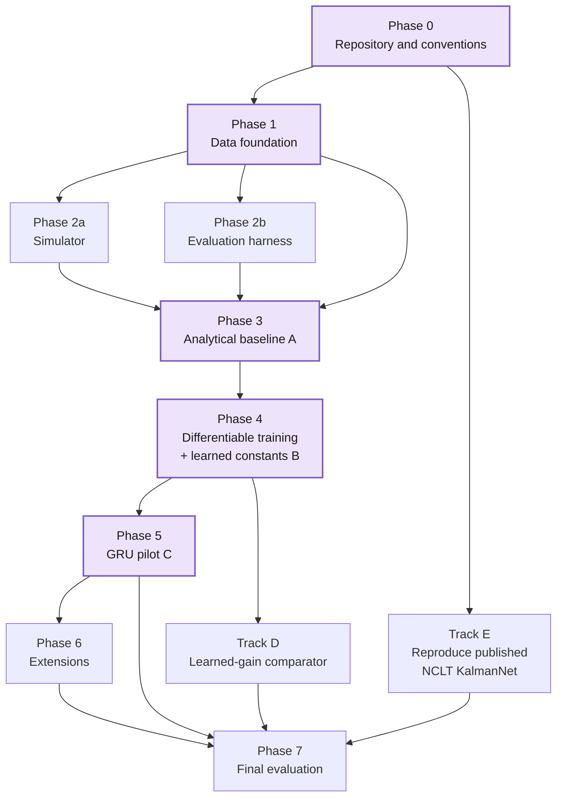

# Learning-Assisted State Estimation: Development Plan

*How the project will be built and validated. Last updated 15 November 2026.*

What the project is and why: [PROJECT_OVERVIEW.md](./PROJECT_OVERVIEW.md) (short) and [PROJECT_SCOPE.md](./PROJECT_SCOPE.md) (full). This document covers **how** it gets built: phases, their parts, what depends on what, and how each part is validated before anything is built on top of it. It is a plan, not a progress tracker; status lives in GitHub issues.

---

## 1. Principles

1. **Validate each part before building on it.** A learned component on top of an unverified filter cannot be debugged. Every phase has an exit criterion, checked against an **independent reference**, not only unit tests.
2. **Truth first, in simulation.** A simulator with known biases, noise and slip comes early. It provides the ground truth that real data lacks, for every later validation.
3. **One implementation.** The filter is written once, in PyTorch, and used for the baseline, training and evaluation. There is no separate "classical" version that could silently diverge.
4. **Causality by construction.** Data is replayed as a time-ordered event stream. Nothing in the estimator can reach future or reference data.
5. **Interfaces before parallel work.** State layout, frame conventions and data formats are fixed in Phase 0, so parts can be built independently, by a person or an agent, and still fit together.
6. **Negative results are kept.** If a component does not help, that is recorded and reported, not quietly removed.

## 2. Phase map



**Critical path (purple, strictly in series):** Phase 0 → 1 → 3 → 4 → 5. Each step requires the previous one to be trustworthy.

**Parallel work:**
- Track E can start right after Phase 0. It is separate code.
- Phases 2a (simulator) and 2b (evaluation harness) run alongside early Phase 3 work. Phase 3 cannot *exit* until both exist, because its validation uses them.
- Within Phase 3, propagation and the observation models can be built in parallel once Phase 0 conventions are fixed.
- Track D runs alongside Phase 5; both reuse the Phase 4 training harness.
- Phase 6 stages follow the scope's investigation order. A stage that fails does not block the others.

---

## 3. Phase 0: Repository, environment and conventions

**Goal:** a clean, reproducible project skeleton with agreed conventions, so all later code is consistent from the first line.

### 3.1 Repository and tooling

| Item | Choice |
|---|---|
| Hosting | GitHub repository, private initially. `main` branch protected; work on feature branches merged through pull requests. |
| Python | 3.12, pinned in `.python-version` |
| Package and environment manager | **uv**: `pyproject.toml` + committed `uv.lock`; `uv sync` reproduces the environment exactly |
| Core dependencies | `torch`, `numpy`, `scipy`, `pandas`, `matplotlib`, `pydantic` (validated configs), `pyyaml`, `tqdm` |
| Dev dependencies | `ruff` (lint + format), `mypy` (type checking), `pytest`, `pytest-cov`, `pre-commit`, `jupyter` |
| Optional, added when needed | `tensorboard` (training curves), `evo` (trajectory-metric cross-check), `gtsam` (independent smoother cross-check) |
| Quality gates | Pre-commit hooks: ruff format, ruff lint, mypy. GitHub Actions CI on every PR: lint, type check, unit tests on CPU. |
| Data | Never committed. Raw data lives at a path given by an environment variable (`LASE_DATA_DIR`). A download script records checksums. |
| Run outputs | `runs/` (gitignored). Each run stores its resolved config, git commit, seed and data manifest. |

### 3.2 Repository structure

The package name is `lase` (Learning-Assisted State Estimation).

```text
learning-assisted-state-estimation/
├── README.md, PROJECT_OVERVIEW.md, PROJECT_SCOPE.md, DEVELOPMENT_PLAN.md
├── CONVENTIONS.md            # frames, units, naming, state layout (Phase 0 deliverable)
├── pyproject.toml, uv.lock, .python-version, .pre-commit-config.yaml
├── .github/workflows/ci.yml
├── configs/                  # YAML: data, filter, simulator, training, experiments
├── src/lase/
│   ├── data/                 # NCLT loaders, split manifest, event stream, geodesy (lat/lon -> NED)
│   ├── geometry/             # SO(3)/quaternion ops, frames, lever arms
│   ├── sim/                  # trajectory-driven sensor simulator
│   ├── filter/               # state, propagation, wheel/GNSS updates, gating, init, ESKF runner
│   ├── learning/             # encoders, heads, learned-constants model (B), output bounding
│   ├── comparators/          # learned-gain filter (D)
│   ├── training/             # TBPTT loop, losses, batching, checkpoints
│   ├── evaluation/           # metrics, outage injection, consistency stats, plots
│   └── utils/                # config loading, logging, seeding, provenance
├── scripts/                  # thin CLIs: download, build caches, run filter, train, evaluate
├── tests/
│   ├── unit/                 # fast, run in CI
│   └── validation/           # slower checks against independent references (section 9)
├── notebooks/                # exploration only; reusable logic moves into src/lase
├── reports/                  # validation reports and figures worth keeping
├── external/                 # third-party code cloned for comparators (e.g. Song et al.), not vendored
├── research/, archive/       # background design material
├── data/  (gitignored)       # optional local link to LASE_DATA_DIR
└── runs/  (gitignored)
```

### 3.3 Code conventions (recorded in `CONVENTIONS.md`)

- **Functional numerical core.** Propagation and update steps are pure functions, `(state, P, inputs, params) -> (state, P, diagnostics)`. They are differentiable, testable in isolation and easy to batch. Classes are used for orchestration (runner, datasets, models), not for hiding numerical state.
- **Batch dimension from day one.** Every filter tensor carries a leading batch dimension, even when it is 1. This keeps the option of training many chunks in parallel (see Phase 3 compute check).
- **Explicit precision.** Filter in float64, network in float32, with explicit casts at the boundary.
- **Frame-explicit naming.** Example: `C_wb` (body-to-world rotation), `p_w_imu` (IMU position in world), `v_w`, `omega_b`. Units in names where ambiguous: `t_us`, `speed_mps`.
- **Typed and documented.** Type hints everywhere. Docstrings state tensor shapes, frames and units.
- **Configs, not constants.** Every tunable value lives in a validated pydantic config loaded from YAML. No magic numbers in code.
- **Reproducibility.** Seeds set and recorded. Every run logs its config, commit and data manifest.

### 3.4 Interface contract (fixed before parallel work)

- State vector layout and error-state ordering: the 16 core coordinates.
- Frame and attitude conventions: NED world, forward-right-down body, body-to-world rotation, right-multiplicative error.
- Event record format: timestamp, sensor ID, payload, validity.
- Function signatures for propagation, each update, and learned-head outputs.

**Exit criterion:** fresh clone → `uv sync` → `pytest` passes; CI green; `CONVENTIONS.md` and the interface contract written and agreed.

---

## 4. Phase 1: Data foundation

**Goal:** every sensor stream loaded, converted and placed correctly in time and space, with its quirks understood across all sessions.

**Parts:**
- Download and checksum the sessions; split manifest (22/2/3 days) as a config file.
- Loaders for IMU, FOG, wheels, GPS and the reference (dense poses plus graph nodes).
- Timestamp handling (microseconds), unit conversions (GPS radians, FOG integrated angle → increments).
- Geodesy: GPS lat/lon → local NED, with a documented origin.
- Frames and lever arms from published calibration.
- A causal **event stream**: all sensors merged in time order, for replay.
- **All-session audit:** rates, gaps, held/repeated GPS values, indoor segments (natural GPS outages), timing jitter, reference coverage.

Existing detail to build on: [research/nclt-sensors-and-state.md](./research/nclt-sensors-and-state.md).

**Validation against independent references:**

| Check | Expected result | What a failure reveals |
|---|---|---|
| GPS converted to NED, overlaid on the reference | Overlap within a few metres | Constant offset → wrong origin or lever arm. Rotated or flipped track → frame error. |
| Cross-correlate IMU yaw rate, FOG rate and the derivative of reference heading | Peaks at near-zero lag, matching signs | Time offsets, sign or axis mistakes |
| Mean wheel speed vs forward speed derived from the reference | Ratio near 1; deviations at plausible slip moments | Wheel scale; slip episodes; reference-point mismatch |
| (right − left wheel speed) / track width vs FOG yaw rate | Linear relationship | Effective track width; wheel sign or ordering |

**Exit criterion:** all checks pass on several sessions; the audit report is in `reports/`.

---

## 5. Phase 2a: Simulator

**Goal:** realistic synthetic sensor data with **known truth** for every quantity the filter estimates or the network learns.

**Approach:** take real NCLT reference trajectories, which give realistic motion, and generate sensor readings from them by differentiation and the measurement models. Then inject controlled errors:
- IMU and FOG biases (constant and drifting), scale errors, white noise;
- wheel scale error and **slip episodes**;
- GPS noise with **time-varying variance**, held values and outages.

**Uses:** validating propagation, updates, bias estimation, covariance consistency (NEES is meaningful here because truth is exact), gradient correctness, recovery of learned constants, and whether the GRU tracks injected time-varying effects.

**Validation:**
- Error-free synthetic data through propagation alone reproduces the trajectory to numerical precision.
- Statistics of injected noise match their configuration.
- The same plots as the Phase 1 checks look structurally like real data.

**Exit criterion:** configurable scenarios (clean, biased, noisy, slip, outage) generated from any reference session.

## 6. Phase 2b: Evaluation harness

**Goal:** one scoring path used by every method and every phase.

**Parts:**
- Metrics: horizontal position RMSE, wrapped heading RMSE and derived velocity RMSE, per day and overall. Drift over fixed intervals.
- Graph-node scoring, with dense-reference scoring as a sensitivity check.
- GPS-outage injection: withhold GPS for 30 / 60 / 120 s windows at many start points. Error growth curves.
- Consistency: NIS (innovation) statistics, coverage, rejection counts.
- Standard plots: trajectory overlays, error vs time, outage growth.

**Validation:**
- Metrics cross-checked against `evo` on the same trajectories.
- Score two trivial "estimators":
  - the **raw GPS track** (should be noisy but bounded);
  - **NCLT's supplied odometry product** (should drift).

  These become reference points for Phase 3.

**Exit criterion:** both trivial estimators scored; metrics agree with `evo`.

---

## 7. Phase 3: Analytical baseline (method A)

**Goal:** a correct, consistent, fairly tuned error-state Kalman filter using IMU, FOG, wheels and GPS. Everything later depends on this phase.

**Parts:**
- Propagation: IMU and FOG fusion, midpoint integration, quaternion update, covariance prediction, Q discretisation.
- Wheel forward-speed update, including the lever arm.
- GNSS horizontal-position update, including the antenna lever arm.
- Innovation gating; Joseph-form update; error-state reset.
- Initialisation (common pose prior; stationary bias priors).
- Tuning of baseline Q and R on training days.

Existing detail to build on: [research/estimator-mathematics.md](./research/estimator-mathematics.md).

**Validation against independent references:**

| Part | Independent check |
|---|---|
| Jacobians F, H | Compare the hand-derived matrices with `torch.autograd` Jacobians of the nonlinear models |
| Propagation mean | Short open-loop runs (1–10 s) started from the reference state, compared with the reference. Error growth should match theory, e.g. accelerometer-bias position error growing with time squared. |
| FOG handling | FOG-only heading integrated over minutes stays very close to the reference heading, since the FOG is high grade |
| Propagation covariance | Monte Carlo: propagate thousands of noisy samples through the nonlinear model; their spread should match predicted P |
| Stationary periods | No motion beyond what bias explains. These periods also provide bias priors. |
| Observation models | **Oracle-state residuals:** feed the reference state into each measurement model. Residuals should be zero-mean; their spread gives an empirical baseline R (training days only). |
| Update algebra | In a linear-Gaussian test case the filter equals batch weighted least squares exactly |
| Full filter, simulation | Estimated biases converge to injected values; NEES consistent with its chi-square bounds |
| Full filter, real data | NIS consistent; an RTS smoother (optionally GTSAM) on the same data does at least as well |
| Full filter vs reference points | Beats the raw GPS track. With GPS removed, matches or beats NCLT's odometry product. |

**Compute check (early in this phase):** measure the time per filter step, forward and backward, at realistic size. This decides the Phase 4 training strategy: sequential streams, many chunks batched in parallel from cached baseline states, IMU pre-integration between updates, or `torch.compile`.

**Exit criterion:** all checks pass; the baseline is tuned and scored on validation days; the compute measurements are recorded.

---

## 8. Phase 4: Differentiable training and learned constants (method B)

**Goal:** prove that training through the filter works, before any network is involved.

**Parts:**
- Truncated backpropagation over chunks, carrying state, P and (later) GRU memory across boundaries.
- Batching strategy chosen from the Phase 3 compute check.
- Losses, starting with normalised MSE on position, heading and velocity.
- Checkpointing, validation replays, early stopping, run provenance.
- Method B: learn constant noise and bias parameters, with no network.

**Validation:**
- `torch.autograd.gradcheck` and finite differences on short float64 chunks.
- **Loss scan:** sweep one parameter (e.g. GPS variance) and plot the loss. The gradient's sign and size must match the slope.
- **Recovery test:** start B from deliberately wrong values. In simulation it should recover the injected values; on real data it should land near the Phase 3 oracle-residual estimates.
- B should match or beat hand-tuned A on validation days.

**Exit criterion:** gradients verified; recovery demonstrated in simulation; B evaluated against A.

## 9. Phase 5: GRU pilot (method C)

**Goal:** answer the central question: does context-dependent adaptation beat the best fixed settings?

**Parts:**
- Causal input features, shared GRU and heads, bounded outputs with neutral initialisation.
- Heads added **one at a time**: noise multipliers, bias drift, wheel residual. Each is evaluated alone, then combined.
- Ablations: encoder variants (GRU, learned IMU encoder + GRU, temporal CNN, small transformer) and loss variants (MSE vs NLL).
- Three seeds for reported comparisons.

**Validation:**
- **Simulation:** with injected slip bursts, GPS noise bursts and bias drift, the head outputs should track the injected truth.
- **Real-data proxies** (diagnostics, not labels):
  - the GPS trust multiplier rises when GPS-vs-reference error is large;
  - the wheel residual follows (wheel speed − reference speed).
- **Null test:** time-shuffle the GRU inputs. Performance should fall back to B's. If it does not, the network is not using context.
- **Consistency:** NIS with the learned R, to see whether learned uncertainty is meaningful.

**Exit criterion:** A/B/C (and D) compared on validation days, including outage tests; one frozen comparison on test days.

## 10. Comparator tracks

**Track D: learned-gain filter.** A KalmanNet-style network predicts the gain, using our inputs and the Phase 4 training harness.
- *Validation:* reproduce sensible behaviour on a synthetic toy problem first, then run on NCLT under the identical protocol.

**Track E: published NCLT KalmanNet (Song et al.).** Clone the official code into `external/`.
- *Validation:* reproduce their published numbers with their unmodified code **before** any change. Report it separately, since its inputs and 1 Hz rate differ from ours.

## 11. Phase 6: Extensions

These follow the scope's investigation order:
1. Process-noise adaptation.
2. Soft lateral no-slip constraint with learned trust.
3. FOG bias and noise adaptation.
4. Calibration terms: wheel scale, then gyro and accelerometer scale factors.

Each one gets:
- a simulation test with injected truth for its target;
- an isolated ablation against the pilot;
- the same consistency checks.

Unidentifiable or unhelpful components are recorded as findings.

## 12. Phase 7: Final evaluation

- All methods frozen and run once on the test days, using the shared evaluation harness.
- Per-day and overall results, outage curves, consistency and cost (runtime, memory).
- Negative and mixed findings reported alongside the positive ones.

---

## 13. Decision points and risks

| Point or risk | When | Response |
|---|---|---|
| Training compute on the laptop | Phase 3 compute check | Choose batching, pre-integration or `torch.compile`; reduce training days if needed; cloud only if measurements justify it |
| Baseline harder than expected (frames, timing, FOG fusion) | Phase 3 | Lean on the simulator and oracle residuals to isolate faults; do not proceed to learning until it passes |
| Reference not independent of our sensors | Throughout | Graph-node scoring, dense-reference sensitivity, no over-interpretation of small differences |
| Song et al. results do not reproduce | Track E | Report the discrepancy; compare against our D under our protocol instead |
| GRU shows no gain over B | Phase 5 | A valid finding. Analyse where and why (outages, slip), then continue with extensions as planned |
