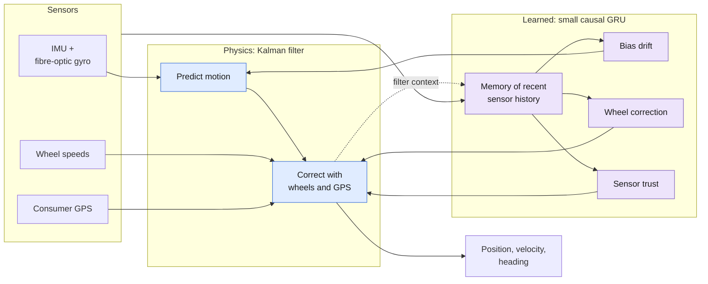
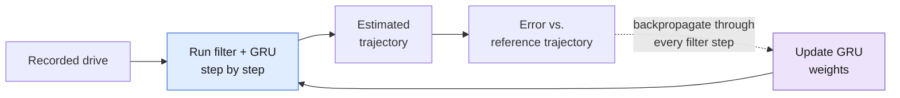
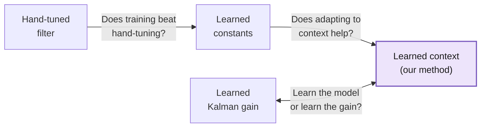

# Learning-Assisted State Estimation: Project Overview

*Big-picture statement of what this project is. Last updated 14 November 2026.*
*For the full scope, see [PROJECT_SCOPE.md](./PROJECT_SCOPE.md).*

## The problem

A robot needs to know where it is, how fast it is moving and which way it is facing. No single sensor tells it this reliably:

- An **IMU** (accelerometer + gyroscope) is fast and always available, but its small errors accumulate; integrated alone, position drifts by metres within seconds to minutes.
- **Wheel speed** is good until the wheels slip.
- **Consumer GPS** gives absolute position, but is noisy, sometimes stale and drops out (indoors, near buildings, under trees).

The standard solution is a **Kalman filter**: it predicts motion using physics, corrects that prediction with each sensor reading, and keeps track of its own uncertainty. Its weak point is the parts humans tune by hand: how fast sensor biases drift, how much each sensor should be trusted at any moment, and how wrong the simple physical models are (for example, wheel speed during slip). Fixed hand-tuned values are a compromise across all conditions.

## The idea

Keep the Kalman filter and its physics. Add a small neural network that watches recent sensor history and **adapts the filter's hand-tuned parts to the current situation**:

1. **How the IMU biases are drifting** (6 values).
2. **A correction to the wheel-speed model** (1 value), e.g. for slip.
3. **How much to trust GPS and wheels right now** (noise-level multipliers).

The network never outputs the position directly and never replaces the filter's mathematics. The filter still computes the corrections and the uncertainty analytically.

**How it fits together** (purple = learned, blue = physics/filter):

**How it learns.** The network is trained **end to end through the filter**: we run the full filter over recorded drives, measure the final position/heading/velocity error against a reference, and backpropagate through every filter step into the network. No labels for "true bias" or "true sensor noise" are needed.

## Scope

- **Dataset:** NCLT, a Segway robot driven around a university campus (27 sessions over 2012–2013, ~35 hours), with a high-quality reference trajectory for scoring.
- **Sensors used:** IMU, a fibre-optic gyroscope, wheel speeds and consumer GPS. **No cameras** in this scope.
- **Outputs:** North/East position, North/East velocity and heading.
- **Learning:** one small causal GRU with separate output heads. Its design and training are a central part of the work, not an add-on.
- **Split:** 22 training / 2 validation / 3 test recording days, by date.

## The central question

> Does a network that adapts the filter to context beat the same filter with the best possible fixed settings, especially when GPS is lost?

The key comparisons:

- **Hand-tuned filter**: the classical baseline.
- **Learned constants**: the same training pipeline, but learning fixed values instead of a network. This isolates the value of context-dependence and keeps the baseline fair.
- **Learned context (our method)**: the GRU adapting the filter step by step.
- **Learned Kalman gain** (KalmanNet-style) on the same inputs: the main alternative philosophy in the literature.

Each step in this ladder answers one question:

The most important test condition is **GPS outages** (natural indoor segments and deliberately withheld GPS windows). There, bias drift and wheel slip dominate the error, and they are exactly what the network targets.

## What we expect and what we claim

- The general pattern (learned noise/bias inside an analytical filter) **already exists** in prior work. We do not claim a new architecture.
- The aimed-for contribution is **careful empirical evidence**: a clean comparison of learning the model versus learning the gain on real data, full-rate multi-sensor evaluation under GPS outages, and a check of whether the learned uncertainties are actually meaningful.
- A well-tuned filter with these sensors may already beat published learned-filter results on NCLT. Gains from learning are expected to be modest with GPS available and potentially meaningful during outages. These are expectations, not results.

## Not in scope

Cameras and vision; LiDAR or RTK GPS as inputs; maps and loop closure; replacing the filter with an end-to-end network. These may be revisited later, but are not part of this project's definition.

## Status

Scope agreed. No code, trained model or results yet.
