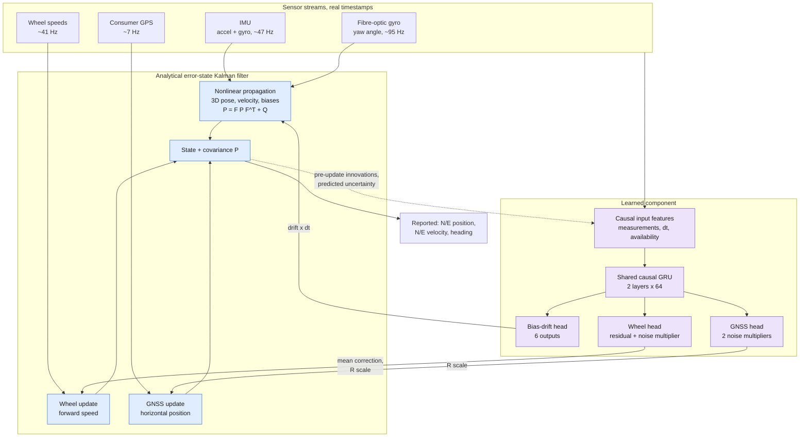
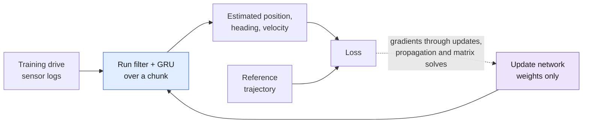
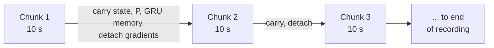
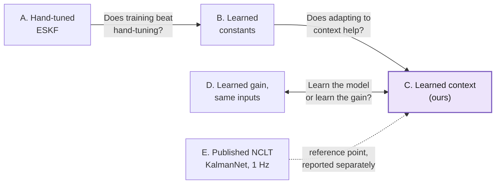
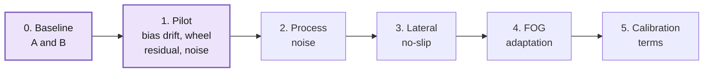

# Learning-Assisted State Estimation: Project Scope

*Comprehensive statement of the project's scope, design, and scientific questions. Last updated 14 November 2026.*

For the short version, read [PROJECT_OVERVIEW.md](./PROJECT_OVERVIEW.md) first. This document is self-contained, though: it assumes no prior reading. It describes **what the project is and why**. It is not an implementation plan, task list or schedule.

**Authority:** this document and the overview define the current project. [`archive/PROJECT_SNAPSHOT.md`](./archive/PROJECT_SNAPSHOT.md) and the [`research/`](./research/) folder are earlier, broader design work. They are kept as background and evidence (sensor audits, literature, derivations). Where they conflict with this document, this document wins. In particular, the camera/vision pipeline described there is **out of scope** here.

---

## 1. Purpose

Build a **causal, physics-based state estimator for a ground robot**, in which a neural network adapts the parts of the filter that are normally hand-tuned. Then measure honestly whether and when that adaptation helps.

"Causal" means the estimator only uses information available up to the current moment, so it could run live on the robot. Future data and reference data are never inputs.

Success is an empirical question, not a promise. A clear negative or mixed result, properly measured, is still a valid outcome.

## 2. Background in brief

### 2.1 State estimation and the Kalman filter

The robot's **state** is its position, velocity and orientation, plus internal quantities like sensor biases. A Kalman filter estimates the state by repeating two steps:

1. **Predict:** use a physical motion model, driven here by IMU and gyroscope measurements, to move the state forward in time. Uncertainty grows.
2. **Update:** when another sensor reading arrives (wheel speed, GPS), compare it with what the predicted state says it should be. Correct the state in proportion to how much each source is trusted. Uncertainty shrinks.

The filter carries an explicit **covariance matrix P** (its uncertainty) and computes the **Kalman gain K** (how strongly to correct) analytically from P and the assumed sensor noise. Because our motion and measurement models are nonlinear (3D rotation, lever arms), we use an **error-state extended Kalman filter (ESKF)**. This is the standard form for inertial navigation.

### 2.2 Why it is not solved

The filter's equations are principled, but several inputs are guesses:

- **Process noise (Q):** how unpredictable the motion and sensor biases are.
- **Measurement noise (R):** how noisy each sensor is. In reality this changes with conditions: GPS near buildings, wheels on wet grass.
- **Bias evolution:** IMU biases drift with temperature and time.
- **Model error:** e.g., wheel speed does not equal ground speed when wheels slip.

Engineers usually fix these values by hand. A fixed value is a compromise: too trusting in bad conditions, too sceptical in good ones.

### 2.3 Lesson from a previous attempt

An earlier version of this idea was tried on the EuRoC drone dataset using **IMU only**, with no correcting sensors. Errors reached metres to tens of metres. This was expected and is not evidence against the approach: a drone with only an IMU has nothing that bounds drift. Successful learned-inertial methods always have some anchor, such as vehicle motion constraints (AI-IMU), human gait patterns (TLIO) or external sensors. This project therefore deliberately uses a platform with real correcting sensors.

## 3. The approach

### 3.1 Grey-box learning

The physics and the filter mathematics stay. A small neural network adjusts specific, physically meaningful parts of the filter from moment to moment:

| Network output | Physical meaning | How it enters the filter |
|---|---|---|
| IMU bias drift (6) | Rate of change of the 3 accelerometer and 3 gyroscope biases | Added to the bias prediction, multiplied by elapsed time. The filter still owns and corrects the biases. |
| Wheel residual (1) | Correction to the predicted forward wheel speed (m/s) | Added to the wheel measurement prediction. Captures predictable slip/model mismatch. |
| GNSS noise multipliers (2) | How much to trust GPS North and East right now | Scale a calibrated baseline measurement variance. |
| Wheel noise multiplier (1) | How much to trust the wheel speed right now | Scales a calibrated baseline measurement variance. |
| Lateral-constraint noise multiplier (1) | How much to trust "the Segway does not slide sideways" right now (lower during lateral skids) | Scales the baseline variance of the lateral no-slip pseudo-measurement. |
| Process noise (later stage) | Structured adaptation of Q | Scales selected baseline process-noise terms. |

**Architecture** (purple = learned, blue = analytical filter; rates are logged rates from one session):



Each head runs when its sensor's data arrives (bias head on IMU events, wheel head on wheel arrivals, GNSS head on GPS fixes), all sharing one GRU memory on one timeline.

The network **does not** output position, velocity or heading, and **does not** output K or P. Those remain analytical. This keeps the system interpretable, physically constrained and safe to fall back from: switch the network off (corrections zero, multipliers one) and it is an ordinary filter.

### 3.2 Training through the filter

There are no labels for "true bias drift" or "true GPS noise right now". Instead:

1. Run the full filter, with the network inside it, over a stretch of recorded data.
2. Compare the filter's outputs (position, heading, velocity) with the reference trajectory.
3. Backpropagate the error through every filter step (predictions, updates, matrix solves) into the network weights.

The network learns whatever adaptations make the *filter's final output* better. This is **differentiable filtering**: the filter is treated as a differentiable layer inside the training graph.



The filter's own equations have no trainable weights. Only the GRU and its heads are learned (or, for comparator B in section 8, a set of constants).

### 3.3 The deep-learning content

The learned component is small in parameter count but central to the project. The substantive deep-learning questions are:

- **Long-sequence training through a recursive physical model:** truncated backpropagation through time over filter dynamics, gradient stability through covariance updates and matrix solves, carrying hidden state across training chunks.
- **Learning uncertainty without labels:** noise levels inferred only through their effect on estimation error. Compare a pure accuracy loss (MSE) with probabilistic losses (Gaussian negative log-likelihood of innovations or outputs), and ask whether the learned variances stay meaningful.
- **Context encoder design:** a GRU over engineered features vs. a learned 1D-convolutional encoder over raw IMU windows feeding the GRU, and comparison with alternative sequence models (temporal CNN, small transformer) under the same causal constraint.
- **Output parameterisation:** bounded outputs (scaled `tanh` for signed corrections, bounded positive multipliers for variances), neutral initialisation so training starts from the classical filter, and monitoring for saturation.
- **Mixed precision in one graph:** filter arithmetic in float64, network in float32, with differentiable casts.

## 4. Platform and data

### 4.1 Dataset: NCLT

The **University of Michigan North Campus Long-Term (NCLT)** dataset: a Segway robot driven repeatedly around one campus. It has 27 sessions over 2012–2013, roughly 35 hours and 147 km, indoor and outdoor, across seasons. It was chosen because:

- it has the right sensor mix (IMU, fibre-optic gyro, wheels, consumer GPS);
- it has natural GPS outages (indoor segments);
- it has a high-quality reference trajectory;
- it is the most common real dataset in the learned-Kalman-filter literature, with a published train/validation/test split to compare against.

It is a ground robot, not a car. Results show cross-day performance on the same campus, not generalisation to new places or robots.

### 4.2 Sensors

| Sensor | File | Role | Key facts |
|---|---|---|---|
| Microstrain IMU | `ms25.csv` | Propagation | 3-axis acceleration and angular rate in sensor axes, ~47 Hz logged. Device-processed values, not raw samples. |
| KVH fibre-optic gyro (FOG) | `kvh.csv` | Propagation (yaw) | Single-axis, high-grade. The released value is an **integrated angle** (rad), so it must be differenced over intervals. It is not absolute heading. ~95 Hz logged. |
| Wheel speeds | `wheels.csv` | Update | Left/right speeds already in m/s. Used initially as a single forward speed. ~41 Hz logged. |
| Consumer GPS | `gps.csv` | Update | Receiver-processed latitude/longitude (in radians). No raw satellite data. Contains held/repeated values and unreliable metadata, so quality checks are needed. ~7 Hz logged. |

Logged rates are from one session and are irregular. The estimator uses real timestamps, never a fixed resampled grid.

**Not used as inputs:** cameras, LiDAR, RTK GPS, magnetometer, barometer, the vendor's own attitude output and NCLT's supplied odometry. The supplied odometry is already a fusion of our own sensors.

### 4.3 Reference ("ground truth")

NCLT's reference is a 6-DOF pose from offline multi-session SLAM using LiDAR, RTK GPS and odometry. It is far better than our sensors, but **not independent of them**: odometry (wheels/IMU/FOG) helps fill in between SLAM graph nodes. To limit this:

- primary scoring uses the SLAM graph-node poses (anchored by LiDAR scan matching and RTK GPS, mostly independent of our sensors), with dense-pose results reported as a sensitivity check. Dense poses between nodes (~5 m / 3.6 s apart) are interpolated with NCLT's wheel+FOG odometry, so short-window and velocity metrics are indicative only;
- velocity "truth" is derived from reference pose, with quality control;
- the reference's roll at graph nodes does not follow the IMU's roll motion closely (Phase 3, FOG investigation), so short-window roll/attitude comparisons against it are indicative only;
- tiny differences between methods are not over-interpreted.

There are no labels for true biases, true noise levels or slip events.

### 4.4 Data split

The 22 / 2 / 3 recording-day split from Song et al.'s published NCLT KalmanNet implementation (dates only, not their preprocessing):

```text
Training (22):
2012-01-08, 2012-01-15, 2012-01-22,
2012-02-02, 2012-02-04, 2012-02-05, 2012-02-12, 2012-02-18, 2012-02-19,
2012-03-17, 2012-03-25, 2012-03-31,
2012-04-29, 2012-05-11, 2012-05-26, 2012-06-15,
2012-08-04, 2012-08-20, 2012-09-28, 2012-10-28, 2012-11-17, 2012-12-01

Validation (2): 2013-01-10, 2013-02-23
Test (3):       2012-11-04, 2012-11-16, 2013-04-05
```

Normalisation statistics, baseline noise values and model weights are fit on training days only. Validation selects settings and checkpoints. Test days are touched only for final, frozen comparisons.

## 5. The estimator

### 5.1 State and outputs

- **Internal state:** 3D position, 3D velocity, 3D orientation (quaternion), 3 accelerometer biases, 3 gyroscope biases, 1 FOG bias. That is 16 error-state coordinates. The internal state is 3D because the campus has slopes and the IMU measures in 3D.
- **Reported outputs:** North/East position, North/East velocity and heading, at NCLT's body reference point.
- **Frames:** local North-East-Down world; body forward-right-down; explicit mounting rotations and lever arms for every sensor.

### 5.2 Models (schematic)

```text
Prediction (each IMU interval):
  bias_next  = bias + learned_bias_drift * dt
  C_next     = C * Exp(fused IMU/FOG rotation increment)
  a_world    = C_mid * corrected_specific_force + gravity
  p_next     = p + v*dt + 0.5*a_world*dt^2
  v_next     = v + a_world*dt
  P_pred     = F P F^T + Q

Wheel update:
  predicted  = forward_component(C^T v + omega x lever_arm) + learned_wheel_residual
  noise      = baseline_R_wheel * learned_wheel_multiplier

GNSS update:
  predicted  = horizontal(p + C * antenna_lever_arm)
  noise      = baseline_R_gnss * diag(learned_gnss_multipliers)

All updates: analytical gain K, Joseph-form covariance update, error-state reset.
```

IMU and FOG angular information are fused analytically, each with its own bias and noise model. If the FOG is missing, the IMU gyro provides the fallback.

### 5.3 Safeguards

- Gating of implausible measurements (innovation checks) before they can corrupt bias estimates.
- Bounded network outputs. Starting defaults: variance multipliers in [0.25, 25], with physical floors on baseline noise.
- Neutral startup: the GRU warms up from a zero hidden state while its outputs are held at "classical filter" values.
- Measurement dropout means skipped updates and growing uncertainty, not failure.

## 6. Learned component

**Starting defaults** (tunable on validation evidence):

| Item | Default |
|---|---|
| Context encoder | Shared causal GRU, 2 layers × 64 units |
| Heads | One per role, 1 hidden layer of 32 units |
| Inputs | Recent sensor measurements, timestamps/elapsed time, availability masks, and the filter's own pre-update context (innovations, predicted uncertainty) |
| Invocation | Bias head on IMU events, wheel heads on wheel arrivals, GNSS heads on GPS arrivals, all sharing one memory on one timeline |
| Initialisation | Corrections start at zero, multipliers at one |

**Rules:**
- No future or reference data in inputs.
- A head may use the pre-update residual of its own sensor, never the posterior from its own update.
- Weights are frozen at inference; hidden state still evolves causally.

## 7. Training

| Item | Starting default |
|---|---|
| Loss | Weighted, normalised MSE on horizontal position, wrapped heading and derived horizontal velocity, sampled at 5 Hz where the reference is valid. Probabilistic (NLL) variants are a studied alternative. |
| Sequences | Two independent chronological streams, each with its own filter and GRU state. 10-second truncated-backprop chunks, with state carried across chunk boundaries and gradients detached. |
| Optimiser | AdamW, learning rate 1e-4, weight decay 1e-5, gradient-norm clip 1.0 |
| Selection | Periodic full replays of both validation days; early-stopping patience of 5 validation checks |
| Repeats | One seed during development; three seeds for reported comparisons |
| Augmentation | Modest training-only sensor dropout and corruption, including simulated GPS outages |

How a recording is processed during training (truncated backpropagation through time):



Each chunk gets its own loss and backward pass. The filter is never reset at chunk boundaries, so training sees the same continuous operation as inference. Chunk length limits how far gradients reach back, not how long the filter remembers.

Platform: Python/PyTorch on a laptop (Apple M5, 16 GB). Filter in float64 on CPU, network in float32. Runtime feasibility is to be measured, not assumed.

## 8. Scientific questions and experiments

### 8.1 Central question

> Does a network that adapts the filter to context beat the same filter with the best possible fixed settings, especially during GPS outages?

### 8.2 Comparison set

| Method | What it isolates |
|---|---|
| **A. Hand-tuned ESKF** | Classical baseline with the same sensors and models |
| **B. Learned-constant ESKF** | Same training pipeline, but learning fixed noise/bias parameters (including the lateral-constraint noise) with no network. The fair baseline: separates "context-dependence helps" from "training tunes the filter better than a human". |
| **C. Learned-context ESKF (ours)** | GRU-adapted biases, wheel residual and noise |
| **D. Learned-gain filter** (KalmanNet-style) | Network predicts the gain directly, on the **same inputs and protocol** |
| **E. Published NCLT KalmanNet** (Song et al., 2024) | Reproduced under its own 1 Hz protocol, reported separately because inputs and rate differ |

The **B vs. C** comparison is the core test of whether the network earns its place. **C vs. D** is a direct real-data comparison of the two main learned-filtering philosophies.



### 8.3 Ablations

- Each head alone: bias drift only, wheel residual only, noise multipliers only, then combined.
- Encoder variants: GRU vs. learned IMU encoder + GRU vs. temporal CNN vs. small transformer.
- Loss variants: MSE vs. NLL-based objectives.

### 8.4 Test conditions

- Normal operation, with GPS available.
- **GPS outages:** natural (indoor segments) and synthetic (GPS withheld for fixed windows, e.g. 30 s / 60 s / 120 s, at many points in the test days).
- Sensor degradation: simulated wheel or GPS faults.

### 8.5 Investigation order

This is the order of scientific questions, not a schedule:



0. **Analytical baseline** (A) validated and fairly tuned; learned constants (B).
1. **Pilot:** bias drift, wheel residual and GNSS/wheel noise heads (C), isolated and combined, against A, B and D.
2. **Process-noise adaptation.**
3. **Learned trust in the lateral no-slip constraint.** The constraint itself is part of baseline A (user decision, Phase 3 review): a soft "doesn't slide sideways" pseudo-measurement along the axle. B learns its noise level as a constant; C learns a context-dependent trust multiplier. Lateral skids are handled like forward wheel slip: variance inflation for moderate inconsistency, rejection when severe, and a suspected-skid diagnostic with hysteresis.
4. **FOG bias/noise adaptation.**
5. **Calibration terms:** gyro/accelerometer scale factors where identifiable. (Wheel scale moved into the baseline: estimated as a slow state, initialised from the previous session's final estimate by date; user decision, Phase 1 review.)

Later stages proceed only if the earlier ones are sound. Negative findings are kept and reported.

## 9. Evaluation

- **Accuracy:** **headline: horizontal position RMSE at graph nodes, always reported with the median and 95th percentile** (consumer-GPS outliers dominate RMSE); also wrapped heading RMSE and derived velocity RMSE, per test day and overall. GPS-outage results are reported for both injected (30/60/120 s) and natural outages. Drift over fixed intervals (relative pose error between **graph nodes**, i.e. LiDAR/RTK-anchored start and end points; the dense-reference version is a sensitivity check); error growth during outages. No fitting or aligning of the test trajectory to the reference for primary metrics.
- **Consistency:** innovation statistics and coverage (does the stated uncertainty match actual errors?). Do learned variances behave like real sensor noise, or just like arbitrary weights?
- **Robustness:** failures, resets, rejected measurements and recovery after outages. Failed intervals stay in the accounting.
- **Cost:** runtime per step and memory, compared with the classical filter.
- **Fairness:** every method gets identical sensors, initialisation and information. Gains from extra sensors or preprocessing are not credited to the network.

## 10. Positioning, novelty and expectations

### 10.1 Prior work

| Work | Relation |
|---|---|
| Haarnoja et al., *Backprop KF* (NeurIPS 2016); Kloss, Martius & Bohg, *How to Train Your Differentiable Filter* (2021) | Training networks through Kalman-type filters; the methodological foundation |
| Brossard et al., *AI-IMU Dead-Reckoning* (IEEE T-IV 2020) | Network adapts measurement noise inside an invariant EKF for cars, using IMU only plus motion constraints. Very close in spirit. |
| Liu et al., *TLIO* (RA-L 2020) | Learned inertial displacement and uncertainty fused in an EKF (pedestrian) |
| KalmanNet family; Song et al. NCLT KalmanNet (SPL 2024) | Networks that learn the **gain**; Song et al. provide the NCLT benchmark and split |
| HDVIO / HDVIO2.0 (RSS 2023, T-RO 2025) | Physics plus learned residual dynamics in visual-inertial estimation for drones |
| Węgrzynowski et al. (IROS 2024) | Learned dynamics and noise optimised through an analytical UKF for a race car |

### 10.2 Novelty, honestly

The general pattern of learned noise, biases and residuals inside an analytical, end-to-end-trained filter **is established**. This project does not claim a new architecture. Novelty is not a requirement.

The intended contributions are empirical:

1. A controlled real-data comparison of **learning the model/noise vs. learning the gain**, with identical inputs.
2. **Full-rate multi-sensor evaluation on NCLT under GPS outages**, against a fairly tuned and a learned-constant baseline.
3. An assessment of whether **learned uncertainties are meaningful** (calibrated) or merely effective weights.

### 10.3 Expected performance

These are expectations, not results:

- A well-tuned full-rate filter with FOG, wheels and GPS will likely beat published 1 Hz NCLT learned-filter results **even without learning**. Such a win reflects the physical model and sensor set, so it is not the headline.
- **With GPS available:** gains from learning are likely small, because GPS bounds the error near the reference's own uncertainty.
- **During GPS outages:** gains are plausibly meaningful, because bias drift and wheel slip, the targets of the network, dominate the error.
- Absolute accuracy will not match LiDAR or visual SLAM, which use a different sensor budget. The relevant advantage is accuracy from cheap sensors at negligible extra compute.

## 11. Out of scope

- **Cameras and all vision processing** (feature matching, masking, visual updates). Earlier design work exists in `research/`; it may be revisited as a separate future extension, but it is not part of this project.
- Network-predicted Kalman gain or covariance in **our** method. It appears only as comparator D.
- End-to-end networks that output position directly in place of the filter.
- LiDAR, RTK GPS, magnetometer and barometer as inputs; maps and loop closure; raw satellite-level GPS processing.
- Other datasets or platforms. Possible future work: VID drone, race-car data.
- Future ideas: a post-filter error-correcting network and language/vision-model scene context (from earlier notes). These are recorded only.

## 12. Status

Scope agreed on 14 November 2026.
- Phases 1 (data foundation) and 2 (simulator + evaluation harness) are complete and accepted (15 November 2026).
- Phase 3 (analytical baseline) is complete and under review.
- No learned model or Phase 4+ work yet.

Decisions from the reviews are in [plans/REVIEW_PHASES.md](./plans/REVIEW_PHASES.md).
