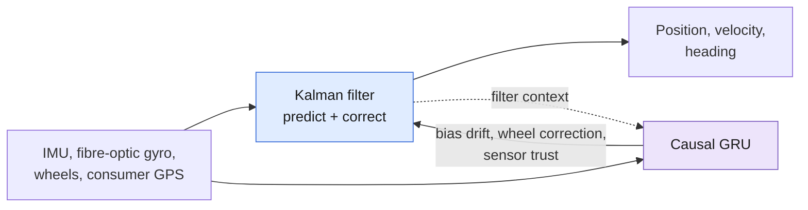
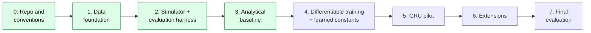

# Learning-Assisted State Estimation

A physics-based Kalman filter for ground-robot navigation, with a small causal neural network (GRU) that adapts the filter's normally hand-tuned parts to the current situation. The network is trained end to end through the filter.

**Current phase:** Phases 1–3 complete, pending review: data foundation, simulator + evaluation harness, and the analytical baseline filter ([reports](./reports/), [review notes](./plans/REVIEW_PHASES.md)). Phase 4 (differentiable training) not started. No learned model yet.

## In one minute

A robot estimates its position, velocity and heading by fusing imperfect sensors in a Kalman filter. The filter's weak point is the values humans tune by hand: how sensor biases drift, how much to trust each sensor right now, and how wrong the simple physical models are (e.g. wheel speed during slip). This project keeps the filter's physics and mathematics, and adds a GRU that adjusts those values from recent sensor history:

- **IMU bias drift** (6 values)
- **wheel-speed model correction** (1 value)
- **GPS and wheel trust** (noise-level multipliers)

The network never outputs position directly and never replaces the Kalman gain or covariance. Switch it off and the system is an ordinary filter.



| | |
|---|---|
| **Dataset** | [NCLT](https://robots.engin.umich.edu/nclt/): Segway robot on a university campus, 27 sessions, ~35 hours. Split 22 / 2 / 3 recording days. |
| **Sensors** | IMU, fibre-optic gyro, wheel speeds, consumer GPS. No cameras. |
| **Outputs** | North/East position, North/East velocity, heading |
| **Central question** | Does context-dependent adaptation beat the same filter with the best possible *fixed* settings, especially during GPS outages? |
| **Comparisons** | Hand-tuned filter · learned constants (same training, no network) · learned context (ours) · learned Kalman gain (KalmanNet-style) on the same inputs · published NCLT KalmanNet |

The general pattern (learning inside an analytical filter) exists in prior work; the aim is careful empirical evidence, not a new architecture. Details: [PROJECT_OVERVIEW.md](./PROJECT_OVERVIEW.md).

## Plan at a glance

Each phase is validated against **independent references** (simulator truth, oracle-state residuals, Monte Carlo, existing products and published baselines) before the next builds on it.



Comparator tracks run alongside: reproducing the published NCLT KalmanNet (from Phase 0) and a learned-gain filter on our inputs (from Phase 4). Full plan: [DEVELOPMENT_PLAN.md](./DEVELOPMENT_PLAN.md).

## Documents

| Document | Purpose |
|---|---|
| [PROJECT_OVERVIEW.md](./PROJECT_OVERVIEW.md) | One-page big picture. **Start here.** |
| [PROJECT_SCOPE.md](./PROJECT_SCOPE.md) | Comprehensive scope: design, data, training, comparisons, evaluation, positioning, exclusions |
| [DEVELOPMENT_PLAN.md](./DEVELOPMENT_PLAN.md) | Phases, dependencies, repository setup and per-part validation |
| [CONVENTIONS.md](./CONVENTIONS.md) | Coding rules, frames and units, state layout, interface contract. **Read before writing code.** |
| [plans/](./plans/) | Detailed per-phase plans, e.g. [Phase 1: data foundation](./plans/PHASE_1_DATA_FOUNDATION.md) |

The overview and scope define the project; where anything else in the repository conflicts with them, they win.

## Development setup

Requires [uv](https://docs.astral.sh/uv/). Python 3.12 is installed by uv if missing.

```bash
uv sync                          # create the environment from uv.lock
uv run pre-commit install        # enable format/lint/type-check hooks
uv run pytest                    # unit tests
```

### Data

The NCLT data is **not in the repository**. It lives in [`local_data/`](./local_data/) at the repository root, which is gitignored apart from its README. Each clone downloads its own copy, about 5.4 GB for all 27 sessions (sensor archives, ground truth, covariances; no images or LiDAR). The code finds `local_data/` automatically; set `LASE_DATA_DIR` only to keep the data somewhere else.

Download instructions, URLs and directory layout: [local_data/README.md](./local_data/README.md). A download script that fetches by split or date and verifies checksums is part of Phase 1.

```text
src/lase/        library code (data, geometry, sim, filter, learning, comparators, training, evaluation, utils)
scripts/         thin command-line wrappers
configs/         YAML configs, validated with pydantic
tests/unit/      fast tests, run in CI
tests/validation/ checks against independent references
notebooks/       exploration only
reports/         validation reports and figures
```

During initial development, commits go directly to `main`. Run `uv run pre-commit run --all-files` before every push.

## Background material

| Location | Content |
|---|---|
| [research/](./research/) | Earlier research notes: NCLT sensor/reference audit, estimator mathematics, calibration, training/evaluation discussion, literature and prior-work reviews, decision log. Useful as evidence and detail; some of it describes the broader earlier scope. |
| [archive/PROJECT_SNAPSHOT.md](./archive/PROJECT_SNAPSHOT.md) | The earlier consolidated design, including the camera/vision pipeline now out of scope. Archived for reference only. |

Treat dated counts, cost estimates and unselected proposals in the background material as historical.
