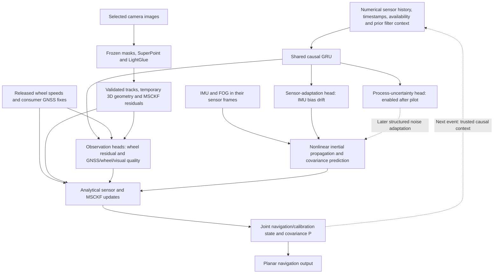

# Learning-assisted state estimation: project snapshot

> **Archived (14 November 2026).** Superseded by [PROJECT_OVERVIEW.md](../PROJECT_OVERVIEW.md) and [PROJECT_SCOPE.md](../PROJECT_SCOPE.md). This is the earlier, broader design, including the camera/vision pipeline that is now out of scope. Kept for background only; where it conflicts with the current documents, they win.

**Snapshot:** 14 November 2026. **Purpose:** the consolidated design and decision record for a reader or agent joining the project. **Status:** research/design agreed; no runnable estimator, trained project model, reproduced benchmark or measured Mac runtime yet. Limited sensor-format and camera-calibration audits exist.

Read this document first. It consolidates the latest decisions; older proposals in [research](../research/) remain as evidence and discussion history and may be superseded here. This describes **what we intend to build and evaluate**, not an implementation task list, execution schedule or tracker.

Decision labels:

- **Agreed:** selected architecture, scope or experimental policy.
- **Starting default:** accepted initial value, adjustable using training/validation evidence and profiling.
- **Planned in-project:** part of the supported research scope, beyond the pilot.
- **Optional/future:** a recorded experiment or alternative, not required for the initial estimator.
- **To verify:** an engineering or data question; do not present it as measured capability.

## Contents

- [Objective and scope](#objective-and-scope)
- [System architecture](#system-architecture)
- [Dataset, sensors and reference](#dataset-sensors-and-reference)
- [State, physics and analytical backend](#state-physics-and-analytical-backend)
- [Learned components and ownership](#learned-components-and-ownership)
- [Visual processing](#visual-processing)
- [Faults, observability and regularization](#faults-observability-and-regularization)
- [Initialization and recovery](#initialization-and-recovery)
- [Training protocol](#training-protocol)
- [Evaluation and comparisons](#evaluation-and-comparisons)
- [Full research scope and investigation order](#full-research-scope-and-investigation-order)
- [Optional and future experiments](#optional-and-future-experiments)
- [Implementation and compute choices](#implementation-and-compute-choices)
- [Exclusions and remaining engineering choices](#exclusions-and-remaining-engineering-choices)
- [Research context and supporting notes](#research-context-and-supporting-notes)

## Objective and scope

Develop a **causal, physically grounded, learning-assisted state estimator** that improves on a relevant state-of-the-art comparator, or offers comparable accuracy with a meaningful advantage in compute, latency, retained history or sensor requirements. Success is an empirical target, not a promised result. Novelty, publication and finding an unclaimed architecture are **not requirements**.

**First application/dataset:** NCLT Segway ground-robot navigation. It is relevant to ground/road-vehicle estimation but is not itself a conventional car dynamics dataset. Indoor drones and road vehicles were the narrowed application interests; **VID indoor** and the **Węgrzynowski et al. IROS 2024 racing-car dataset** remain optional other-platform investigations. No transfer to another robot or unseen environment is assumed.

**Reported navigation output:** North/East position, North/East velocity and heading: five planar quantities. Internally retain 3D position, velocity and attitude for inertial propagation, slopes and camera geometry. The system uses external measurement corrections; it is not intended as an IMU-only dead-reckoning project. GNSS outages are supported through the remaining valid sensors, with appropriate uncertainty and observability limits.

**Modelling philosophy:** grey-box/hybrid learning. Retain nonlinear physical propagation and measurement functions; learn selected calibration evolution, structured mean residuals and noise/reliability models. Train through the estimator rather than replacing it with an unrestricted state-predicting network. Auxiliary physical quantities matter because they may improve navigation, not as independent goals.

The nominal estimator is already nonlinear. Linearized matrices describe local error/covariance sensitivities; they do not replace all nominal physics or camera projection with linear equations. The GRU/MLP mappings are nonlinear too. A learned physical residual can reduce model mismatch, but does not automatically remove first-order uncertainty/linearization error.

## System architecture

**Agreed:** error-state EKF with tightly coupled **MSCKF-style visual feature-track updates**, a bounded history of cloned rig poses, temporary 3D landmark geometry and **no persistent global map or loop closure initially**.



In words: correct sensor errors in their native axes; combine IMU/FOG angular information; propagate physics and uncertainty; correct the same joint estimate with wheel, GNSS and validated visual observations. Neural outputs enter the relevant physical/noise relations. The filter computes **Kalman gain K and state covariance P analytically**.

Visual matches become geometric constraints, not an independently produced VO pose followed by a second fusion of the same images. Temporary landmarks are eliminated from the update; recent pose clones and cross-covariances connect observations over time. Synchronized cameras share one rig-pose clone per timestamp. Camera observations constrain motion/calibration through geometry; they do not independently measure the complete state at one instant.

## Dataset, sensors and reference

### Selected inputs and processing

NCLT's dataset paper appeared in **2016**; its 27 recording sessions span 2012–2013, approximately 34.9 hours/147.4 km, with indoor/outdoor travel and seasonal/scene changes. The main estimator input budget is **IMU + FOG + wheels + consumer GNSS + selected cameras**.

| Stream | Main role and contract |
|---|---|
| Microstrain IMU, `ms25.csv` | Use released 3-axis acceleration and angular rate in sensor axes. These have device-internal processing; they are not ADC samples. Apply bias/scale correction before mounting rotation and estimator-owned gravity compensation. |
| KVH DSP-3000 FOG, `kvh.csv` | Separate single-axis fiber-optic gyro. Released column is integrated relative angle in radians: unwrap/difference over compatible intervals, subtract rate-bias contribution and apply scale/mounting. It is not absolute north heading or a raw rate to integrate again. |
| Wheels, `wheels.csv` | Released left/right speeds are already m/s, not raw encoder ticks. Initially observe scalar forward speed, accounting for reference point, calibration and slip. |
| Consumer GNSS, `gps.csv` | Fuse receiver-processed horizontal position after radian latitude/longitude conversion, frame/antenna-offset handling and quality/staleness/innovation checks. Initially do not use receiver speed/course/altitude as additional observations. |
| Ladybug3 images | Six available views: five surrounding and one upward, approximately 5 Hz. Begin with two, using calibrated individual views and frozen processing. |
| Magnetometer | Disabled initially and potentially indefinitely; no required later experiment. Do not introduce hidden magnetic information through vendor attitude. |
| Barometer | Excluded; no pressure stream established in the documented release/audited archive. |
| Vendor Euler attitude | Diagnostic or explicitly declared reproduction/initialization input only; not an independent main measurement alongside its source IMU. Its internal magnetic/GNSS processing is not established. |
| RTK, LiDAR and supplied reference products | Reference/diagnostic roles, not main-estimator online inputs. Supplied odometry is already fused from IMU/wheels/FOG and must not be independently fused again with those ingredients. |

GNSS supplies fixes/aggregate metadata, **not raw satellite pseudorange, carrier phase, Doppler, satellite identities/ephemerides or per-satellite quality**. No raw GNSS reconstruction or satellite-level weighting is planned. There is no released full per-fix consumer position covariance/DOP product to assume available. Speed/course share the receiver and are not independent sensors; validate ambiguous track units before any later use.

One complete 2013-01-10 sensor-archive audit found mean logged row rates near IMU 47.1 Hz, wheels 41.2 Hz, FOG 94.55 Hz and consumer GNSS 7.0 Hz. These are **one recording's irregular CSV row rates**, not universal hardware/update clocks. GNSS has repeated held values and an all-zero satellite-count field despite valid-looking fix modes. Neither zero satellite count nor unchanged coordinates alone is a universal rejection rule. Audit validity/held samples across recordings and avoid treating reused data as independent evidence.

Use actual timestamps/microsecond conversions, elapsed time, age and missing-input masks. Common logging time does not imply perfect hardware synchronization; FOG arrival-time jitter matters. Do not impose a fictitious common-rate grid or use future interpolation in online inputs. Use corrected published camera calibration; the original camera-center table has a documented coordinate typo.

### Reference and meaning of ground truth

Use official **six-DOF body pose in the common NED frame** as the navigation reference. It comes from offline multi-session LiDAR/RTK/odometry SLAM, not simply consumer GNSS or the standalone RTK stream. Dense roughly 100-Hz poses are odometry-interpolated between graph nodes; released graph-node marginal covariances help quality inspection.

**Evaluation policy:** use supported graph-node position/heading scoring with quality checks and dense-reference sensitivity results. Node-only scoring reduces interpolation dependence but does not make the reference independent of our IMU/wheel/FOG information. Velocity is a quality-controlled derivative of pose unless a separate validated source is found. There are no established true bias, gain, per-sample covariance or physical slip-event labels.

A reference estimator is useful because it can use higher-grade instruments, LiDAR, external information, offline processing and future observations outside the deployment budget. Shared source information still limits claims about absolute physical truth or tiny improvements. Matching reference trajectories alone does not prove physically correct learned parameters.

## State, physics and analytical backend

| Quantity | Agreed treatment |
|---|---|
| Nominal inertial state | 3D IMU-position/velocity, quaternion attitude, accelerometer biases (3), gyro biases (3), FOG rate bias (1). |
| Error representation | Three attitude-error coordinates: **16 core error coordinates** before pose clones or later augmentations. Quaternion storage uses four components. |
| Visual history | Bounded cloned 3D rig poses; temporary feature geometry, not a persistent landmark map. |
| Reported point/state | Transform to NCLT's axle-center/body reference; report horizontal position/velocity and heading. Internal height/vertical velocity are nuisance quantities, not a new evaluation objective. |
| Frames | Local North–East–Down world; body forward/right/down; navigation position/velocity at IMU. Explicit mounting rotations and lever arms for all observations/reporting. Biases remain in their released sensor axes. |
| Attitude convention | Body-to-world rotation in the design derivation, right-multiplicative small-angle error and quaternion nominal storage. OpenVINS uses a different left-error/JPL convention; convert/rederive consistently when reusing it. |
| Fixed calibration initially | Published/verified intrinsics, mounting and timing geometry; nominal/offline gains and wheel scale. No unrestricted online geometry or gravity learner. |
| Integration | Midpoint over completed actual-time intervals, rotation-exponential/quaternion update and consistent discrete Jacobian/noise integration. |

Schematic relations, with corrected specific force already expressed in body axes:

```text
IMU_bias_pred = IMU_bias_previous + learned_bias_drift(history) * dt
C_next = C * Exp(skew(fused_IMU_FOG_rotation_increment))
a_world = C_mid * corrected_specific_force_mid + gravity_NED
p_next = p + v * dt + 0.5 * a_world * dt^2
v_next = v + a_world * dt
P_pred = F * P * transpose(F) + Q_discrete

v_axle_body = transpose(C) * v_IMU_world + cross(omega_body, IMU_to_axle_lever_arm)
wheel_prediction = forward_component(v_axle_body) + learned_wheel_model_error
GNSS_prediction = horizontal(p_IMU + C * IMU_to_antenna_lever_arm)
innovation = observation - nonlinear_observation_prediction
```

FOG and IMU gyro provide redundant angular information on compatible intervals, combined analytically with separate calibration/noise models. Preserve IMU information on all axes and IMU-only fallback when FOG is absent. Carry bias/gain sensitivities and correlated interval errors consistently; exact fusion/colored-noise discretization remains to verify. Do not reuse the same FOG increment as an independent heading correction. Sensor agreement alone cannot identify both sensors' absolute biases/scales.

Wheel input-noise reuse in lever-arm velocity and inertial propagation can induce correlation; derive that treatment or disclose a justified approximation. Initially use forward wheel speed without hard lateral or world-vertical zero-velocity assumptions. The later **soft lateral no-slip experiment is committed in-project work**.

For visual updates, use calibrated reprojection/bearing residuals across retained poses; whiten with accepted observation noise, eliminate temporary landmark sensitivity by nullspace projection and compress as appropriate. Transform nonuniform learned covariances correctly. Consume observations once; a RANSAC verification pose is not independent extra evidence.

Use analytical gain, linear solves, **Joseph-form covariance update**, consistent nominal-state injection/error-coordinate reset, and joint navigation/bias/clone cross-covariances. Ordinary independent-noise equations require modification/augmentation when reused inputs cause correlation. Covariance symmetrization only addresses roundoff.

Differentiate explicit state dependence of the combined physical/learned mean model. Use observability-aware/FEJ treatment adapted to GNSS/wheel/FOG; do not blindly preserve unaided-VIO gauge freedoms after external information makes directions observable. A standalone arbitrary learned Jacobian correction is not selected. For the pilot, condition on GRU memory rather than augmenting every hidden unit into P: hidden-memory, selection and cross-time uncertainty are an **explicit approximation**, not solved merely by positive Q/R.

## Learned components and ownership

### Architecture and timing

**Starting network:** one shared forward causal GRU, **two layers with 64 hidden units per layer**; at least two layers requested. Separate small heads initially use one 32-unit hidden layer plus output. Architecture sizes remain tunable. Logical roles are sensor adaptation, model residual and process uncertainty, with observation-specific GNSS/wheel/vision quality heads. Head switches support isolated ablations.

| Component | Execution and information contract |
|---|---|
| GRU and IMU bias-drift head | IMU events, using true dt; numerical sensor history plus previous estimator context/trusted innovation summaries, availability and age. Aggregate FOG rotation over compatible completed intervals. |
| Wheel residual/quality | Wheel arrivals, using shared memory and current permitted local features. |
| GNSS quality | Valid-fix arrivals and permitted metadata/pre-update context. |
| Visual quality | Available feature observations at their acquisition times; can share head weights across cameras with camera/track quality context. |
| Memory | Persistent per sequence. Separate head clocks are invocation rates on the same physical timeline, not separate incompatible time bases. |

No future/reference data enters inference. Observation heads may use declared current pre-update quality/residuals, not the posterior produced by their own update. Such adaptive weighting is not an independent measurement or automatically a calibrated Gaussian likelihood. Delayed images retain acquisition time and corresponding state/context; processing-completion time is not substituted. Training mini-batches do not turn inference into joint sliding-window optimization.

### Exact pilot outputs

| Output | Meaning and insertion |
|---|---|
| **6 IMU bias-drift components** | Three accel and three gyro bias derivatives, bounded and multiplied by dt. The filter owns persistent biases and analytically corrects them jointly with navigation. |
| **1 wheel mean residual** | Scalar m/s added to the forward wheel observation prediction; wheel scale fixed in this pilot. Not a true slip ratio or actuator-torque estimate. |
| **2 GNSS variance multipliers** | Positive North/East multipliers of calibrated baseline variances; diagonal initially. |
| **1 wheel variance multiplier** | Positive multiplier for the scalar forward-speed observation, plus explicit invalid/severe-outlier rejection. |
| **1 multiplier per visual observation** | One positive scalar for each accepted original **2x2 feature-observation covariance block**, not a whole-frame/track/navigation covariance. Transform it through MSCKF processing. |
| **General process noise** | Fixed calibrated baseline in the initial pilot ablation; process head is architecturally present and activated subsequently. |

FOG bias remains an analytical slow state during the pilot. Gains, wheel scale and baseline general process noise stay fixed; this is a **pilot, not the complete research scope**. Never subtract a neural full-bias estimate and a second unrelated filter-owned estimate of the same bias.

**Numerical defaults:** signed means use scaled `tanh` (a centered/rescaled sigmoid is equivalent); variance outputs are bounded positive baseline multipliers, initially **0.25–25**, with positive baseline floors. This is a variance range, corresponding to standard-deviation factors 0.5–5, and is tunable by sensor. Initialize learned means to **zero**, multipliers to **one**. Mean physical limits and baseline noise are determined from supported training information/validation, not invented universal constants. Monitor bound saturation.

### Full supported inventory: planned in-project

Investigate IMU/FOG bias evolution, selected IMU and FOG gains, wheel scale, wheel-model mean mismatch, IMU sample-noise intensity, FOG interval noise, bias-driving uncertainty, structured residual process uncertainty and richer GNSS/wheel/visual covariance. Keep sample noise, bias evolution and residual mismatch at distinct injection points; avoid duplicate explanations through unconstrained Q/R/mean channels.

Gains adapt slowly under sufficient excitation; compare fixed train-calibrated values, analytical calibration-state estimation and learned assistance. Constrain competing wheel residuals while identifying wheel scale. Investigate the gain families but keep unsupported axes at justified priors/offline values. Navigation improvement alone is not proof of uniquely identified physical calibration.

NCLT has no established independent motor-command/current/torque channel for our model. Wheel scale/residual is not actuator gain. Robot mass/inertia or actuator-driven dynamics require suitable inputs and identification evidence; optional VID/racing data may support them. Environmental effects enter the relation they affect: slip in wheel reliability/mean, multipath in GNSS, poor imagery in vision, remaining propagation mismatch in structured Q. External acceleration already sensed by the IMU is not another independent wind-force input to add again.

## Visual processing

**Selected frozen frontend:** SuperPoint + its LightGlue matcher, alongside DynaSLAM-style instance masking. **Selected initial mask model:** torchvision Mask R-CNN ResNet-50-FPN with `COCO_V1` weights, evaluation mode. No new visual model training is required.

| Setting | Accepted starting default |
|---|---|
| Cameras | **Two**, exact IDs to verify from calibrated overlap, static tracks and triangulation/temporal quality. A third is a measured extension, not necessary just for relative height. |
| Broader capability | Any selected one-through-six cameras; useful-pair and all-pairs modes. Six cameras give 15 simultaneous unordered pairs; this is not the starting workload or a required exhaustive benchmark sweep. |
| Matching graph | Temporal tracks per selected camera and simultaneous overlap edges where useful. Extract features once per image and reuse them across edges. |
| Images | Native approximately 5 Hz; **800-pixel longest edge**, preserve aspect ratio and correct intrinsics/coordinate mappings. |
| Features | Up to **1024 retained background features per image**, spatially distributed; up to 2048 initial candidates when useful before masking. |
| Matcher settings | Reference adaptive LightGlue defaults initially; exact performance/operator behavior profiled locally. |
| Masks | Every processed image; recognized potentially mobile people/vehicles/animals, including parked vehicles. Adjustable 0.5 confidence/mask thresholds and 3-pixel boundary guard band. |
| Visual history/work | **10 rig-pose clones**, approximately two seconds at 5 Hz; initially up to **200 accepted tracks per rig update**, with geometric/spatial/camera diversity. |
| Caches | Frozen masks, keypoints/descriptors and match candidates with configuration provenance. State-dependent validation still uses the actual causal filter. |

Ladybug is not a conventional wide-baseline stereo rig. Corrected calibration gives roughly **49-mm neighboring** and **80-mm farther side-camera baselines**; limited overlap and outward viewing directions can outweigh center separation. Choose useful triangulation information, not simply the farthest pair. Two suitable views triangulate 3D features, including relative height; this is different from absolute world-height observability. An upward camera may mainly see sky.

Use original individual images and calibrated multi-camera geometry, not a stitched panorama treated as a perfect single-center camera. Preserve shared track identities and sufficient temporal/parallax geometry. Simultaneous stereo can match a moving point correctly without making it a stationary-world landmark.

**Robustness stack:** instance masks → mask-aware SuperPoint selection → LightGlue → RANSAC/geometric checks → uncertainty-aware IMU/FOG temporal consistency → robust/gated MSCKF update with calibration protection. A moving bus can dominate RANSAC; geometry alone is insufficient. Mask semantic classes conservatively initially; unknown movers, reflections and missed masks still require temporal/inertial checks. LightGlue confidence is not covariance or proof of stationarity.

Extract from real image content and discard suspect keypoints; do not create artificial features on blacked-out mask boundaries or restore foreground just to fill a feature quota. Coordinate orientation, distortion handling, color/grayscale and resizing must remain consistent. Control SuperPoint and detector internal resizing explicitly; an 800-pixel tracking image does not itself cap all model computation. Missing usable geometry means a skipped/degraded visual update. Reduced-rate/propagated masks require age/coverage validation and are not the initial default.

## Faults, observability and regularization

**Wheel slip policy:** bounded mean compensation where predictable/useful; continuous variance inflation for moderate unreliability; reject severe/unusable observations; suspected-slip diagnostics with hysteretic recovery. No mandatory slip-classifier network or calibrated slip-probability claim. The pilot's combined scalar wheel observation cannot claim isolated per-wheel slip ratios. Relax/reject the planned lateral no-slip relation during lateral sliding.

Use pre-current-update prediction uncertainty, quality and corroborating sensors; historical wheel influence means the prior is not completely independent. Fixed-noise/bounded safeguards prevent a learned large R from hiding every discrepancy. Common-mode steady slip may be poorly detectable without external motion information. Timing/calibration faults can also cause residuals; NCLT has no established independent physical slip-event labels. Synthetic corruption is not slip ground truth.

**Regularization is head- and regime-dependent.** Prefer modest/smooth physical calibration evolution, but allow rapid wheel-residual and observation-quality responses to supported slip, blur, obstruction or foreground dominance. Reduce/remove the relevant change penalty during degradation, permit immediate uncertainty increases/rejection and recover trust cautiously. Do not let a free learned head disable its own penalty arbitrarily. Preserve navigation loss on valid-reference failure periods; do not hide them by relaxing the task objective. Gate bad observations before they contaminate joint bias/calibration updates; arbitrary posterior clipping without consistent covariance is not selected.

**Sensor removal:** omit unavailable observation updates and continue with valid sensors/uncertainty growth. A missing propagation input requires a validated fallback or declared failure; IMU loss is not handled by merely skipping a correction. FOG loss has IMU-gyro fallback. Ordinary GNSS loss is not automatically fatal. Distinguish temporary dropout from permanent-subset training/deployment.

Reject unsupported configurations/initializations; warn/report degraded output or weak calibration observability. Sensor presence alone does not prove observability: motion, visual geometry and uncertainty matter. Weak gain excitation can freeze adaptation without terminating navigation. A subset without the necessary anchors may lose global heading/position or metric-scale support; do not promise arbitrary sensor removal preserves full performance.

## Initialization and recovery

| Situation | Agreed policy |
|---|---|
| Initial pilot | A disclosed **common initial-pose prior**, identical across comparators; one reference-assisted position/attitude prior is allowed. No further reference feedback, hidden true velocity/bias/gain or reference-based recovery. |
| Sensor-only mode | Separately labeled/evaluated. Valid GNSS for position; gravity for tilt; supported motion/visual-inertial information or declared prior for heading/velocity. Start with supported stationary initialization; report moving-start limitations. |
| Velocity/calibration | Zero velocity only after confirmed rest. Supported stationary statistics/offline priors with uncertainty; one resting orientation does not identify all accel biases/gains, and FOG is not absolute heading. Course need not equal body heading during reverse/slip. |
| GRU startup | Zero hidden state and causal baseline warm-up/ramp: consume history while mean corrections are zero and noise multipliers one. Same policy in training/evaluation; startup scoring declared. |
| Normal gaps/return | Preserve navigation, calibration, P and GRU; use remaining valid sensors. Gate returning measurements; no automatic pose jump/reset. |
| Visual tracking loss | Restart affected tracks, remove obsolete history consistently, preserve joint navigation/calibration/GRU and healthy-camera information. |
| New recording/unrecoverable failure | Coordinated reset of state/P/visual history/GRU for independent sequences, unrecoverable propagation gaps, timestamp discontinuity or numerical failure. Preserve only justified fixed calibration/verified priors. Count resets/lost intervals. |
| Contiguous training chunks | Carry state/P/memory; detach gradients without a physical reset. Independent/shuffled starts need independent initialization or causal roll-in/checkpoint. |

## Training protocol

**Agreed split:** 22 training / 2 validation / 3 test recording days from Song et al.'s published implementation. This is not a universal official NCLT split. We reuse dates, not its complete 1-Hz/vendor-heading/coordinate-offset preprocessing.

```text
Training (22):
2012-01-08, 2012-01-15, 2012-01-22,
2012-02-02, 2012-02-04, 2012-02-05, 2012-02-12, 2012-02-18, 2012-02-19,
2012-03-17, 2012-03-25, 2012-03-31,
2012-04-29, 2012-05-11, 2012-05-26, 2012-06-15,
2012-08-04, 2012-08-20, 2012-09-28, 2012-10-28, 2012-11-17, 2012-12-01

Validation (2): 2013-01-10, 2013-02-23
Test (3):       2012-11-04, 2012-11-16, 2013-04-05
```

Freeze the manifest before fitting normalization, baseline noise or model weights; unknown recordings must not silently join a split. Fit using training data; validation selects settings/checkpoints; reserve test days for frozen-method comparisons. This demonstrates cross-day performance on the same campus, not unseen-place generalization. Short training/validation clips may support initial feasibility work without changing the eventual split.

| Training element | Accepted starting protocol |
|---|---|
| Objective | End-to-end differentiation through the analytical ESKF/MSCKF over sequences, optimizing final estimator outputs at multiple times; no true bias/gain/covariance labels required. |
| Task loss | Weighted normalized **MSE** for horizontal position, wrapped heading and reliable derived horizontal velocity, plus event-aware regularization. Start loss sampling at **5 Hz** with valid-reference masks; unit/channel scales from training information, weights tuned on validation. |
| Uncertainty | Mandatory innovation/coverage/consistency/saturation/acceptance/recovery diagnostics. Initially learn R multipliers through task loss; add a small calibration/likelihood term after its conditioning, gating, covariance and reference-dependence assumptions are verified. Accuracy-trained R may be an effective weight rather than true sensor covariance. |
| Batching/history | Initially **two independent chronological streams**, each with its own filter/GRU/P; **10-second truncated-backpropagation chunks**. Shuffle recording selection/order, not internal time. Preserve contiguous state while detaching gradients. |
| Optimizer | **AdamW, learning rate 1e-4, weight decay 1e-5, gradient-norm clip 1.0**. Tunable defaults. |
| Memory | Reduce to one stream first if needed; profile chunk length and investigate longer gradients if validation warrants. Ten seconds is not inference delay or a memory reset. |
| Learning stages | Analytical baseline; mean heads with fixed observation noise and isolated ablations; uncertainty heads/uncertainty-only ablation; joint pilot. Later full scope follows the agreed investigation order. |
| Validation/stopping | Quick fixed validation clips plus periodic complete chronological replays of both validation recordings; checkpoint by predefined navigation metric and failure/completion behavior, inspecting calibration. Initial patience: **five full-validation checks**. |
| Repeats/inference | One seed for bring-up; **three seeds for final pilot comparisons**. Freeze learned weights at inference; hidden state and outputs still evolve causally. |

No repeated ground-truth state replacement at chunk boundaries or test-derived reliability signals. Reference smoothing/interpolation for labels does not authorize future data in inference inputs. Discrete matching/masks/RANSAC/track decisions initially stay outside the trained gradient path; cache causal frozen outputs and specify treatment of state-dependent gates. A C++ reference is not automatically differentiable.

Use modest training-only sensor corruption/dropout and degraded-image examples with realistic timing/metadata. Blur/occlusion experiments must rerun frozen visual processing on altered images; unchanged good matches are not a valid blurred-image experiment. Preserve fast degradation responses and score valid-reference failure periods. Synthetic perturbation labels remain synthetic, not measured physical calibration/slip truth.

## Evaluation and comparisons

| Comparison | Purpose and limits |
|---|---|
| Identical estimator, learning disabled | Primary controlled comparator: same sensors, images, frozen models/masks, history, initialization and gates; zero learned means, multipliers one, ordinary analytical bias estimation retained. It is a fixed analytical backend, **not an entirely classical visual pipeline**. |
| OpenVINS | First external classical VIO candidate, with traditional tracking and compatible camera/IMU subset. Verify calibration/data adaptation; stock software is not assumed to implement our full FOG/wheel/GNSS/six-camera pipeline. |
| Song et al. NCLT KalmanNet | First external learned-reference candidate. Match or clearly separate sensor subset, 1-Hz processing, filtered fixes, vendor heading and initialization. A modified controlled-input version is not an unchanged reproduction. |
| Learned ablations | Bias drift only, wheel residual only, observation uncertainty only, combined pilot; later families separately/jointly. Targeted masking/inertial-check, lateral-constraint and sensor-budget tests. |

Report horizontal position, wrapped-heading and quality-controlled derived-velocity RMSE by held-out day and overall. Include declared-interval relative pose/drift and GNSS-outage behavior; aligned ATE/RPE may supplement published comparisons. Primary globally referenced errors use the declared frame/startup, **without fitting the whole test trajectory**; label supplemental alignment and do not fit scale for metric outputs.

Report completion, failures/resets, accepted/rejected observations, recovery, uncertainty coverage/innovations and covariance saturation. NEES interpretation requires suitable state/reference covariance assumptions; NCLT's shared reference information prevents simplistic claims of exact physical calibration. Keep all failed/lost intervals in accounting rather than reporting only a successful subset.

Match training information, sensor/derived-input budgets, initialization, history, masking, alignment and loop-closure use. Do not credit extra sensors or preprocessing to neural heads. Beating our internal baseline alone does not establish broad state-of-the-art superiority. Use common evaluation adapters and cross-check standard trajectory metrics with established tools such as evo/OpenVINS evaluation utilities.

Measure complete-system acquisition/processing delay, median/tail runtime, throughput, peak memory, camera/sensor budget and retained history, including frozen vision. Distinguish cached-frontend replay speed from actual frontend-to-output performance and retrospective pose updates from originally available online outputs. No measured numerical accuracy/latency target is promised before baselines/profiling.

## Full research scope and investigation order

This is the **agreed scientific investigation order**, not an execution backlog or a requirement to finish every experiment before independent work in another family can proceed.

| Stage | Scope |
|---|---|
| 0. Analytical baseline | Validated aided inertial/visual estimator with fixed calibrated noise and analytical bias states. |
| 1. Pilot | Exact six-bias-drift/wheel-residual/GNSS-wheel-visual noise specification above, isolated and combined. |
| 2. Process uncertainty | Selected IMU sample-noise intensities, then bias-evolution uncertainty, then justified residual model/environment process channels; separate families before combining. |
| 3. Lateral wheel relation | Soft no-slip constraint and adaptive reliability; on/off and lateral-slide handling. **Planned in-project.** |
| 4. FOG adaptation | Learned FOG rate-bias drift and interval-noise/reliability adaptation in joint angular propagation, gain initially fixed. |
| 5. Calibration gains | Common wheel scale, then supported gyro/FOG gains and accelerometer gains, axis/family at a time; fixed/offline and analytical-state comparisons. |
| 6. Richer covariance/full combination | Full GNSS 2x2, anisotropic visual 2x2 and justified inertial/process blocks; assess the full supported combination. |

Check mathematical/numerical correctness, causality and identifiability; evaluate isolated contributions and practical cost. Include a component in the recommended combined configuration when evidence supports it, retain negative findings and continue other planned families if one fails to help. Parameter support/stability are scientific conditions, not additional user-permission gates. The full supported set remains a research commitment; it does not imply every gain axis will be identifiable or beneficial.

## Optional and future experiments

### Post-filter neural error refiner

**Accepted potential experiment/future work after the pilot.** Preserve the baseline; investigate a small causal network that adds a bounded correction to reported horizontal position/velocity/heading. Example design: two small hidden layers using local filter/motion features, existing GRU summary, recent innovations, covariance/quality and availability/age. Exact size is not locked.

```text
delta_navigation = small_MLP(causal_filter_context)
refined_navigation = filter_navigation + bounded_delta_navigation
```

It learns remaining **predictable estimator error**, not a uniquely labeled nonlinear or linearization component. The final state alone may not contain enough information. Start with the core frozen, zero-initialized corrections and separately reported raw/refined outputs; do not feed the correction into the next propagation initially. Train on reference-minus-filter errors within training, consider honest held-out/out-of-fold core predictions within that partition and keep validation/test roles intact. Check temporal/kinematic consistency and route memorization as well as accuracy. Recursive feedback/joint refinement is a later experiment if useful. The original EKF P is **not automatically calibrated for refined output**; correlations/context uncertainty need appropriate treatment.

### Gemma 4

**Deferred future-experiment order agreed:**

1. **Offline annotation/teacher during training:** frozen quantized E2B first, E4B if quality warrants; review noisy pseudo-labels on difficult training clips and use them as auxiliary supervision for already planned quality heads. Teacher-free inference must use deployable inputs. No Gemma fine-tuning or new general visual-model training is required.
2. **Low-frequency supplemental scene context:** test sparse causal image/history calls for unusual foreground, obstruction, reflections or possible surface/visibility issues; feed context to the quality subsystem with timestamp/age/availability and evaluate navigation/recovery/compute. Keep estimation operating if the model is late/absent. Generated confidence is not calibrated physical covariance.

Keep SuperPoint/LightGlue and masking as the baseline. Gemma is not a validated geometric matcher or an automatic precise-mask replacement; semantic assistance must earn its cost. Frozen-output caching avoids repeating teacher inference every training epoch.

Feasibility discussed, not benchmarked: Google's dated 4-bit load estimates are approximately **2.9 GB E2B / 4.5 GB E4B**, before context/runtime and other pipeline memory. Local inference has no API token bill. A free quota-limited developer API was listed; Google Cloud's 26B listing was **USD 0.15/M input and 0.60/M output tokens**. At an assumed 1000 total input + 50 output tokens/image, that is approximately **USD 0.18/1000 images**. These are 14-Nov-2026 reference figures, not a compute budget or throughput promise; recheck before execution. Primary links and detailed qualifications are retained in the [Gemma note](../research/model-learning-and-gemma4.md).

### Other optional investigations

- Frozen **XFeat + LighterGlue**, **ALIKED + LightGlue**, **ORB + Hamming**, **Shi–Tomasi + pyramidal KLT**. No requirement to run every alternative or a dual-frontend ensemble. A matching benchmark win does not guarantee trajectory superiority in every condition.
- Visual fine-tuning if time/evidence warrants; initially frozen. Compact visual training from scratch remains excluded.
- Third/more cameras and useful-pair versus all-pairs studies, within the agreed design capability and measured resource limits.
- VID indoor and 2024 racing-car data for additional physical dynamics/input support; not required extra datasets.
- UKF/iterated/higher-order or optimization comparisons only if useful evidence motivates them; they are not unresolved primary-backend choices. Arbitrary learned matrix corrections or a full neural transition replacement are not selected baseline modules.

## Implementation and compute choices

**Agreed platform:** Python/PyTorch research prototype, one differentiable analytical core for training and inference replay. Reuse official frozen models/utilities and OpenVINS mathematics/reference behavior, converting conventions consistently. OpenVINS is an external candidate/reference, not a promise of a ready differentiable full-sensor implementation.

**Hardware:** M5 MacBook Air, **16 GB shared RAM**. Keep filter/covariance arithmetic **Float64 on CPU**; learned module **Float32**, with differentiable casts. Profile CPU/MPS vision/neural paths and supported operators; retain a tested CPU path. Local-first feasibility is a plan, not a demonstrated full-workload capacity. Cloud compute and optimized/C++ bottleneck ports are optional after measurements justify them, preserving agreement with the training core.

Incremental data/cache use and short feasibility clips are agreed. Record dependency/source versions, pretrained weights, calibration, split/configuration, cache/data provenance, seeds and evaluation settings. Cache keys must include transforms/model/settings; frozen caching does not authorize future/GT-dependent inputs. Selected-camera extraction may still require transferring a combined compressed archive; storage/transfer and sustained memory/latency must be measured before scaling.

No environment installation, full dataset staging, frontend run, learned training or external benchmark reproduction is claimed complete by this snapshot. The limited audited archive/calibration findings are not all-session validation.

## Exclusions and remaining engineering choices

**Excluded from the initial/main design:** direct neural Kalman-gain/P replacement; unrestricted end-to-end navigation replacing physics; a new general competitive VO/SLAM system; visual-model training from scratch; persistent global map/loop closure; raw satellite GNSS reconstruction; RTK/LiDAR as online main-estimator inputs; magnetometer and barometer. Novelty hunting and debugging the old EuRoC project are not project work.

**Already decided but tunable:** network/batch/chunk sizes, optimizer settings, variance limits, image/feature/update budgets, mask thresholds/guard band, history window and stopping patience. Refine with training/validation/profiling; do not silently turn optional work into a prerequisite or reduce the committed full supported scope to the pilot.

**Still to verify/refine:** actual camera IDs/overlap and delayed-update policy; exact physical output limits/noise calibration and gating/recovery thresholds; state-dependent Jacobians and FOG/lever-arm correlated-noise derivations; weakly observable gain axes; reference-node coverage/quality and velocity-label processing; exact loss weights/calibration term; frontend/runtime/operator compatibility; data/cache storage; external baseline adapters and fair protocol variants; measured accuracy/compute targets. These are engineering/scientific questions, not automatically reasons to reopen the selected dataset/backend or ask for routine permission.

An execution plan and progress tracker are separate follow-on deliverables. This snapshot intentionally contains no build-task schedule, command sequence, tickets or fabricated completion status.

## Research context and supporting notes

| Topic | What the research established / preserved detail |
|---|---|
| Why NCLT | Strong fit for the targeted learned-filter shortlist and multi-sensor ground navigation. Published 22/2/3 day split supports a concrete comparison; this is not a claim that it is universally the most-used dataset. |
| EuRoC | Remains a valid visual-inertial benchmark. The user's previous meter/tens-of-meters results used camera-free, effectively dead-reckoning inputs; they do not establish camera/IMU SOTA accuracy. No previous-project debugging requested. |
| KalmanNet and successors | Useful learned-filter/comparison literature; many learn K/implicit covariance and use synthetic tasks. Their dataset/input/training protocols differ. Our main architecture keeps K/P analytical and learns model/noise components. |
| HDVIO/HDVIO2.0 | Close hybrid-physics/residual/VIO inspiration, on drones rather than our NCLT task. Their residual models use motion-change supervision; not evidence that every hybrid system trains the entire final estimator end to end. |
| 2024 racing UKF study | Close example of learned physical/residual dynamics and noise optimized through an analytical filter; also motivates optional actuator/tire-model investigations on suitable data. |
| Dynamic scenes | DynaSLAM motivates masks; DynaVINS/++ motivate inertial consistency and protection against bad vision corrupting biases. Adopt principles adapted to our backend, not an unchanged optimization implementation. |
| Broader explanations | Classical/learned matching benchmarks, monocular/stereo tradeoffs, DROID-SLAM, UWB (ultra-wideband ranging) and other application/dataset options remain background in the notes, not additional required components. |

Supporting documents, retained for provenance and detail:

- [Decision log](../research/project-decisions.md): chronological choices D1–D53 and older context; this snapshot resolves superseded proposals.
- [Sensor/state audit](../research/nclt-sensors-and-state.md), [mathematical specification](../research/estimator-mathematics.md), [calibration ownership](../research/calibration-ownership.md).
- [Visual configuration](../research/visual-operating-configuration.md), [architecture/flowcharts](../research/architecture-options.md).
- [Training objectives](../research/training-objectives.md), [training protocol and dates](../research/training-protocol.md), [evaluation/implementation](../research/evaluation-and-implementation.md), [full-set rollout](../research/full-set-rollout.md).
- [Model learning, refiner and Gemma discussion](../research/model-learning-and-gemma4.md).
- [Literature/dataset review](../research/literature-review.md), [prior-work/data audit](../research/benchmark-data-and-novelty-audit.md), [KalmanNet variants](../research/kalmannet-variants.md), [modelling choices](../research/nclt-modeling-options.md), [compute/background](../research/modeling-and-compute-options.md). Dated citation/access snapshots remain in research; do not interpret those counts as live measurements.

Primary anchors: [NCLT documentation/corrections](https://robots.engin.umich.edu/nclt/), [OpenVINS](https://docs.openvins.com/), [official NCLT KalmanNet code](https://github.com/SongJgit/KalmanNet4SensorFusion), [SuperPoint/LightGlue implementation](https://github.com/cvg/LightGlue). Other paper/model links are in the supporting notes.
