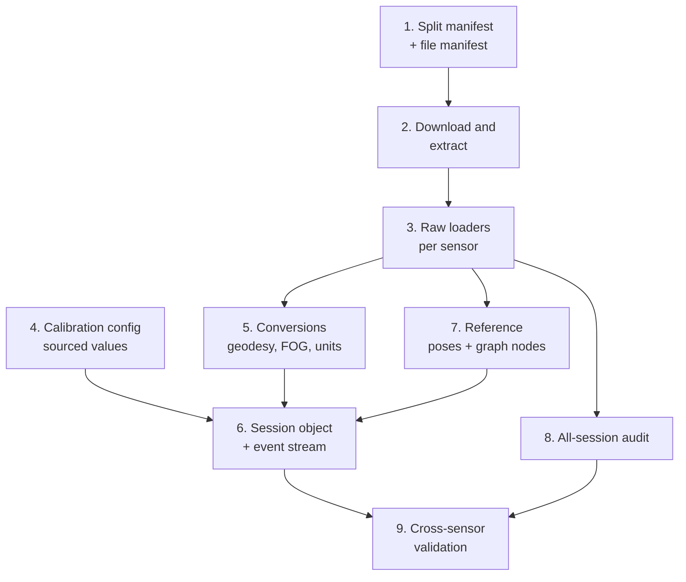

# Phase 1 Plan: Data Foundation

*Detailed plan for Phase 1 of [DEVELOPMENT_PLAN.md](../DEVELOPMENT_PLAN.md). Written 15 November 2026.*

## 1. Goal

Every sensor stream needed by the project is downloaded, loaded, converted and placed correctly **in time and space**, its quirks are understood across all 27 sessions, and the estimator can consume it as a causal event stream.

**Exit criterion:**
- All four cross-sensor validation checks (section 7) pass on several sessions.
- The all-session audit report is in `reports/phase1_audit/`.
- Unit tests cover loaders, conversions and the event stream.
- The calibration config cites a source for every number.

**Not in this phase:** the filter, the simulator (2a) and scoring metrics (2b). Phase 1 produces the data those phases consume.

## 2. What we already know

| Topic | Facts (from earlier audits; one session unless stated) |
|---|---|
| Download | Per date: `sensor_data/<date>_sen.tar.gz`, `ground_truth/groundtruth_<date>.csv`, `covariance/cov_<date>.csv` under `https://s3.us-east-2.amazonaws.com/nclt.perl.engin.umich.edu/`. All 27 dates verified available. |
| Size | ~2.75 GB sensor archives + ~2.66 GB ground truth + ~10 MB covariances ≈ 5.4 GB for all sessions. Extracted size not yet measured. |
| Session lengths | Most archives are 90–140 MB. **2013-01-10 (a validation day) is only ~21 MB, about 17 minutes.** 2012-04-29 and 2012-06-15 are also short. |
| IMU `ms25.csv` | utime, magnetometer xyz, accelerometer xyz, gyro xyz. ~47 Hz rows. |
| FOG `kvh.csv` | utime, **integrated heading angle** (rad), arbitrary reference. ~95 Hz rows; very irregular (5th/95th percentile intervals 0.13 / 19.9 ms). |
| Wheels `wheels.csv` | utime, left and right speed in m/s. ~41 Hz rows. |
| GPS `gps.csv` | utime, fix mode, satellite count, latitude, longitude (radians), altitude, track, speed. ~7 Hz rows. Many held (repeated) positions; satellite count is all zero despite valid fix modes. |
| Diagnostic files | `ms25_euler.csv` (vendor attitude), `gps_rtk.csv`, odometry products (already a fusion of IMU, wheels and FOG). **Never estimator inputs.** |
| Reference | Ground truth: utime, x, y, z, roll, pitch, yaw in the dataset's local NED frame, ~100 Hz, odometry-interpolated between SLAM graph nodes. The covariance file gives graph-node marginal covariances. |

Background detail: [research/nclt-sensors-and-state.md](../research/nclt-sensors-and-state.md).

## 3. Deliverables

| Kind | Item |
|---|---|
| Scripts | `scripts/download_nclt.py`: fetch by split or date; resumable; checksums; extract only needed CSVs |
| Configs | `configs/data/split.yaml` (22/2/3 manifest), `configs/data/nclt_files.yaml` (URLs, sizes, checksums), `configs/data/nclt_calibration.yaml` (frames, lever arms, origin; every value with a source) |
| Library (`src/lase/data/`) | `splits.py`, `download.py`, `raw.py` (per-sensor loaders and schemas), `geodesy.py`, `conversions.py` (FOG increments, units), `calibration.py`, `reference.py`, `session.py`, `events.py`, `audit.py` |
| Tests | Unit tests with small synthetic CSV fixtures (no real data in CI); validation tests marked `validation` that run on downloaded data |
| Reports | `reports/phase1_audit/`: per-session summary table, all-session overview, validation figures |

## 4. Work items and order

Items 3 (one loader per sensor), 4 and 7 can proceed in parallel. Item 4 is research (dataset paper, official readers), not code.

**Bring-up order for data:** download **2013-01-10** first (smallest, ~41 MB with ground truth) plus one ordinary training day to build and debug the loaders. Download everything only once the loaders work.

### 4.1 Split and file manifests
- `split.yaml` lists the 22/2/3 dates. A pydantic model checks all 27 are present, the sets are disjoint and no unknown date can join a split silently.
- `nclt_files.yaml` lists URLs and expected sizes. NCLT publishes no checksums, so SHA-256 values are recorded on first download and verified afterwards.

### 4.2 Download and extract
- Raw downloads are kept unmodified under `local_data/nclt/raw/`.
- Resumable (HTTP range requests); skips files whose checksum already matches.
- Extracts only the needed CSVs into `local_data/nclt/extracted/<date>/`: estimator inputs plus diagnostic files. First step: list the archive contents to confirm file names.
- Records the extracted size so storage needs are known.

### 4.3 Raw loaders
- One loader per file, each with an explicit column schema (names, units, dtypes). Timestamps stay `int64` microseconds.
- Loaders **never drop rows**. They add validity flags instead: non-monotonic timestamps, duplicates, out-of-range values, GPS fix mode, held GPS values.
- Output: typed NumPy-backed records per sensor. Conversion to torch happens at the event-stream boundary.
- Parsed sessions are cached as Parquet in `local_data/nclt/cache/` (adds `pyarrow`). The cache key includes the loader version.

### 4.4 Calibration config (research)
Find and cite:
- the reference frame's geodetic origin (the official GPS reader uses a fixed origin; confirm it matches the ground-truth frame);
- body frame definition and reference point;
- IMU, FOG and GPS-antenna positions and orientations relative to the body;
- wheel track width and wheel reference point;
- FOG axis and sign convention.

Every value gets a source (paper section, official reader, archive README) or is marked **estimated** with the method used. Estimated values are confirmed by the section 7 checks.

### 4.5 Conversions
- **Geodesy:** GPS latitude/longitude (radians) → WGS-84 → ECEF → local NED at the configured origin. Use the exact transform, not the official reader's linearised approximation; compare the two as a check.
- **FOG:** unwrap the integrated angle; provide angle increments over arbitrary intervals `[t0, t1)`. Keep the raw angle; never re-integrate a differenced rate.
- **Units:** confirm SI throughout. Check whether accelerometer values are in m/s² or g, and the gyro and wheel sign conventions.

### 4.6 Reference
- Load dense poses and graph-node covariances. Graph-node times are the covariance-file timestamps.
- Express the reference at the body reference point in NED, consistent with `CONVENTIONS.md`.
- Derive reference velocity (offline, non-causal, which is allowed for labels) with quality masks; ground-truth gaps produce masked spans, not interpolation.
- Kept behind a separate API so the estimator cannot access it.

### 4.7 Session object and event stream
- A `Session` groups one date's sensor records, reference, calibration and validity flags.
- **Causality by construction:** the event stream accepts only estimator-input sensors (IMU, FOG, wheels, GPS). Diagnostic and reference data are reachable only through separate evaluation-side APIs.
- Events sorted by `t_us` with the tie priority from `CONVENTIONS.md`. Windowed replay `[t0, t1)` for training chunks.
- Unit tests: ordering, ties, windowing and that no reference field can appear in an event.

### 4.8 All-session audit
Per session:
- duration;
- per-sensor row rates and interval distributions;
- gaps above thresholds, timestamp monotonicity and duplicates;
- GPS fix-mode distribution, held-value fraction and **outage spans** (natural outages, e.g. indoors);
- reference coverage and graph-node density;
- stationary periods (for bias priors later).

Output: one table across all 27 sessions, plus per-session figures.

## 5. Design decisions

| Decision | Choice | Reason |
|---|---|---|
| Raw data | Immutable; all processing derives from it | Reproducible; re-extraction always possible |
| Bad samples | Flag, never delete | Downstream components decide; audit stays honest |
| GPS conversion | Exact geodetic transform, origin matched to the reference frame | Avoids linearisation error; mismatch is caught by the overlay check |
| Data access | Estimator inputs, diagnostics and reference behind separate APIs | Enforces causality and the sensor contract in code |
| Cache format | Parquet, keyed by loader version | Fast reload; safe invalidation |
| Units and frames | Converted once in `data/`, following `CONVENTIONS.md` | One place to get conventions right |

## 6. Testing

- **Unit tests (CI):** small synthetic CSVs written in test fixtures, so no real data is in the repository. They cover:
  - schema parsing and validity flags;
  - geodesy against known reference points (e.g. origin maps to zero; known offsets; round trips);
  - FOG unwrapping across ±π and increment additivity;
  - event ordering, ties, windowing and the causality restriction.
- **Validation tests (local, on downloaded data):** the section 7 checks, marked `validation`. They write figures to `reports/phase1_audit/`.

## 7. Cross-sensor validation (independent references)

| # | Check | Pass condition | A failure reveals |
|---|---|---|---|
| V1 | GPS in NED overlaid on the reference trajectory | Horizontal residual median within a few metres; no systematic rotation or scale | Wrong origin, lat/lon order, radian handling or lever arm |
| V2 | Cross-correlate IMU yaw rate, FOG rate and the derivative of reference heading | Peak correlation at near-zero lag, matching sign | Time offset, sign or axis error |
| V3 | Mean wheel speed vs reference forward speed | Ratio close to 1 outside slip episodes; residual mean near zero | Wheel scale, sign, reverse driving, reference-point mismatch |
| V4 | (right − left) / track width vs FOG yaw rate | Linear with slope near 1 | Track width, wheel ordering or sign |
| V5 | Integrity: monotonic time, sensor time spans overlap the reference span | No unexplained gaps or clock jumps | Logging or clock problems needing special handling |

Each check runs on at least the bring-up sessions plus a sample of others from different seasons, then on all sessions in the audit.

## 8. Open questions (to be answered in this phase)

1. Exact archive contents and file names across sessions; are any files missing in some sessions?
2. Reference-frame origin and whether it is the same for all sessions.
3. Sensor mounting geometry and its sources (dataset paper, readers, archive README).
4. Accelerometer units, FOG sign and axis, wheel sign conventions, and how reverse motion appears.
5. GPS fix-mode semantics, and how to detect held versus genuinely stationary fixes.
6. Ground-truth coverage: does it span the whole session or leave gaps at the start and end?
7. The short 2013-01-10 validation day. The split stays as agreed; the audit records how much validation data it actually contributes.
