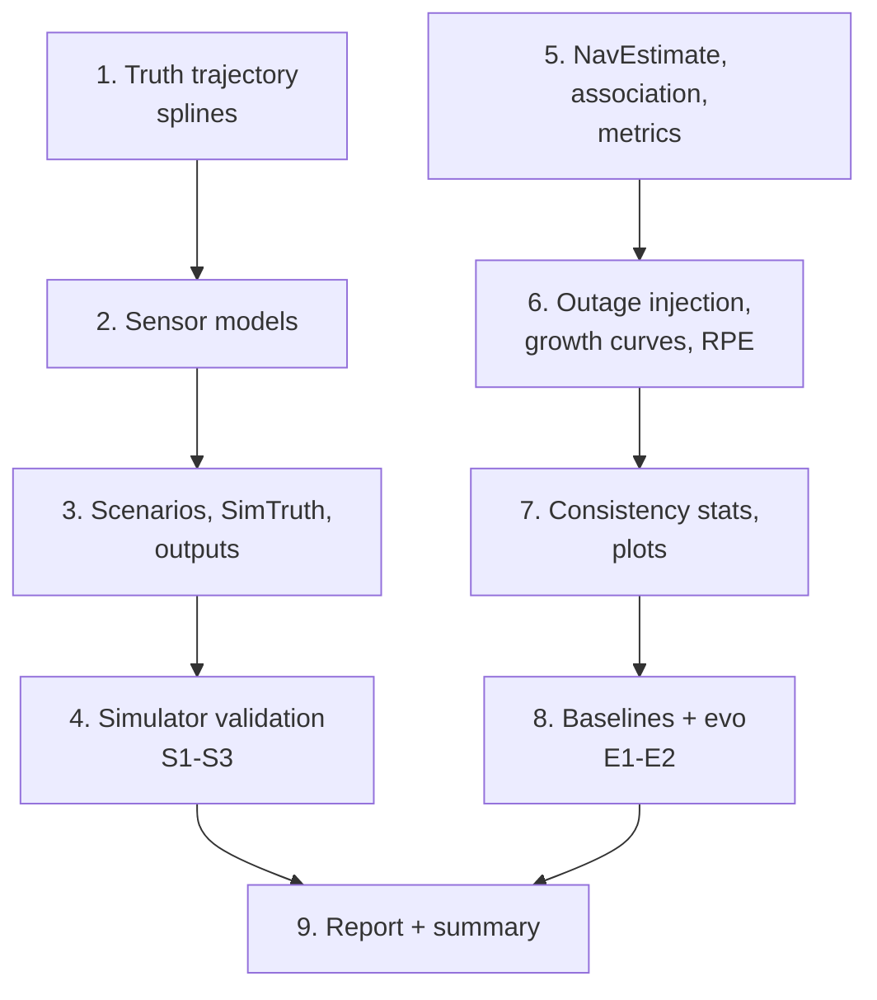

# Phase 2 Plan: Simulator and Evaluation Harness

*Detailed plan for Phases 2a and 2b of [DEVELOPMENT_PLAN.md](../DEVELOPMENT_PLAN.md). Written 15 November 2026. Builds on Phase 1 ([report](../reports/phase1_audit/README.md)).*

## 1. Goals

**2a. Simulator:** synthetic sensor data with **known truth** for every quantity the filter estimates or the network will learn: biases, noise levels, wheel scale, slip, GPS errors and outages. Motion comes from real NCLT reference trajectories, so it is realistic.

**2b. Evaluation harness:** one scoring path for every method and phase: accuracy, outage behaviour, consistency and plots, validated against an established tool.

**Key design choice:** the simulator outputs the *same types* as the real-data loaders (`SensorStreams` + `Reference`). Every later component (filter, training, evaluation) runs unchanged on simulated or real data, and simulated runs additionally expose a `SimTruth` with the hidden quantities.

**Exit criterion:**
- configurable scenarios (clean, biased, noisy, slip, outage) generated from any session;
- simulator validation passes (section 4);
- the harness scores the raw-GPS and NCLT-odometry baselines;
- the harness metrics agree with `evo`.

## 2. Phase 2a: Simulator

### 2.1 Truth trajectory
- Start from a session's valid dense reference (body pose, ~148 Hz).
- Resample to a uniform grid and low-pass filter with a zero-phase filter, so second derivatives (acceleration, angular acceleration) are smooth and physically plausible.
- Fit cubic splines to position and to unwrapped roll, pitch and yaw. **The spline *is* the truth:** positions, velocities, accelerations, attitude and body angular rates (from Euler rates) are exact at any time.
- Optional time window `[t0, t1)` to simulate a segment.

### 2.2 Sensor models (evaluated at the session's real timestamps, so timing jitter and gaps stay realistic)

| Sensor | Model | Injected truth |
|---|---|---|
| IMU (at its lever arm; axes = body) | `f_b = C_bw (a_imu_w - g_w)` with lever-arm acceleration terms; `gyr = omega_b` | Accelerometer and gyro biases (constant + random walk), white noise, optional scale factors |
| FOG | Integrated body-z rotation, plus rate bias and angle noise, then released as `sign x angle` wrapped to [0, 2π), as in the real data | FOG bias, noise, released sign (−1) |
| Wheels | `left/right = v_fwd ± omega_z W / 2` at the axle centre, times the wheel speed scale | Wheel scale, physical track width, white noise, **slip episodes** (time-limited over-speed and asymmetric slip) |
| GPS | Antenna position → geodetic via the dataset projection (Phase 1), plus first-order Gauss–Markov correlated error and white noise | Time-varying noise σ (bursts), multipath outliers, outage windows, held values, fix mode |

Defaults come from the Phase 1 measurements (rates, wheel scale 1.054, track 0.560 m, GPS median error ~3–5 m). They are configurable per scenario.

### 2.3 Outputs
- `SensorStreams` (estimator inputs, same format as real data).
- `Reference` built from the truth: dense at 100 Hz, with "graph nodes" every 3.6 s and tiny covariance, so the evaluation harness works unchanged.
- `SimTruth`: bias trajectories, per-sample noise σ, slip flags, GPS error and outage spans, wheel scale and track width.

### 2.4 Scenarios (`configs/sim/*.yaml`)
`clean` (no errors), `biased` (biases only), `nominal` (realistic noise + biases), `slip` (nominal + slip episodes), `gps_degraded` (nominal + noise bursts, outliers, outages).

## 3. Phase 2b: Evaluation harness

| Component | Content |
|---|---|
| Estimate format | `NavEstimate`: times, North/East position, North/East velocity, heading, optional 5×5 covariance. Reported at the body reference point. |
| Association | Causal: at each reference time, use the **latest estimate at or before it** (no interpolation into the future), with a maximum staleness |
| Accuracy | Horizontal position, wrapped heading and velocity RMSE; mean, median and max; at **graph nodes** (primary) and dense reference times (sensitivity); per session and pooled |
| Drift | Relative pose error (planar) over fixed time intervals (10 / 30 / 60 s) |
| GPS outages | Withhold GPS in windows (30 / 60 / 120 s; seeded starts, minimum spacing, only where GPS was available); error-growth curves vs time since outage start; error at outage end. Natural outages (from the Phase 1 audit spans) are reported separately. |
| Consistency | NEES and coverage from estimate covariance; NIS statistics from update diagnostics; chi-square bounds |
| Plots | Trajectory overlay, error vs time, outage growth curves |
| Baselines | (1) Raw GPS track, held between fixes, with velocity and course from successive fixes; (2) NCLT's supplied odometry aligned by the common initial-pose prior. Both are scored as reference points for Phase 3. |

## 4. Validation (against independent references)

| # | Check | Pass condition |
|---|---|---|
| S1 | Clean simulation through an independent strapdown integrator (validation-only NumPy code) | Position error over 10-s windows small, and shrinking with IMU rate (convergence check: native rate vs 4× rate) |
| S2 | Phase 1 cross-checks (V1–V4) run on simulated data | Recover the injected FOG sign, IMU scale, wheel scale and track width; GPS median error matches the injected noise |
| S3 | Injected-noise statistics | Sample standard deviations and bias random-walk growth match the configuration |
| E1 | Harness metrics vs `evo` (APE translation, no alignment) | RMSE agrees to < 1 mm on the same associated poses |
| E2 | Harness on trivial estimators | Raw GPS: bounded error of a few metres; odometry: drift that grows with distance; metrics behave sensibly with the reference itself (error 0) |

## 5. Work items

Steps 1–4 (simulator) and 5–8 (harness) are independent.

## 6. Out of scope

The filter itself (Phase 3), training (Phase 4) and learned components.
