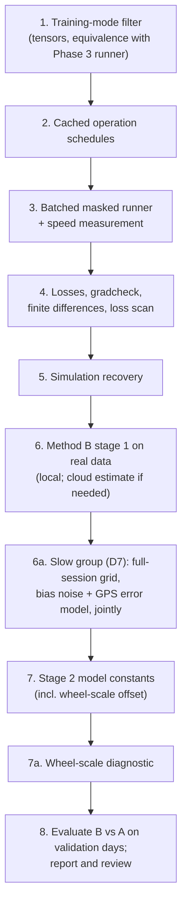

# Phase 4 Plan: Differentiable Training and Learned Constants (Method B)

*Detailed plan for Phase 4 of [DEVELOPMENT_PLAN.md](../DEVELOPMENT_PLAN.md). Written 15 November 2026 with the user. Builds on the Phase 3 analytical baseline (method A).*

## 1. Purpose

1. **Training machinery:** backpropagation through the complete filter (propagation, wheel / GPS / lateral-constraint updates, Joseph form) over chunks of real data, fast enough to be practical.
2. **Correctness first:** gradients verified, and known values recovered in simulation, before any learning on real data.
3. **Method B (learned constants):** the same filter, with its noise models (and, in stage 2, selected model constants) learned by gradient descent instead of hand-tuning. B is the fair comparator for the GRU (method C, Phase 5) and answers on its own: *does training beat the Phase 3 tuning?*

**Exit criterion:**
- gradients verified (gradcheck, finite differences, loss scan);
- recovery of injected values in simulation;
- B trained on training days, selected on validation days, and compared with A on the validation days;
- test days untouched.

## 1a. Inputs from Phase 3 (15 November 2026)

Phase 3 decisions and findings that shape Phase 4:

| Topic | Phase 3 outcome | Consequence for Phase 4 |
|---|---|---|
| Frames | Filter state = IMU state (MS25; 0.71 m above the axle, 0.11 m back, 0.18 m left). Wheel and GPS updates use 3D lever arms. Output and scoring are at the axle centre (NCLT reference point); only horizontal position, horizontal velocity and heading are scored. | The training-mode filter outputs at the axle centre exactly like the Phase 3 runner; the task loss uses the same scored quantities. |
| Wheel model | Predicted mean wheel speed = `scale · V_roll + R_w · q`. V_roll is the axle's horizontal speed along the heading (IMU velocity minus the lever-arm swing `C(ω × l)`). `R_w · q` (R_w = 0.24 m, q = gyro pitch rate) is the encoder effect. Kinematics only: no joint state, no dynamics. | `R_w` is a stage-2 constant anchored at 0.24 m (σ_anchor ≈ 0.04 m, from the measured 0.17–0.24 m range). |
| No kinetics | NCLT has no torque, current or command data; the IMU measures the effect of the forces directly, so no dynamic model. | The lean-to-acceleration coupling of the balance controller is a candidate learned effect for the network (Phase 5), not a constant in B. |
| Left/right wheels | Not used for yaw rate in the filter. Measured on 5 training days (1 s windows): left/right scale difference +0.75 to +0.99% in every session (left reads higher); wheel turn-rate noise ~0.03 rad/s (≈1,500× FOG, ≈15× MEMS gyro); standstill is not a clean no-rotation reference (1.55° apparent turn vs 0.21° from the FOG over 2.6 min). Decision: no wheel yaw-rate update, no separate left/right scale or difference states. | **Keep left and right wheel speeds separately in the training data and caches** (not only their mean), plus the FOG turn rate, so Phase 5 can use them as network inputs: left and right speeds, and a wheel-versus-FOG turn-rate mismatch `(v_L − v_R)/W − r_FOG`, a skid/slip indicator. Expect a ~1% speed-proportional offset in that feature from the left/right scale difference. Not learned in B. |
| Wheel scale (R6) | Chained online scale state (start 1.0, σ 0.05) converged within one session but to the wrong value (1.077–1.088 vs 1.044–1.058 measured from the reference in Phase 1) and claimed σ ≈ 0.0014 (~20× overconfident): it absorbs some other model error. Fixed 1.054 was better on position, drift and outages (3 days). **Phase 3 decision (user):** the scale is fixed per session from a linear trend in date (1.04409 + 0.03268/yr from 2012-01-01; 22 training days; residual std 0.0044; validation days within 0.4%), carried as a **Schmidt consider state**: never updated (zero gain), its σ 0.0044 kept in the covariance for honest dead reckoning. | The trend handles the year-long drift in A already. B stage 2 learns a common **offset to the trend** as an anchored constant (anchor 0, σ_anchor 0.01). The training-mode filter must support the consider mask. A **wheel-scale diagnostic** step tests which error a free scale absorbs. |
| FOG bias (R5, R7a) | Two parts: per-session turn-on offset −25 to +28°/h, and a within-session change of ~5–20°/h over 30–60 min. No correlation with time since start, season, pitch or roll rate; no temperature in NCLT. Matches the KVH datasheet (±20°/h turn-on, 6°/h temperature). A now uses prior 1e-4 rad/s and random walk 1e-6 rad/s/√s (≈ 20.6°/h and ≈ 12°/h per hour: consistent with both parts). Accuracy almost tied with the old 1e-5 / 1e-7 (score 1.591 vs 1.609); chosen because only a realistic prior absorbs the turn-on offset. | Anchors 1e-4 and 1e-6. These are **slow parameters** (D7): invisible to 30 s chunks, learned in the slow group. Expect a flat loss, so the anchors will likely hold. |
| GPS error model (R7a) | The 2 Gauss–Markov error states (2.53 m / 55 s + 1.44 m white) are much worse on real data (position median 6.5–9.0 m vs 3.0 m; heading 2.4–4.2° vs 1.8–1.9°) though they helped in simulation (NEES 19.7 → 1.9). Slow GPS-vs-dead-reckoning disagreements go to the GPS-error state (reached 14 m, 5.7σ) because dead reckoning is overconfident (unmodelled FOG bias drift, wheel-scale error). Not a code bug. A keeps white GPS (σ 5 m, 1 Hz); the error states stay in the layout, off by default. | Learn the GPS error states **only jointly with the dead-reckoning process noise** (slow group, D7). A learned short τ or small correlated σ means "white GPS". Report learned FOG bias noise and GPS noise together: B can trade one against the other for the same loss. |
| State layout (pending) | Terrain-gradient option `nonholonomic.vertical_mode: grade` adds 2 states (∂h/∂N, ∂h/∂E; indices 19–20, `N_ERR` 19 → 21): the axle follows an estimated slope instead of flat ground. Default (off / level / grade) decided in Phase 3 R7b. | **Phase 4 code uses `N_ERR` and the state slices only, never hard-coded sizes.** Caches of warm-start states and covariances record the state layout in their provenance. If the grade states are on, B also learns their noise (see D1). |

## 2. Decisions (agreed with the user)

### D1. What B learns

**Stage 1: all sensor noise.** Measurement and process noise are both treated as sensor noise.

| Group | Learned quantities |
|---|---|
| GPS | white σ; with the GPS error state on, correlated-error σ and correlation time τ (slow group, D7) |
| Wheels | forward-speed σ |
| Lateral constraint | lateral σ (the constraint's trust; scope requirement) |
| IMU | accelerometer and gyro noise densities; accelerometer and gyro bias random walks (bias random walks: slow group, D7) |
| FOG | angle random walk; bias random walk (slow group, D7; anchor 1e-6 rad/s/√s) |
| Terrain gradient (only if the grade states are on) | grade random walk; vertical-constraint σ |

**Stage 2: model constants**, as anchored deviations:
- **wheel speed scale offset** added to the per-session date-trend value (anchor 0, σ_anchor 0.01, about 2× the trend residual 0.0044). The scale stays a consider state as in A. The learned offset is compared with the Phase 1 independent measurements: a clear offset with a real loss gain is reported as an *effective* scale compensating another error, not a tyre measurement.
- encoder pitch coefficient `R_w` (physically ≈ wheel radius; anchor 0.24 m, σ_anchor ≈ 0.04 m);
- possibly small mounting corrections, if identifiable.

Not learned:
- discrete thresholds (gates, re-acquisition rules) stay fixed;
- slowly varying quantities (IMU/FOG biases) remain **filter states**, estimated online; B learns only their uncertainty models. (The wheel scale is the exception: a consider state fixed at the date trend in A, with a learned offset in stage 2, see above.)
- context-dependent effects (slip, multipath) are left to method C.

**Anchoring to the physics (agreed):** every learned quantity is a **deviation from its physical or tuned anchor**:

```text
positive quantities (noise levels, scales):  value = anchor × exp(δ)
signed quantities (offsets):                 value = anchor + δ
δ starts at 0 (B starts exactly at baseline A)
anchor penalty added to the loss:            Σ (δ / σ_anchor)²   (a Gaussian prior centred on the physics)
```

- `σ_anchor` comes from how well each anchor is known: datasheet tolerance, Phase 1/2 measurement spread, or the flat range of the Phase 3 tuning grid.
- Each learned δ is reported with its effect on the loss. A δ that moves without improving the loss is **not identifiable** from the data, and the penalty keeps it at the physics value.
- The Jacobians are never learned: they are recomputed from the current state at every step, so learned values always enter the nonlinear model.

### D2. Loss

```text
loss = (1 − α) · task_loss + α · innovation_NLL + anchor_penalty
α = 0 initially (task loss only); both terms are implemented from the start
```

**task_loss:**
- position and wrapped heading errors at **graph nodes** (LiDAR/RTK-anchored), plus horizontal velocity against the dense reference;
- each normalised by a per-channel scale;
- **Huber (robust)** so rare large GPS-driven errors don't dominate;
- channel weights are parameters.

**innovation_NLL:** the Gaussian negative log-likelihood of GPS, wheel and lateral-constraint innovations under the filter's own predicted innovation covariance. It needs no reference, and pushes the noise toward honest uncertainty.

### D3. Speed: batched masked training runner

The baseline runs at ~2 ms per IMU step forward, roughly 6–8 ms with the backward pass. The training days hold ~5 M IMU steps, so a single-process pass is ~10 h. The plan:

1. **Training-mode filter:**
   - tensors end to end: no NumPy round-trips or `float()` calls inside the graph, and in-place operations are safe for autograd;
   - one implementation with the Phase 3 runner;
   - **equivalence test:** with batch size 1 it reproduces the Phase 3 runner to ~1e-9.
2. **Cached operation schedules:** per session, precompute the exact sequence of operations the runner performs, namely:
   - propagate over each sub-interval, with the interpolated IMU values and FOG increments;
   - wheel, GPS and lateral-constraint updates, with their measurements (left and right wheel speeds kept separately, for Phase 5 inputs);

   stored as tensors, with provenance. The exact-time splitting and the causal FOG handling are encoded in the schedule.
3. **Batched masked runner:** B chunks step through their schedules in parallel. At each step every chunk applies the operation it needs, and the others are masked. The Python loop cost is shared across the batch: target B = 32–128.
4. **Warm starts and burn-in:** a chunk starts from baseline A's cached state and covariance at that time, then runs a **20 s burn-in** without gradient, so the state adapts to B's current constants. The cached state includes the bias estimates, so only chunks at a true session start begin with zero bias; those stay in training because the filter must handle the turn-on offset. The **10 s loss window** follows with backpropagation. Chunks may continue chronologically, carrying state across windows with gradients detached (the scope's truncated backpropagation, now with many parallel streams).
5. **Hardware:**
   - The filter needs float64, which Apple's GPU backend (MPS) does not support, so it runs on the **CPU**. (A float32 filter is a possible later experiment, not part of the core plan: see section 5.)
   - `torch.compile` is a measured option later.
   - **Cloud compute only after a local measurement and cost estimate**, and with the user's approval per run. Budget: **≤ $10 for the first training run, ≤ $30 for the pilot, ≤ $50 in total**.
   - Likely best value: a many-core CPU instance (FP64 + tiny sequential operations suit CPUs). GPUs pay off only with very large batches and data-centre FP64.
   - The account and provider choice are the user's.

### D4. Discrete decisions

Gating, re-acquisition and interval splitting stay as they are. Gradients flow through continuous quantities only.

### D5. Validation before learning on real data

| Check | Pass condition |
|---|---|
| `torch.autograd.gradcheck` on short float64 chunks (small batch) | passes |
| Finite differences of the loss with respect to each learned δ | agree with autograd |
| Loss scan (e.g. GPS σ over a range) | gradient sign and size match the slope; minimum near the expected value |
| Simulation recovery: start from deliberately wrong noise levels on a simulated scenario with known noise | converges near the injected values (within stated tolerance) |
| Real data, sanity | learned GPS / wheel values near the Phase 2 fits (GPS 1.44 m white + 2.53 m / 55 s correlated; wheel residual ~0.035 m/s), or a documented reason why not |

### D6. Training protocol

| Item | Starting value |
|---|---|
| Data | training days only for fitting; validation days for checkpoint selection (full replays); test days untouched |
| Optimiser | AdamW on the δ parameters |
| Learning rate | **1e-2** start, short **linear warm-up** (~20 steps), **cosine decay** to 1e-4 |
| Gradient clipping | norm 1.0 |
| Batch | B = 32–128 chunks (from the speed measurement) |
| Windows | 20 s burn-in (no gradient) + 10 s loss window |
| Early stopping | validation full replays at fixed intervals; patience as a parameter |
| Seeds | one during development; three for reported comparisons |

All of these are named, commented parameters in the `training` section of `configs/parameters.yaml` (added 15 November 2026), together with the loss settings, the anchor widths (`anchor_sigma`) and the D7 grid (`slow_grid`). The anchors themselves are the `filter` values (baseline A).

### D7. Slow parameters (agreed 15 November 2026: option (a))

Some quantities only affect the estimate over minutes, so 30 s chunks give them almost no gradient:
- FOG bias random walk 1e-6 rad/s/√s adds only ~5.5e-6 rad/s (~1°/h) of bias uncertainty over a 30 s chunk: under 0.01° of heading in the loss window;
- bias priors matter only at a true session start (other chunks start from A's cached covariance);
- the GPS correlation time (55 s) exceeds the chunk length.

**Decision:**
- **Fast group:** white noise levels, wheel σ, lateral σ, accelerometer/gyro/FOG white noise, plus stage 2 constants. Learned by gradient on 30 s chunks (D3).
- **Slow group:** FOG and gyro bias priors and random walks, accelerometer bias random walk, GPS error-state σ and τ. Learned **jointly** (they trade against each other), with the fast group held at its learned values, by:
  **full-session causal replays without gradient** over a small grid around the anchors (same horizon and scoring as A's tuning). Long chunks with gradient checkpointing (5–10 min, after a cost estimate) are only a fallback, if the optimum lands on a grid edge with a clear gain.
- GPS error states are tried only in this joint search, never alone (R7a failure).

**Starting grid** (values finalised when the `training` section goes into `configs/parameters.yaml`):

| Round | Varied | Values | Runs |
|---|---|---|---|
| 1 | FOG bias prior × FOG bias random walk (white GPS) | {3e-5, 1e-4, 3e-4} rad/s × {3e-7, 1e-6, 3e-6} rad/s/√s | 9 |
| 2 | GPS error states on: correlated σ × τ, at the best FOG prior and the best FOG random walk ×{⅓, 1, 3} | {1.5, 2.53} m × {20, 55} s × 3 | 12 |
| 3 (if time) | gyro and accelerometer bias random walks, one at a time | anchor ×{⅓, 3} | 4 |

- Scored on the training days with A's score; the chosen point is confirmed on the validation days (full replays).
- Report: the loss surface of each round (flat or not), the learned FOG bias noise next to the GPS noise, and GPS error states vs white GPS.
- Cost: one full replay of the training days per run, parallel over sessions on local cores; measured on the first run before scheduling the rest.

## 3. Work order



| Step | Output | Check |
|---|---|---|
| 1 | Training-mode filter (state-size agnostic: `N_ERR` and slices only; consider-state mask as in the Phase 3 update) | Matches the Phase 3 runner (B = 1) to ~1e-9, for each state layout in use (with and without the grade states) |
| 2 | Per-session schedule cache with provenance | Replaying a schedule equals running the event stream |
| 3 | Batched runner; measured steps/s for forward and backward vs B | Batched results equal per-chunk results |
| 4 | Loss module (task, innovation NLL, anchor penalty); gradient tests | D5 rows 1–3 pass |
| 5 | Recovery experiment on simulated data | D5 row 4 passes |
| 6 | B stage 1 trained; learned δ table | D5 row 5; validation-day comparison with A |
| 6a | Slow group (D7): grid of full-session replays over FOG/gyro bias priors and random walks with the GPS error model, jointly | Learned FOG bias noise and GPS noise reported together; GPS error states with vs without; loss flatness around the anchors |
| 7 | Stage 2 constants (wheel-scale offset to the date trend, encoder coefficient) | Identifiability report per constant (incl. loss curvature at the optimum: nearly flat directions mixing e.g. FOG bias noise and GPS σ mean the data cannot separate them); learned scale vs the Phase 1 measurement |
| 7a | **Wheel-scale diagnostic:** rerun the chained online scale state inside B (learned noise, GPS error states on), with and without learning `R_w` jointly | Does the free scale converge near the Phase 1 values (1.044–1.058) once correlated GPS error and the encoder term are handled? Identifies the absorbed error, or narrows the candidates |
| 8 | Phase 4 report; review notes | User review |

## 4. Risks

| Risk | Mitigation |
|---|---|
| Backward pass too slow or too memory-hungry on 16 GB | Batched runner; short loss windows; measure first; cloud within budget |
| Gradient explosion through long filter sequences | 10 s windows, clipping, float64, gradcheck |
| Learned noise becomes "effective weights" rather than honest noise | Report consistency (NEES/NIS); innovation-likelihood term available (α > 0) |
| Non-identifiable constants | Anchor penalty plus the identifiability report |
| Warm-start mismatch (cached state from A, constants from B) | 20 s burn-in; check sensitivity to burn-in length |
| Learned constants absorb unmodelled errors (as the R6 scale state did) | Anchor penalty; compare each learned constant with its independent measurement; report as "effective" when they disagree |
| Slow parameters get no gradient from 30 s chunks; a flat loss is then misread as "not identifiable" | Slow group handled separately (D7) with full-session horizon |
| GPS error states absorb dead-reckoning error (R7a) | Only learned jointly with the dead-reckoning process noise; compared with white GPS |
| State layout changes (e.g. grade states) after caches are built | Layout recorded in cache provenance; caches rebuilt automatically when it changes; no hard-coded sizes |

## 5. Optional experiment: float32 filter (not part of the core plan)

*Noted at the user's request (15 November 2026). The core plan keeps the filter in float64.*

**Why consider it:**
- float32 opens GPUs: Apple MPS supports float32 only, and cloud or consumer GPUs run float32 30–60× faster than float64;
- with the batched runner (many chunks in parallel), that could be the practical way to scale training.

On the laptop CPU alone the gain is small (maybe 1.2–2×), because the cost is per-operation overhead on tiny matrices, not arithmetic.

**What float32 risks** (~7 significant digits vs ~16):

| Risk | Detail |
|---|---|
| Covariance range | P spans ~10¹³: position variance up to ~900 m², FOG-bias variance ~1e-10 (rad/s)². Small-variance states (biases) lose precision; variances can turn negative. |
| Differences of large accumulators | The unwrapped FOG angle reaches hundreds of rad. A float32 difference at 300 rad resolves only ~3e-5 rad per increment, about 75× the FOG's own noise. |
| Long gradient chains | Rounding accumulates through thousands of steps; gradient checks need float64 |
| Not affected | Positions (~0.06 mm resolution at 1 km); timestamps (int64) |

**Safeguards that would make it workable:**
1. Data preparation in float64, then cast: FOG increments, interpolated IMU values, positions relative to a session origin.
2. Rescaled state units so all variances are of order 1 (e.g. FOG bias in µrad/s), shrinking P's range to ~10³, as in embedded float32 Kalman filters.
3. Keep the Joseph form and symmetrisation; add a small diagonal floor. A square-root covariance formulation is the robust fallback.
4. float64 stays the reference: gradient checks and the verification path remain float64.

**Gate before adopting it:** run baseline A in float32 and float64 on the same sessions and compare accuracy, covariance health (positive variances, condition number) and NEES. Adopt float32 only if it matches within noise. It would change the convention "filter float64, network float32" (CONVENTIONS.md), so it needs the user's approval.

## 6. Notes for Phase 5 (method C), from Phase 3 R5/R7a

Recorded here until the Phase 5 plan exists.
- **FOG turn-on offset is not predictable from context.** If the network learns it on training days, it is memorising sessions. Give the network **no date, absolute time, session identity, or absolute position** features.
- The within-session FOG bias change may also be unpredictable from the available inputs.
- **Better output:** how fast the bias may change. A multiplier on the FOG bias random walk (like the existing trust multipliers) lets the filter estimate the value. Adaptive process noise is more likely to generalise. Caveat (D7): its effect shows over minutes, so training it needs long-horizon chunks.
- Context-dependent GPS errors (multipath, re-acquisition) stay with the GPS trust multiplier.
