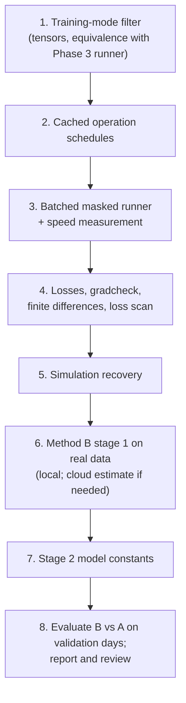

# Phase 4 Plan: Differentiable Training and Learned Constants (Method B)

*Detailed plan for Phase 4 of [DEVELOPMENT_PLAN.md](../DEVELOPMENT_PLAN.md). Written 15 November 2026 with the user. Builds on the Phase 3 analytical baseline (method A).*

## 1. Purpose

1. **Training machinery:** backpropagation through the complete filter (propagation, wheel / GPS / lateral-constraint updates, Joseph form) over chunks of real data, fast enough to be practical.
2. **Correctness first:** gradients verified, and known values recovered in simulation, before any learning on real data.
3. **Method B (learned constants):** the same filter, with its noise models (and, in stage 2, selected model constants) learned by gradient descent instead of hand-tuning. B is the fair comparator for the GRU (method C, Phase 5) and answers on its own: *does training beat the Phase 3 tuning?*

**Exit criterion:**
- gradients verified (gradcheck, finite differences, loss scan);
- recovery of injected values in simulation;
- B trained on training days, selected on validation days, and compared with A on the validation days;
- test days untouched.

## 2. Decisions (agreed with the user)

### D1. What B learns

**Stage 1: all sensor noise.** Measurement and process noise are both treated as sensor noise.

| Group | Learned quantities |
|---|---|
| GPS | white σ; with the GPS error state on, correlated-error σ and correlation time τ |
| Wheels | forward-speed σ |
| Lateral constraint | lateral σ (the constraint's trust; scope requirement) |
| IMU | accelerometer and gyro noise densities; accelerometer and gyro bias random walks |
| FOG | angle random walk, bias random walk |

**Stage 2: model constants**, as anchored deviations:
- encoder pitch coefficient `R_w` (physically ≈ wheel radius);
- starting uncertainties of the FOG/gyro bias and wheel-scale states;
- possibly small mounting corrections, if identifiable.

Not learned:
- discrete thresholds (gates, re-acquisition rules) stay fixed;
- slowly varying quantities (biases, wheel scale) remain **filter states**, estimated online; B learns only their uncertainty models;
- context-dependent effects (slip, multipath) are left to method C.

**Anchoring to the physics (agreed):** every learned quantity is a **deviation from its physical or tuned anchor**:

```text
positive quantities (noise levels, scales):  value = anchor × exp(δ)
signed quantities (offsets):                 value = anchor + δ
δ starts at 0 (B starts exactly at baseline A)
anchor penalty added to the loss:            Σ (δ / σ_anchor)²   (a Gaussian prior centred on the physics)
```

- `σ_anchor` comes from how well each anchor is known: datasheet tolerance, Phase 1/2 measurement spread, or the flat range of the Phase 3 tuning grid.
- Each learned δ is reported with its effect on the loss. A δ that moves without improving the loss is **not identifiable** from the data, and the penalty keeps it at the physics value.
- The Jacobians are never learned: they are recomputed from the current state at every step, so learned values always enter the nonlinear model.

### D2. Loss

```text
loss = (1 − α) · task_loss + α · innovation_NLL + anchor_penalty
α = 0 initially (task loss only); both terms are implemented from the start
```

**task_loss:**
- position and wrapped heading errors at **graph nodes** (LiDAR/RTK-anchored), plus horizontal velocity against the dense reference;
- each normalised by a per-channel scale;
- **Huber (robust)** so rare large GPS-driven errors don't dominate;
- channel weights are parameters.

**innovation_NLL:** the Gaussian negative log-likelihood of GPS, wheel and lateral-constraint innovations under the filter's own predicted innovation covariance. It needs no reference, and pushes the noise toward honest uncertainty.

### D3. Speed: batched masked training runner

The baseline runs at ~2 ms per IMU step forward, roughly 6–8 ms with the backward pass. The training days hold ~5 M IMU steps, so a single-process pass is ~10 h. The plan:

1. **Training-mode filter:**
   - tensors end to end: no NumPy round-trips or `float()` calls inside the graph, and in-place operations are safe for autograd;
   - one implementation with the Phase 3 runner;
   - **equivalence test:** with batch size 1 it reproduces the Phase 3 runner to ~1e-9.
2. **Cached operation schedules:** per session, precompute the exact sequence of operations the runner performs, namely:
   - propagate over each sub-interval, with the interpolated IMU values and FOG increments;
   - wheel, GPS and lateral-constraint updates, with their measurements;

   stored as tensors, with provenance. The exact-time splitting and the causal FOG handling are encoded in the schedule.
3. **Batched masked runner:** B chunks step through their schedules in parallel. At each step every chunk applies the operation it needs, and the others are masked. The Python loop cost is shared across the batch: target B = 32–128.
4. **Warm starts and burn-in:** a chunk starts from baseline A's cached state and covariance at that time, then runs a **20 s burn-in** without gradient, so the state adapts to B's current constants. The **10 s loss window** follows with backpropagation. Chunks may continue chronologically, carrying state across windows with gradients detached (the scope's truncated backpropagation, now with many parallel streams).
5. **Hardware:**
   - The filter needs float64, which Apple's GPU backend (MPS) does not support, so it runs on the **CPU**. (A float32 filter is a possible later experiment, not part of the core plan: see section 5.)
   - `torch.compile` is a measured option later.
   - **Cloud compute only after a local measurement and cost estimate**, and with the user's approval per run. Budget: **≤ $10 for the first training run, ≤ $30 for the pilot, ≤ $50 in total**.
   - Likely best value: a many-core CPU instance (FP64 + tiny sequential operations suit CPUs). GPUs pay off only with very large batches and data-centre FP64.
   - The account and provider choice are the user's.

### D4. Discrete decisions

Gating, re-acquisition and interval splitting stay as they are. Gradients flow through continuous quantities only.

### D5. Validation before learning on real data

| Check | Pass condition |
|---|---|
| `torch.autograd.gradcheck` on short float64 chunks (small batch) | passes |
| Finite differences of the loss with respect to each learned δ | agree with autograd |
| Loss scan (e.g. GPS σ over a range) | gradient sign and size match the slope; minimum near the expected value |
| Simulation recovery: start from deliberately wrong noise levels on a simulated scenario with known noise | converges near the injected values (within stated tolerance) |
| Real data, sanity | learned GPS / wheel values near the Phase 2 fits (GPS 1.44 m white + 2.53 m / 55 s correlated; wheel residual ~0.035 m/s), or a documented reason why not |

### D6. Training protocol

| Item | Starting value |
|---|---|
| Data | training days only for fitting; validation days for checkpoint selection (full replays); test days untouched |
| Optimiser | AdamW on the δ parameters |
| Learning rate | **1e-2** start, short **linear warm-up** (~20 steps), **cosine decay** to 1e-4 |
| Gradient clipping | norm 1.0 |
| Batch | B = 32–128 chunks (from the speed measurement) |
| Windows | 20 s burn-in (no gradient) + 10 s loss window |
| Early stopping | validation full replays at fixed intervals; patience as a parameter |
| Seeds | one during development; three for reported comparisons |

All of these become named, commented parameters in `configs/parameters.yaml` (new `training` section) **once the user confirms the file is safe to edit**. Until then they live in this plan.

## 3. Work order



| Step | Output | Check |
|---|---|---|
| 1 | Training-mode filter | Matches the Phase 3 runner (B = 1) to ~1e-9 |
| 2 | Per-session schedule cache with provenance | Replaying a schedule equals running the event stream |
| 3 | Batched runner; measured steps/s for forward and backward vs B | Batched results equal per-chunk results |
| 4 | Loss module (task, innovation NLL, anchor penalty); gradient tests | D5 rows 1–3 pass |
| 5 | Recovery experiment on simulated data | D5 row 4 passes |
| 6 | B stage 1 trained; learned δ table | D5 row 5; validation-day comparison with A |
| 7 | Stage 2 constants (encoder coefficient, bias/scale priors) | Identifiability report per constant |
| 8 | Phase 4 report; review notes | User review |

## 4. Risks

| Risk | Mitigation |
|---|---|
| Backward pass too slow or too memory-hungry on 16 GB | Batched runner; short loss windows; measure first; cloud within budget |
| Gradient explosion through long filter sequences | 10 s windows, clipping, float64, gradcheck |
| Learned noise becomes "effective weights" rather than honest noise | Report consistency (NEES/NIS); innovation-likelihood term available (α > 0) |
| Non-identifiable constants | Anchor penalty plus the identifiability report |
| Warm-start mismatch (cached state from A, constants from B) | 20 s burn-in; check sensitivity to burn-in length |

## 5. Optional experiment: float32 filter (not part of the core plan)

*Noted at the user's request (15 November 2026). The core plan keeps the filter in float64.*

**Why consider it:**
- float32 opens GPUs: Apple MPS supports float32 only, and cloud or consumer GPUs run float32 30–60× faster than float64;
- with the batched runner (many chunks in parallel), that could be the practical way to scale training.

On the laptop CPU alone the gain is small (maybe 1.2–2×), because the cost is per-operation overhead on tiny matrices, not arithmetic.

**What float32 risks** (~7 significant digits vs ~16):

| Risk | Detail |
|---|---|
| Covariance range | P spans ~10¹³: position variance up to ~900 m², FOG-bias variance ~1e-10 (rad/s)². Small-variance states (biases) lose precision; variances can turn negative. |
| Differences of large accumulators | The unwrapped FOG angle reaches hundreds of rad. A float32 difference at 300 rad resolves only ~3e-5 rad per increment, about 75× the FOG's own noise. |
| Long gradient chains | Rounding accumulates through thousands of steps; gradient checks need float64 |
| Not affected | Positions (~0.06 mm resolution at 1 km); timestamps (int64) |

**Safeguards that would make it workable:**
1. Data preparation in float64, then cast: FOG increments, interpolated IMU values, positions relative to a session origin.
2. Rescaled state units so all variances are of order 1 (e.g. FOG bias in µrad/s), shrinking P's range to ~10³, as in embedded float32 Kalman filters.
3. Keep the Joseph form and symmetrisation; add a small diagonal floor. A square-root covariance formulation is the robust fallback.
4. float64 stays the reference: gradient checks and the verification path remain float64.

**Gate before adopting it:** run baseline A in float32 and float64 on the same sessions and compare accuracy, covariance health (positive variances, condition number) and NEES. Adopt float32 only if it matches within noise. It would change the convention "filter float64, network float32" (CONVENTIONS.md), so it needs the user's approval.
