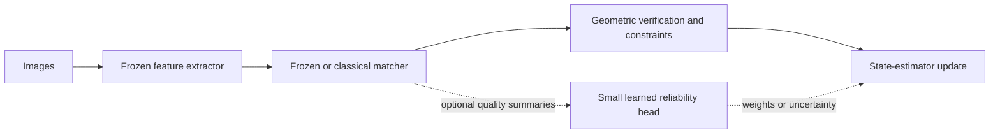
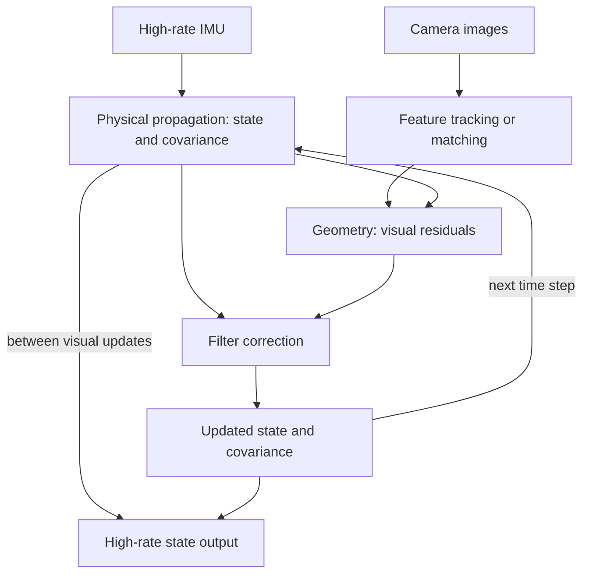
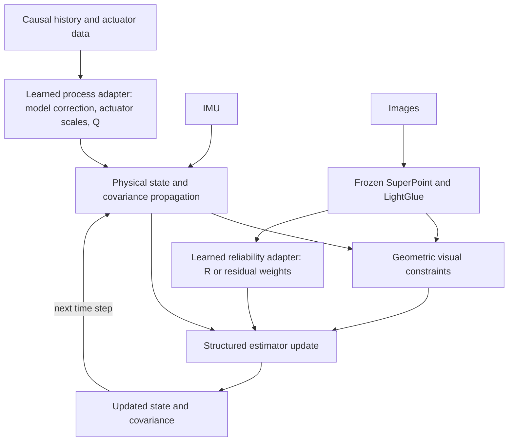
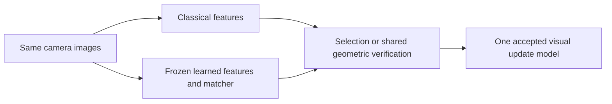
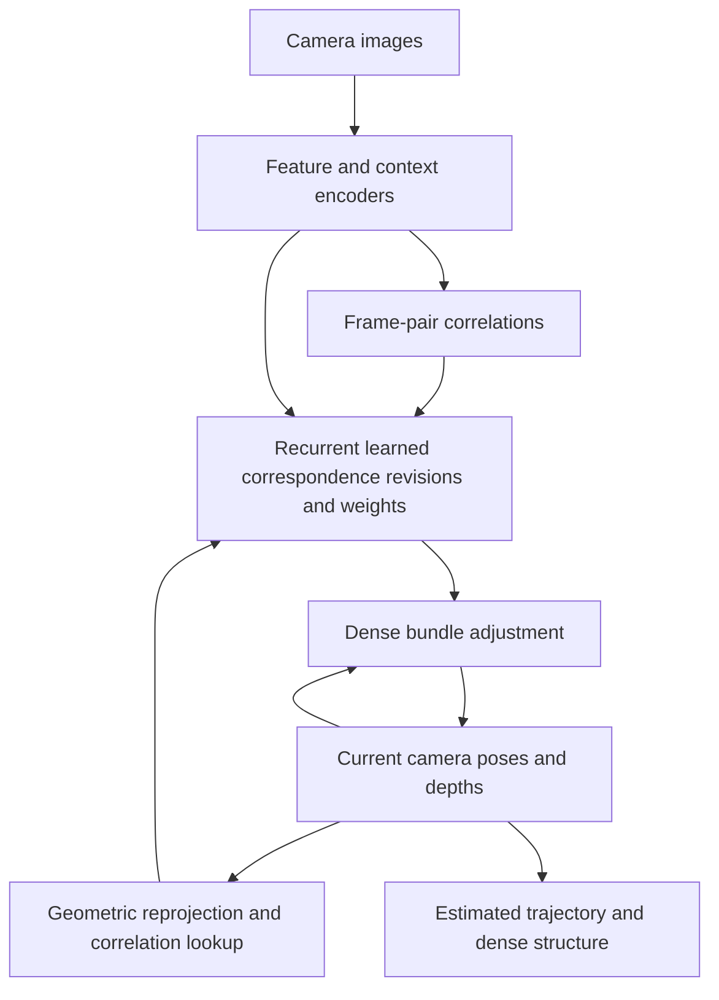
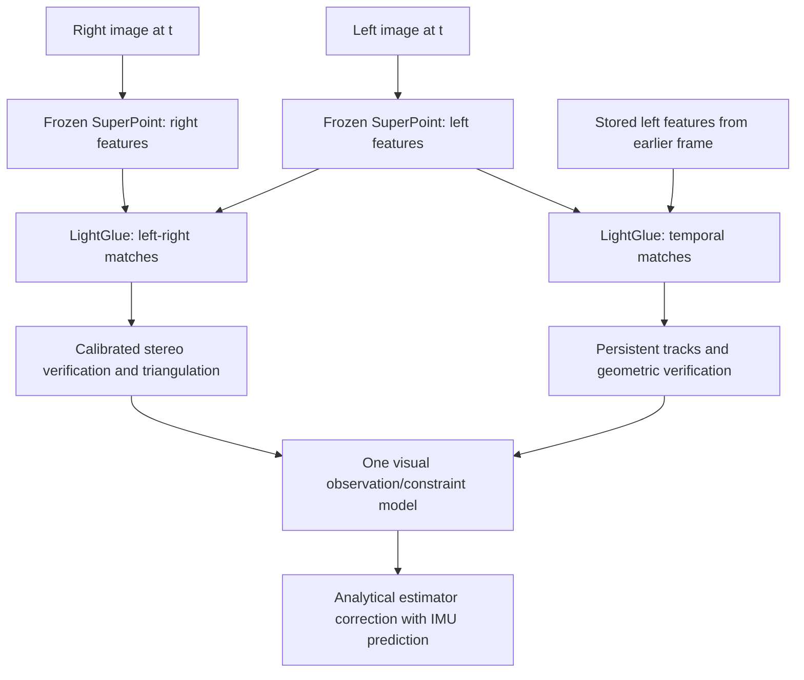
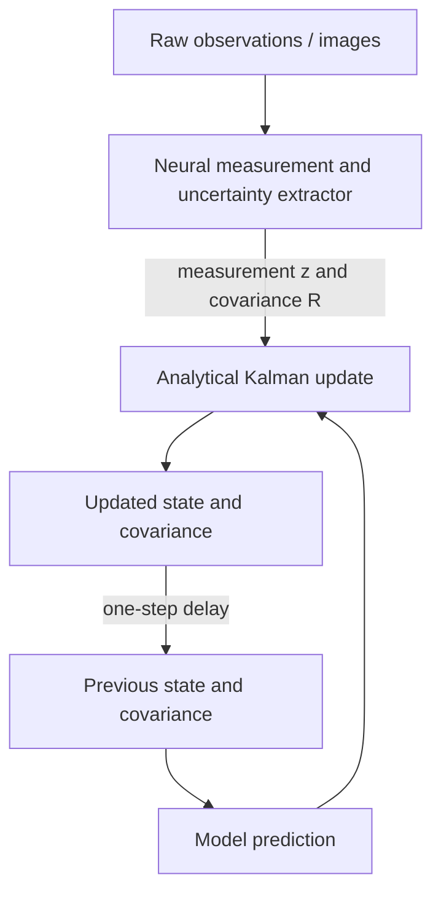
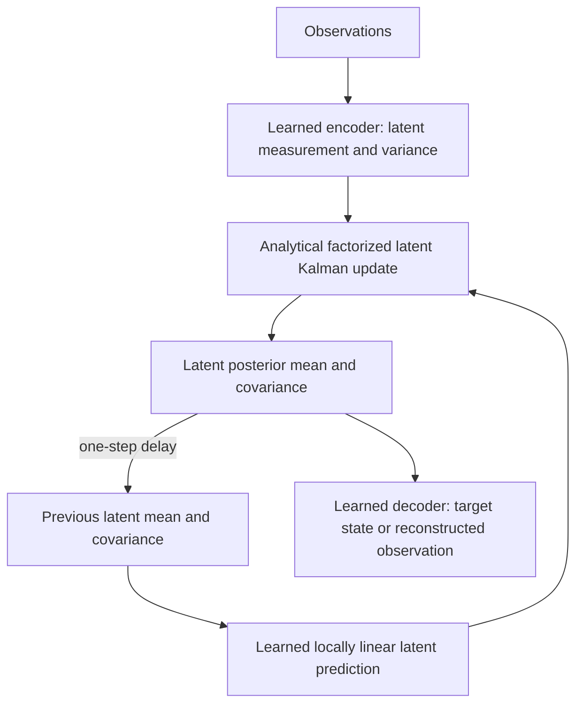
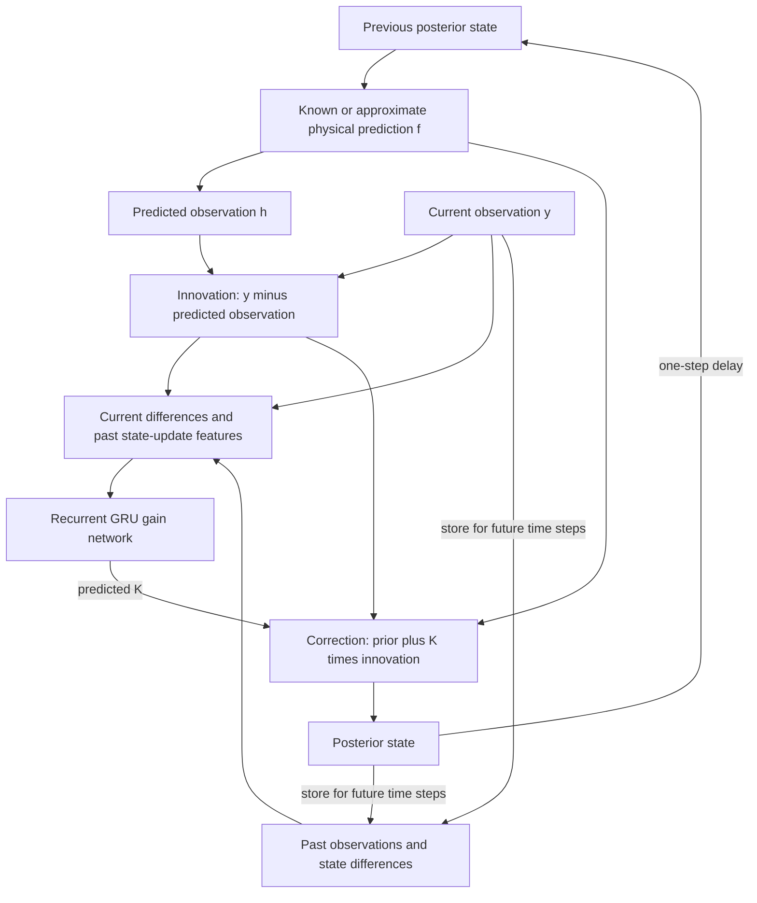

# Estimator architecture: discussion and flowcharts

Status: conceptual design discussion, updated 14 November 2026. **NCLT and the error-state EKF/MSCKF backend are locked**, with bounded local history and no initial persistent map/loop closure. Five planar outputs, internal tilt-aware attitude, IMU/FOG propagation, wheel/GNSS/visual updates, frozen SuperPoint/LightGlue, instance masks and inertial-prior robustness are agreed. Sensor adaptation, model residual and uncertainty adaptation are the learning roles. Exact augmented states, segmentation deployment and neural interfaces remain open; see [calibration ownership](./calibration-ownership.md). Earlier diagrams describe alternatives rather than a complete selected implementation.

**Project criterion:** the user does not require novelty or publication claims. Follow a promising design and evaluate it. Related methods in the [prior-work/benchmark audit](./benchmark-data-and-novelty-audit.md) are useful technical references, not a gate to continuing.

## Current locked backend and learned flow

The user has now locked **error-state EKF + tightly coupled MSCKF-style feature-track updates + bounded recent rig-pose history + no persistent map/loop closure initially**. Historical alternative diagrams below remain background. The [calibration ownership note](./calibration-ownership.md) gives the current full flow with separate calibration, model-residual, process-noise and observation-noise heads feeding propagation and correction. These neural interfaces are proposed; exact network count/output inventory is being discussed. Kalman gain K and joint covariance P remain analytical. Actuator gains require independently supported actuation inputs; environmental effects enter the specific process/observation error model they affect.

## 1. Scope decisions from this discussion

- The scientific objective remains improved state estimation, or comparable accuracy with measurable compute, latency/history or sensor advantages.
- Existing classical visual processing and frozen pretrained visual processing are in scope.
- Start with frozen SuperPoint + LightGlue. Other visual front ends are optional investigations, not required experiments; the bounded shortlist appears in section 6.
- Training a visual feature/measurement network from scratch and developing a new competitive general VO/SLAM system are out of scope.
- Visual-model fine-tuning is deferred and optional, for later work or if justified within available time.
- Small trainable estimator components, including residual, actuator-parameter, uncertainty or feature-quality/fusion heads, remain candidates. Adding such a head is optional; a frozen visual model does not inherently require one.
- Physical sensor/actuator gain, scale, bias and uncertainty adaptation remain candidates. Kalman gain and state-correction calculation stay analytical; direct neural K prediction is reference material outside the primary architecture.
- No data download, baseline execution or implementation is implied by these diagrams.

## 2. What frozen features and matching provide

A learned keypoint/descriptor extractor returns image locations, descriptors and possibly feature scores. A matcher identifies correspondences. Geometry turns those observations into reprojection constraints, relative-motion constraints or a pose estimate when sufficient information is available.



An extra MLP is not required to obtain matches or use them geometrically. If added, a head could predict observation uncertainty, feature rejection weights, expert selection or an observation correction. It needs an explicit training objective and validation. Matching confidence is not automatically a calibrated pixel covariance or state covariance.

The geometric pipeline must also manage temporal tracks, camera calibration, stereo relationships if applicable, outlier rejection and failed observations. A feature extractor alone is not a navigation estimator. A full visual odometry/SLAM system has additional state and geometry machinery.

[SuperPoint](https://arxiv.org/abs/1712.07629), [LightGlue inputs/outputs and pretrained weights](https://github.com/cvg/LightGlue).

## 3. Classical visual-inertial filtering

For discussion, use an error-state/MSCKF-style filter as the reference structure. A sliding-window optimization backend is another valid option; it is not yet ruled out or selected. A typical navigation state includes position, velocity, orientation and IMU biases. Filtering may retain cloned past camera poses or features to connect observations over time.



The high-rate propagation supplies predictions even between camera updates. At camera updates, the estimator compares measured visual information with predictions from its state. In a tightly coupled implementation, it often uses pixel/feature residuals directly; an independently estimated camera pose is not required.

**Observability qualification:** ordinary vision does not directly observe every navigation state. Velocity and biases can be corrected indirectly through dynamics and cross-covariances over time. Standard VIO without an external spatial reference retains global translation/yaw gauge freedoms. Monocular vision alone also has scale ambiguity; stereo provides metric geometric scale, while monocular–inertial scale recovery depends on sufficient motion and calibration. Fixing a coordinate frame removes an arbitrary gauge for representation, not future drift.

Known-map localization, surveyed visual markers, GNSS or suitably configured anchor observations change the information available. They must be stated in the task definition. Adding a second feature algorithm to the same images does not create a new external reference.

[OpenVINS filter description](https://docs.openvins.com/), [measurement update structure](https://docs.openvins.com/update.html), [VINS observability and calibration analysis](https://arxiv.org/abs/2201.09170).

## 4. Working hybrid architecture

The initial design recommendation is to place learned components inside the estimation model/uncertainty path. A network that corrects a completed estimator output is a possible baseline, but its state/covariance and feedback consistency require explicit design.



The process-adapter outputs are examples, not a requirement to learn all of them. The diagram does not mandate treating an IMU-driven model and an actuator-driven model as independent predictions. Their joint model and shared noise must be specified.

A provisional experimental progression is:

1. Reproduce a credible classical baseline with fixed calibrated parameters/noise.
2. Add a constrained physical parameter or mean-residual correction.
3. Separately test adaptive process uncertainty and observation reliability.
4. Evaluate the combined design and ablate each contribution.
5. Test a dual visual front end only if the individual front ends have demonstrably complementary failures.

The latest selected architecture uses error-state EKF/MSCKF, with the sensor family and planar outputs already agreed. Exact auxiliary-state ownership, learned outputs and implementation remain open; see [calibration ownership](./calibration-ownership.md). Candidate neural inputs must be causal and exclude evaluation ground truth.

### Why an output-correction network is a separate choice

A downstream network can learn an error correction and even be trained on final state error. However, a corrected state needs a corresponding uncertainty treatment. If its correction feeds future propagation, the filter's linearization, bias states and covariance representation must remain consistent with the corrected state. A frozen classical estimate followed by an unrelated state-only correction does not automatically inherit the classical filter's covariance calibration.

End-to-end training through a structured estimator is different from placing a neural network after its output. Either can be studied, but the recommendation is to preserve an explicit model of how the learned correction affects inference and uncertainty.

[AI-aided Kalman-filter design review](https://arxiv.org/abs/2410.12289), [hybrid dynamics VIO](https://arxiv.org/abs/2306.11429).

## 5. Using classical and frozen learned visual processing together

Potential complementarity is a hypothesis. Both operate on the same images and can share failure sources. Two derived pose estimates may additionally share map history or the same IMU, creating further correlation.

Three designs are worth distinguishing:

| Design | What is combined | Key issue |
|---|---|---|
| Conditional fallback / expert selection | Choose one front end or accepted constraint set using causal quality cues | Practical candidate for robustness versus compute; switching and uncertainty need evaluation |
| Shared geometric processing | Pool correspondences with track association, duplicate handling and one geometric validation/update model | Deduplication helps but does not by itself prove all image errors independent |
| Fuse separate pose or motion estimates | Combine two observation estimates analytically or through a small learned fusion module | Needs temporal and cross-estimator dependence treatment, common frames, valid rotation geometry and calibrated uncertainty |



A learned selector could use inlier counts, residual distributions, image coverage, parallax, blur indicators and matching scores. An MLP may be sufficient for aggregated quality summaries. A generic MLP is not automatically an appropriate model for unordered variable-length raw correspondence sets.

Blindly applying two independent Kalman updates to estimates from the same images can underestimate uncertainty. A learned fusion network does not automatically resolve this dependence. Conservative fusion with unknown correlation is another possible approach, but adds scope and requires testing on the intended state representation.

Start with the selected SuperPoint–LightGlue route. If the optional classical/learned comparison is pursued, compare individual front ends under the same backend before conditional fallback. Running both on every frame increases compute and could conflict with the efficiency objective. The front-end sweep is not a prerequisite for the initial estimator experiment.

## 6. Initial visual route and optional shortlist

These are feature/matching candidates, not complete interchangeable VIO pipelines. Mac CPU/MPS support and streaming latency remain unmeasured for the selected versions.

| Option | Status / role | Reason to inspect | Main practical question |
|---|---|---|---|
| **SuperPoint + LightGlue** | **Selected initial route; both frozen** | Established sparse learned feature/matching combination | Temporal track/stereo integration and measured CPU/MPS latency |
| **XFeat + LighterGlue** | Optional learned alternative 1 | Efficiency-oriented candidate relevant to the M5 and lower-compute target | Accuracy/robustness after geometric estimation and actual Mac portability |
| **ALIKED + LightGlue** | Optional learned alternative 2 | Another lightweight feature extractor using the same matcher family | Implementation/operator portability; the original extractor includes custom operations |
| **ORB + Hamming matching** | Optional classical alternative 1 | Descriptor-based classical reference; mutual/ratio filtering as appropriate | Robust matches, spatial coverage and runtime in the same estimator |
| **Shi–Tomasi + pyramidal KLT** | Optional classical alternative 2 | Temporal optical-flow tracking reference for VIO | Track lifetime, subpixel residuals, blur/illumination sensitivity and runtime |

This is a bounded backlog, not a commitment to evaluate every row. The project may finish with only the selected route. Visual fine-tuning remains optional/deferred. LoFTR and complete learned SLAM systems stay background reading rather than additional active alternatives. KLT is a temporal tracker, so it must be compared as a full tracking pipeline rather than mislabeled as a descriptor matcher.

[LightGlue supported feature families](https://github.com/cvg/LightGlue), [XFeat and LighterGlue official implementation](https://github.com/verlab/accelerated_features), [ALIKED](https://github.com/Shiaoming/ALIKED), [OpenCV Shi–Tomasi/KLT example](https://docs.opencv.org/4.x/d4/dee/tutorial_optical_flow.html).

## 7. DROID-SLAM

DROID expands to Differentiable Recurrent Optimization-Inspired Design. The original system is a complete visual SLAM architecture: learned image information guides repeated geometric optimization of camera poses and depth. It supports monocular, stereo and RGB-D inputs; its basic architecture is not an inertial Kalman filter.



The full system manages keyframes, local updates and global refinement. Its learned weights guide optimization; they are not automatically calibrated Kalman observation covariances. Treating the complete system as a visual observation source needs additional modeling, especially if its results are fused with other processing of the same images. Its original code has CUDA dependencies, so it is not a default M5-native front end.

[Original DROID-SLAM paper](https://arxiv.org/html/2108.10869), [official code and requirements](https://github.com/princeton-vl/DROID-SLAM). Training DROID-SLAM is outside this project's scope; its architecture is explanatory/reference material and pretrained use would be a separate optional benchmark decision.

## 8. Learning physical sensor and actuator calibration

A simple thrust relation is

```text
T is approximately k_T * sum(omega_i^2 over motors i) + b_T
```

This is an illustrative static model, not a complete actuator model. Thrust coefficient/gain, voltage dependence, lag, saturation and offsets can all matter. A gain/scale parameter can be more meaningful than an arbitrary additive bias for an actuator. IMU additive biases remain important for a different reason.

| Quantity | Role | Candidate treatment |
|---|---|---|
| Actuator gain or physical coefficient | Changes the prediction model's response to a command or measured speed | Calibration, augmented parameter estimation, or constrained learned correction |
| Sensor/actuator offset | Systematic additive discrepancy | Bias state or model correction where supported |
| Q / R | Process/observation uncertainty | Calibrated baseline plus structured learned adaptation |
| Kalman gain K | Maps an innovation into a state correction | Keep analytical; direct neural K prediction is reference material outside the primary architecture |

For example, learning actuator gain or Q/R changes the filter's effective Kalman gain indirectly while leaving its formula analytical. That is different from KalmanNet-style direct K prediction.

Gain, mass, steady disturbance and sensor calibration can be confounded. An augmented state or neural output does not ensure identifiability. Use constrained parameterizations, appropriate motion excitation and reference/supporting measurements. No decision has been made to estimate every motor coefficient separately or make it arbitrarily time-varying.

### Calibration during motion

The user's proposal is physically meaningful. A simplified IMU measurement model is

```text
f_m     = diag(s_a) * f     + b_a + n_a
omega_m = diag(s_g) * omega + b_g + n_g
```

where f is true specific force in the sensor frame, s contains dimensionless scale factors near one, and b contains additive offsets. More complete models include cross-axis/misalignment terms. The corresponding corrected readings use the inverse calibration model before propagation; this is not a second independent sensor measurement.

Several gravity orientations can constrain accelerometer scale and bias. One resting orientation cannot identify all of them. At ordinary consumer-IMU precision, a stationary gyro principally reveals bias: its approximately zero rotational input does not identify gain. Gyro scale needs rotational excitation with another constraint on rotation, or suitable specialized calibration equipment/conditions. During movement, camera observations can constrain rotation/motion and make joint calibration possible without a required stop. Wheel, GNSS or other signals can help only in directions/regimes where they supply independent information.

Online visual-inertial self-calibration is already established classically. Yang et al. analyze scale/misalignment calibration and prove observability under fully excited six-axis motion, while identifying degenerate motions. Their EuRoC/KAIST experiments also show that additional IMU intrinsic calibration can hurt estimation with under-actuated/planar motion. This makes motion excitation and uncertainty central to choosing which gains to adapt. [Online self-calibration analysis and experiments](https://arxiv.org/html/2201.09170), [OpenVINS IMU measurement models](https://docs.openvins.com/propagation.html).

**Relevant learned prior art:** Calib-Net combines a trainable gyro calibration matrix with a time-dependent neural angular-rate correction from IMU history, trained with orientation supervision and evaluated with OpenVINS. Its constant trained matrix is different from a network identifying a fresh physical gain online on every deployment. It nevertheless demonstrates that learned scale/misalignment calibration and dynamic correction can coexist. [Calib-Net, published 3 January 2022 in the journal's 2021 volume](https://www.frontiersin.org/journals/robotics-and-ai/articles/10.3389/frobt.2021.772583/full).

Candidate designs for this project, still unselected:

- A small causal network predicts bounded slow scale/bias corrections, potentially conditioned on temperature, dynamics inputs and past innovations.
- A network supplies an initialization or prior for explicit calibration parameters; the structured estimator updates those parameters jointly with the navigation state.
- A network predicts a useful effective measurement correction without claiming each component is an identifiable physical calibration parameter.

Start from a small physically supported subset and compare against fixed calibration and classical online calibration. Use positivity/near-nominal bounds and a model for parameter uncertainty; do not let an unconstrained per-sample gain absorb every error source. Lack of excitation should lead to conservative adaptation or retention of the prior. A network can exploit learned priors but cannot make an unobservable parameter independently identifiable from absent information. State-accuracy gains alone would not prove that all learned parameters equal physical truth.

For actuators, the analogous question is whether commands, measured RPM/current/steering, dynamics and reference observations distinguish a gain from mass, load, bias or disturbance. Dataset support decides feasibility. A per-motor gain experiment is not implied by having an IMU and camera alone.

## 9. Nonlinearity, model error and linearization

**Discussion resumed:** the user now asks about physical/model parameters, learned nonlinearities, data-driven modeling and small matrix/linearization corrections. The current [NCLT modeling note](./nclt-modeling-options.md) connects these choices to available sensor inputs. No exact correction architecture is selected.

These are different error sources:

- Model mismatch: the f/h functions omit or misdescribe real effects.
- Linearization approximation: a first-order approximation can be insufficient over the uncertainty region, even when f/h are correct.
- Distribution approximation: a single Gaussian may inadequately represent uncertainty.
- Numerical/discretization errors: propagation or optimization can introduce further error.

A neural residual can improve f/h and automatic differentiation can provide its Jacobian. The EKF still uses a first-order approximation. Autodiff gives derivatives of the chosen model; it does not remove neglected curvature or incorrect model assumptions. Neural nonlinear expressiveness is therefore not automatically a cure for linearization error.

Possible routes include:

1. Keep known physics and learn a residual, with consistent derivatives of the combined model.
2. Test iterated EKF, suitable error-state/invariant formulations, UKF/cubature filters, or nonlinear optimization as relevant classical alternatives. Their assumptions and compute differ.
3. Investigate a learned correction to propagated moments, covariance or the update. This can compensate for approximation error but requires an explicit calibration/stability evaluation and does not inherently establish a physical model correction.
4. Predict Jacobian corrections directly only with particular care: an independently learned matrix can be inconsistent with the mean model. Learning a differentiable residual is a more coherent initial reference design.

The diagnostic, when this discussion resumes, is to compare appropriate analytical inference variants on the same observations and model before declaring linearization the dominant error. Direct neural gain prediction is outside the primary architecture under the latest decision.

[AI-aided filtering review](https://arxiv.org/abs/2410.12289), [recent uncertainty/gain-correction example, preprint](https://arxiv.org/abs/2608.04201). No novelty or guaranteed accuracy claim is made for the optional directions here.

## 10. Plan and decision gates

| Stage | Status | Evidence needed |
|---|---|---|
| Agree objective, application scope and visual-training limits | Agreed | Recorded in the decision log |
| Discuss the architecture and measurement/uncertainty roles | Current | This note and user discussion; remaining choices stay open |
| Fix an initial visual route and Kalman correction policy | Agreed | Frozen SuperPoint + LightGlue; analytical K/correction; no requirement for another visual method |
| Discuss physical parameters, nonlinear residuals, matrix/linearization corrections and data-driven modeling | Current | Distinguish the learned quantity and assess NCLT input/identifiability support |
| First dataset/platform | **Agreed: NCLT ground robot** | VID indoor and 2024 racing-car data are optional future investigations |
| Select exact sensors, state/geometry, model/backend, sessions and baseline | Open | Dataset fixed; define the remaining data/model protocol |
| Reproduce the baseline and profile local/cloud feasibility | Not started | Matching metrics, trajectory conventions, successful runs and measured compute |
| Evaluate learned residual/parameter and covariance modules | Not started | Separate ablations, held-out experiments, calibration and deployment metrics |
| Consider other visual front ends, dual-front-end fallback or fine-tuning | Optional/deferred | Bounded shortlist in section 6; may never be investigated |

Working recommendation: one transparent estimator backend, the selected frozen visual front end where cameras are used, and small explicit learned components inside its physical/uncertainty model. Front-end alternatives/ensembling are optional; model/parameter/approximation learning is under discussion now. Direct Kalman-gain learning is outside the primary architecture. An analytical fixed-parameter estimator with frozen learned vision is an ablation, not a fully classical visual baseline.

## 11. Published comparisons of classical and learned visual processing

The literature separates detection/description, matching, temporal tracking and full estimator evaluation. A classical detector can use a learned matcher; SIFT + LightGlue is a supported combination. Better matching does not establish improved navigation on every sequence.

### Original SuperPoint comparison

SuperPoint's 2018 paper evaluates HPatches homography correctness with up to 1000 features per image at 480 × 640 resolution, nearest-neighbor matching and RANSAC. The entries below are correctness percentages, not position errors.

| Feature method | 1-pixel threshold | 3-pixel threshold | 5-pixel threshold |
|---|---:|---:|---:|
| ORB | 15.0 | 39.5 | 53.8 |
| SIFT | **42.4** | 67.6 | 75.9 |
| SuperPoint | 31.0 | **68.4** | **82.9** |

SuperPoint wins over ORB here; SIFT wins at the tightest threshold. ORB also has higher detector repeatability in that table, despite worse homography correctness. Detector repeatability, correspondence quality and downstream geometry therefore need separate evaluation. These are historical results from that paper's implementation, not a prediction for current weights or our hardware. [SuperPoint, table 4](https://arxiv.org/html/1712.07629).

### Holding the extractor fixed to test the matcher

LightGlue's MegaDepth-1800 comparison reports relative-pose AUC at 5° as follows (percentage scale; higher is better). The common sparse feature budget is 2048 points. This is angular relative-pose recovery, not a VIO trajectory-error metric.

| Features | Matcher | Pose AUC at 5° |
|---|---|---:|
| SIFT | Nearest neighbor + ratio | 48.3 |
| SIFT | LightGlue | 57.0 |
| SuperPoint | Nearest neighbor + mutual check | 37.7 |
| SuperPoint | LightGlue | 65.5 |

This isolates a learned-matcher benefit within each feature family; it also shows that a learned extractor plus a simple matcher need not beat a classical pipeline. It does not establish universal dominance. Reported GPU matcher timings exclude extraction and robust geometry and cannot be treated as M5 end-to-end latency. [LightGlue, table 8 and timing appendix](https://arxiv.org/html/2306.13643).

### Independent and estimator-level evidence

| Study | What is compared | Relevance and limitation |
|---|---|---|
| Jin et al., *Image Matching across Wide Baselines: From Paper to Practice*, 2020 | Modular feature/matcher/robust-geometry combinations scored by camera pose | Benchmark authors show properly configured classical methods can beat some learned alternatives; this is historical evidence, not a ranking of all 2026 methods. [Paper](https://arxiv.org/abs/2003.01587) |
| Hamesse et al., *Practical Deep Feature-Based Visual-Inertial Odometry*, 2024 | SuperPoint/LightGlue tracks feeding VINS-Mono, versus its default tracking; EuRoC | Demonstrates the exact proposed front-end/back-end division and the need to select a useful number of matches. Not a guarantee for a new filter or Mac. [Author institution record](https://researchportal.rma.ac.be/en/publications/practical-deep-feature-based-visual-inertial-odometry/) |
| Choi et al., *Benchmarking Visual Feature Representations for LiDAR-Inertial-Visual Odometry Under Challenging Conditions*, IEEE Access 2026 | ORB/Hamming, SuperPoint/SuperGlue, SuperPoint/LightGlue, XFeat/MNN inside a FAST-LIVO2-based framework | Tests pose error, runtime and tracking across Newer College, SubT-MRS and MARS-LVIG. The LiDAR and sparse-direct components matter; results are not a pure VIO comparison. [Paper](https://arxiv.org/html/2603.18589) |

The defensible conclusion is that learned features/matchers are strong candidates for difficult correspondences, while a universal or dataset-independent claim that either family is always or usually better is unsupported. KLT's short-baseline temporal tracking task is also different from wide-baseline image matching. The eventual choice should consider accuracy, failures, track lifetime/coverage, latency and memory together.

If the optional front-end comparison is pursued, use the same sensor data, splits, geometry/backend and initialization; control feature/image budgets and give each method a comparable validation-tuning budget. A single RANSAC threshold can disadvantage features with different localization errors, so document validation-selected settings. Evaluate full-estimator state errors, consistency, failures and compute, not just match counts or pairwise AUC. No benchmark has been reproduced locally.

## 12. Using frozen SuperPoint–LightGlue with stereo

The same weights can be applied separately to left/right images and used for both simultaneous stereo matching and temporal matching. This uses the model's pairwise feature interface; it is not a dedicated depth network and does not inherently consume the rig's calibration. Each image's features can be computed once and reused for multiple image pairs.



This is an explanatory data flow, not a mandatory scheduling strategy. A tightly coupled backend can use stereo reprojection constraints directly, with triangulated landmarks/depth for initialization rather than independent noise-free depth observations.

For a compatible rectified pinhole stereo pair, depth is Z = fB/d, with focal length f in pixels, calibrated baseline B in meters and disparity d in pixels. General camera pairs require the appropriate projection model and triangulation. Stereo geometry supplies metric depth, but distant points with small disparity have large depth uncertainty. Occlusion means not all temporal features need a valid stereo partner. [OpenCV stereo geometry](https://docs.opencv.org/4.x/dd/d53/tutorial_py_depthmap.html).

Calibration, distortion/rectification or the correct raw-image projection, camera synchronization, camera-to-IMU extrinsics and temporal track IDs still have to be implemented. Apply epipolar and cheirality/reprojection checks; ensure image resizing/cropping uses consistent coordinates/intrinsics. Reuse of a track or derived depth must be represented consistently to avoid counting the same image information twice. The second camera improves geometric constraints and metric scale; it does not directly observe the full navigation state or an absolute global pose. No stereo-specific retraining is intrinsically required, but domain robustness and Mac feasibility need measurement. [LightGlue pairwise input/output interface](https://github.com/cvg/LightGlue).

## 13. KalmanNet and earlier structured learned filters

**Scope clarification:** the user meant KalmanNet variations and subsequent models, rather than predecessors. The requested comparison and additional flowcharts are now in [KalmanNet variants and later models](./kalmannet-variants.md). The earlier material below remains background reading.

These are related historical designs, not a claim of a single direct genealogy. KF/EKF provide the prediction/innovation/correction structure. Backprop KF and RKN are earlier learned-filter examples; KalmanNet's 2021 preprint was published in IEEE TSP in 2022. None is an automatically interchangeable visual-inertial navigation package.

### Backprop KF, 2016



The network learns an observation and its uncertainty; training backpropagates the final estimation loss through the filter. K is calculated analytically. This is conceptually close to the reliability-learning branch, although our visual features are frozen and our main candidate learning also concerns physical parameters/residuals. [Haarnoja et al., Backprop KF](https://arxiv.org/html/1605.07148).

### Recurrent Kalman Network, 2019



RKN learns a high-dimensional inference representation and transition model; covariance structure makes updates inexpensive. Its latent state is not necessarily physical position, velocity and bias. Keeping an analytical update does not by itself make the whole learned model physically interpretable. [Becker et al., RKN](https://proceedings.mlr.press/v97/becker19a.html).

### KalmanNet, 2021/2022



The mean prediction remains model-based, while a recurrent network produces K from innovations and causal difference features. State-history inputs use previous updates, avoiding a same-time algebraic loop. Original KalmanNet does not maintain the standard explicit posterior covariance recursion; internal recurrent quantities do not automatically give a calibrated navigation P. Training uses state labels and backpropagation through the recursion. The proposed project keeps the physical-state structure but **does not adopt direct neural K prediction**. [Revach et al., KalmanNet, sections III-A–III-D](https://arxiv.org/html/2107.10043).

### Where the current project sits

| Design | Candidate learned quantity | How correction gain is obtained |
|---|---|---|
| Backprop KF | Observation and observation uncertainty | Analytical Kalman formula |
| RKN | Latent encoding, latent dynamics and decoding | Analytical factorized Kalman operations in learned space |
| Original KalmanNet | Recurrent gain map | Network output |
| Current project direction | Physical scale/bias/residual and possibly Q/R, with frozen visual features | Analytical formula from the current model and covariance |

For a local linearized measurement model,

```text
S = H * P_predicted * transpose(H) + R
K = P_predicted * transpose(H) * inverse(S)
```

A model/uncertainty adapter can change its inputs while the gain/correction computation stays analytical. Positive covariance parameterizations alone do not prove calibration; parameter uncertainty, shared information and held-out consistency still need a defined treatment. Exact learned outputs and training losses remain open.

## Dynamic scenes: moving-object handling

Added 14 November 2026 in response to the user's question about pedestrians, cars and robots; revised after the user explicitly prioritizes the moving-bus/dominant-foreground failure case and favors DynaSLAM-style segmentation plus DynaVINS-style inertial checks. **A correct correspondence can violate the stationary-landmark model.** A feature on a moving bus may be matched correctly across frames, yet interpreting it as a fixed world point can produce incorrect camera motion. LightGlue confidence describes correspondence strength; it is not a calibrated static-world probability. [Official matching interface and thresholds](https://github.com/cvg/LightGlue).

### Approaches used in established systems

| Reference | Mechanism | What it establishes for our discussion |
|---|---|---|
| [VINS-Mono feature tracker](https://github.com/HKUST-Aerial-Robotics/VINS-Mono/blob/master/feature_tracker/src/feature_tracker.cpp) | Fundamental-matrix RANSAC removes geometrically inconsistent tracks | Semantic object detection is not required for a first geometric rejection layer |
| [ORB-SLAM3 optimizer](https://github.com/UZ-SLAMLab/ORB_SLAM3/blob/master/src/Optimizer.cc) | Robust Huber kernels and reprojection-error outlier handling | Robust estimation limits individual bad constraints; this is not an explicit object classifier |
| [DynaSLAM, RA-L/IROS 2018](https://github.com/BertaBescos/DynaSLAM) | Mask R-CNN masks potentially dynamic semantic classes; the paper adds multiview motion geometry in RGB-D mode | Published examples use TUM and KITTI; semantic masking is a valid additional frontend, not proof that every retained point is stationary |
| [DynaVINS, RA-L 2022](https://arxiv.org/abs/2208.11500), [official implementation](https://github.com/url-kaist/dynaVINS) | IMU-prior-assisted robust bundle adjustment rejects moving-object features; additional machinery handles temporarily static objects in loop closure | Motion consistency can address dynamics without requiring class labels; published BA evaluation uses VIODE, not our NCLT configuration |
| [DynaVINS++, RA-L 2024](https://arxiv.org/html/2410.15373v1) | Adaptive truncated least squares plus IMU-bias consistency checks/state recovery | Abruptly moving objects can corrupt estimated IMU biases; feature-level rejection alone may be insufficient. Evaluates VIODE and the authors' recordings |

The DynaSLAM mode distinction is documented in the [accepted paper, Figure 2 and Section III](https://zaguan.unizar.es/record/71183/files/texto_completo.pdf). These are method references, not reproduced results or evidence of a ready NCLT/SuperPoint/LightGlue/six-camera implementation. The nearby KalmanNet-family NCLT navigation comparisons do not use cameras, so this is an additional visual-estimation requirement for our system.

### Semantic masking was adopted in subsequent research

The earlier suggestion to keep masks optional was an implementation-scope/compute recommendation for this project, not evidence that research abandoned the approach. It is now superseded by the user's robustness priority. Related/follow-up examples include:

- [DynaSLAM II](https://arxiv.org/abs/2010.07820): instance-semantic segmentation and joint camera/object tracking/SLAM. It models moving agents rather than simply discarding all object information; the full multi-object backend is not required by our masking decision.
- [SEG-SLAM, 2024](https://pmc.ncbi.nlm.nih.gov/articles/PMC11014023/): an ORB-SLAM3-based RGB-D system combining YOLOv5-derived detection/segmentation priors with depth and epipolar checks. This is evidence for the semantic-geometric design family, not an assumption that its RGB-D pipeline transfers unchanged to Ladybug images.
- [Panoptic-SLAM, 2024](https://arxiv.org/abs/2405.02177): panoptic segmentation for dynamic visual SLAM, including experiments addressing unknown moving objects. It is another relevant design reference, not a selected replacement backend.

Detection/segmentation are established modern perception capabilities. [Tesla's public neural-network description](https://www.tesla.com/SI) explicitly describes semantic segmentation, detection and depth estimation. [Waymo's panoramic video panoptic research](https://waymo.com/research/waymo-open-dataset-panoramic-video-panoptic-segmentation/) addresses semantic/instance understanding across cameras and time. These public sources support the role of semantic perception; they do not establish that either company's production ego-localization uses DynaSLAM's exact Mask R-CNN feature-removal pipeline. Perception for predicting/planning around road users and selecting static features for ego-motion are related uses with different interfaces.

The capability should be distinguished from a specific network architecture. Mask R-CNN is the first named reference for our masking implementation; a particular pretrained checkpoint/runtime is not yet selected. Latency/memory and class dependence affect model/cadence choices, not whether the project now includes semantic masking.

### Limits of simple rejection and semantic masks

- RANSAC is useful when a sufficiently supported static-background motion can be recovered. A dominant moving object can itself form a coherent competing motion; robust loss alone does not identify which rigid motion is the robot's motion relative to the world.
- Epipolar consistency is a necessary geometric check in its applicable model, not a general static-point test. Some independently moving points can pass it.
- A detector's box masks the object plus some background. Pixel-level instance/semantic masks can preserve more background, but have segmentation and class-coverage errors.
- Semantic class and actual motion are different: a parked car can provide static features; an unfamiliar moving robot may not belong to a pretrained detector's classes. Shadows, reflections and moving vegetation are further cases for geometry/temporal checks.
- A synchronously observed moving point can triangulate correctly in a stereo pair. It becomes unsuitable for a static-landmark constraint when reused across time without modeling its motion. Stereo verification alone does not establish stationarity.

The dominant-motion and predefined-class limitations are discussed explicitly in [DynaVINS++'s introduction](https://arxiv.org/html/2410.15373v1). The stereo point is a geometric implication: fixed calibrated inter-camera geometry applies at an instant even when the point later moves.

### Agreed visual robustness policy; detailed implementation still open

1. **Frozen instance masks:** run a pretrained segmenter on original images, using Mask R-CNN as the first reference. Mark people, vehicles and other recognized potentially mobile classes. Exact class/confidence policy and checkpoint remain to be specified. Proposed first policy is conservative exclusion, including parked vehicles, so a bus starting to move does not suddenly convert a dominant accepted track group into false ego-motion. Recovering verified static vehicle features can be a later refinement.
2. **Mask-aware feature selection:** extract SuperPoint features from the original image and reject keypoints inside suspect masks before LightGlue matching. Avoid blacking out regions and treating synthetic mask boundaries as natural features. Retain sufficient candidate/background coverage after masking; a small boundary guard band is an implementation candidate.
3. **Match quality and geometry:** run frozen LightGlue on retained features, then RANSAC/geometric verification appropriate to the camera/rig. Matching confidence is not measurement covariance or stationarity.
4. **Inertial-prior motion checks:** use causal IMU/FOG predictions, and wheel/GNSS information when available, with their uncertainty to guide motion hypotheses and multi-frame reprojection checks. The user explicitly adopts the DynaVINS/DynaVINS++ principle. Do not force valid vision to agree exactly with an imperfect propagation model. Maintain spatial coverage, camera diversity and shared track identities.
5. **Robust state update:** innovation gating and a covariance-consistent robust filter update, or robust residuals if an optimization backend is chosen. Reject an entire camera/update when usable geometry is insufficient; continue with supported other sensors and report degraded visual mode. Masked foreground is not automatically restored merely to increase feature count.
6. **Calibration consistency:** monitor visual-quality and bias evolution; prevent untrusted visual residuals from being explained as rapid physical sensor drift. DynaVINS++ supplies a relevant consistency/recovery reference. Exact checks, state recovery and weighting must be adapted to the chosen backend; arbitrary clipping/freezing of analytical corrections without consistent covariance is not selected.

Semantic masking is **enabled in the intended baseline**, with an off switch for ablations/matched comparisons. This supersedes the earlier optional-mask proposal. Preserve configurable mask cadence and one-to-six-camera operation, but use time-consistent masks; reduced-rate/mask-propagation schemes require validation and age checks. Frozen pretrained masking does not require a new training project. Exact checkpoint, runtime support, resolution and M5/six-camera latency remain to be profiled. Full multi-object tracking/SLAM is not implied.

Candidate quality features for the agreed uncertainty/reliability role: accepted-track count/fraction, spatial coverage, reprojection/innovation statistics, parallax, track lifetime, camera consistency, observation age, mask confidence/coverage and available background fraction. Neither semantic class nor robust inlier count alone should produce falsely small covariance. The semantic and inertial checks remain complementary for unknown movers, mask errors and geometric degeneracy; learned uncertainty is another layer after validation.

Evaluate natural NCLT moving-object intervals with matching/RANSAC/basic robust processing held fixed while semantic masking and inertial-prior checks are disabled/enabled separately and together. Calibration-consistency mechanisms can have a separate ablation. Measure state error, failures/recovery, usable visual coverage, calibration transients, uncertainty consistency and end-to-end frontend/backend latency. No dynamic-scene inference or experiment has been run. Backend/visual coupling is now locked; exact calibration ownership and learned outputs are the current decision.
