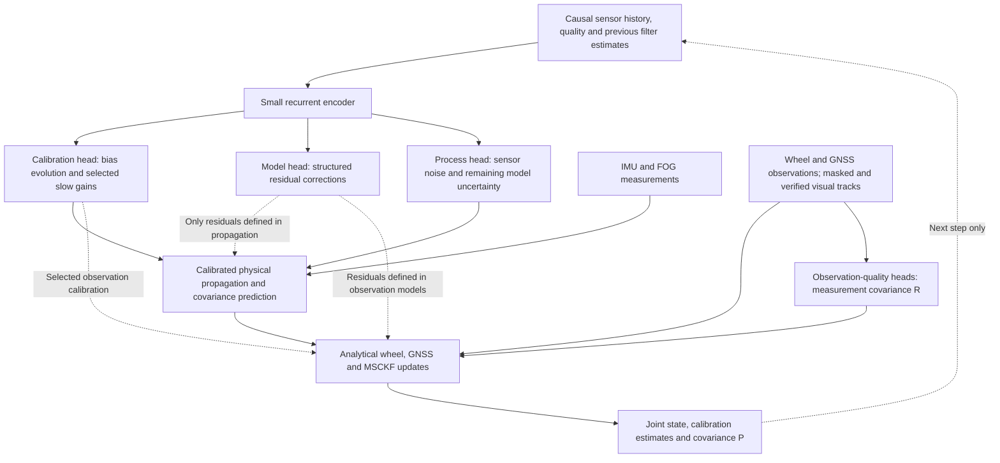

# Calibration ownership and learned-module interfaces

Discussion proposal, 14 November 2026. **Backend locked by the user:** error-state EKF with tightly coupled MSCKF-style feature-track updates, bounded recent rig-pose history, temporary 3D feature geometry and no persistent map or loop closure initially. Five planar navigation outputs, internal tilt-aware attitude, IMU/FOG propagation, wheel/GNSS/visual updates, frozen visual networks and three logical learning roles remain agreed.

**Locked now:** shared GRU/head organization and clocks, persistent causal memory, sequence-mini-batch training with online MSCKF inference, wheel-slip design, pilot outputs/ownership **as written**, initialization/reset/recovery, [baseline estimator mathematics](./estimator-mathematics.md), initial numerical/visual settings and [training goals with event-aware regularization](./training-objectives.md). The limited experiment is a **pilot**, while the **full supported inventory remains the planned research target**. Lateral no-slip is committed subsequent in-project work; deeper linearization/data-driven modelling is the final design discussion. The [training protocol](./training-protocol.md) is accepted; evaluation/comparisons and implementation/compute are accepted; the rollout order is accepted; current discussion is [model learning and Gemma 4](./model-learning-and-gemma4.md). Configuration, exact input features, physical bounds and training truncation remain tunable. No implementation/training has begun. Equations use plain text.

## Ownership principle

The estimator owns navigation states, persistent estimated calibration states, their joint covariance P and the analytical correction gain K. Networks parameterize selected state-evolution models, physical observation/transition residuals and process/measurement noise models. Offline calibration owns quantities that are nominally fixed in the first experiment. Do not maintain two unrelated estimates of the same bias and subtract both.

```text
predicted_bias = previous_bias + learned_bias_drift(history) * dt
corrected_sensor_value = inverse(scale_matrix) * (measurement - predicted_bias)
```

The filter then jointly updates supported calibration states and navigation from trusted observations. The network need not replace the total bias every sample. Gains remain fixed or adapt slowly under sufficient excitation. A drift output uses bias-per-time units; simply adding it without time scaling would change the model when sampling changes. The current sensor vectors have already passed internal device processing; estimated errors refer to those released channels.

This follows the physical separation between sensor bias/scale, inertial propagation and state covariance in [OpenVINS' measurement models](https://docs.openvins.com/propagation.html). Neural drift and noise modulation are project proposals, not claimed stock OpenVINS functionality. Planar data may not identify all scale/misalignment parameters; priors and an observability check are needed.

## Updated proposed flow



This shows logical interfaces, not a decision to enable every branch. The initial wheel-model residual goes to the wheel update, not also to inertial acceleration. Existing frozen segmentation, SuperPoint and LightGlue are upstream of the visual-track input. Learned observation heads consume available local quality information plus permitted history; they do not receive test reference labels. The gain K and covariance P are computed by the filter.

## Proposed inventory

| Quantity | Units/frame | Initial ownership and evolution | Neural contribution / injection point |
|---|---|---|---|
| Accelerometer bias, three axes | m/s^2 in released IMU axes | Persistent filter states, initialized from declared nominal/offline/sensor-only priors | Bounded predicted drift; affects corrected specific force before physical propagation |
| Gyroscope bias, three axes | rad/s in released IMU axes | Persistent filter states with priors | Bounded predicted drift; affects angular increments before joint IMU/FOG propagation |
| FOG rate bias, one axis | rad/s about FOG sensing axis | Persistent slow filter state with prior; not the arbitrary initial angle | Analytical evolution in pilot; learned drift planned after bias identifiability review |
| Accelerometer/gyro gains, three each; FOG gain, one | Dimensionless, sensor-axis calibration | Nominal/offline fixed first; selected gains may later become slow supported calibration states | Candidate bounded parameter evolution, not seven freely varying per-sample outputs; first online gain axes remain a discussion item |
| Wheel speed scale | Dimensionless | Start with one common offline calibration factor; independent left/right scales require justified geometry/excitation | Slow online adaptation planned after pilot; avoid simultaneous free scale drift and wheel residual fitting the same effect |
| Wheel-model mean residual | m/s, wheel forward-speed relation | Network-owned structured observation-model correction | First model-residual candidate: effective error in the wheel-speed/body-speed relationship; not automatically uniquely identifiable slip |
| IMU sensor-noise intensity, three accel and three gyro axes | Sensor-frame continuous-time noise intensity with stated convention | Fixed baseline calibrated on training data; filter discretizes/maps to state noise | Bounded positive axiswise multipliers; enter propagation, not direct independent observation updates |
| FOG interval-noise model | Rotation-increment covariance in rad^2 for a specified interval | Baseline angle/increment model with timing/correlation treatment | Bounded reliability multiplier; enters angular fusion and propagation without treating differenced integrated angle noise as independent white rate samples |
| Bias evolution uncertainty | Noise driving persistent bias-state evolution | Baseline slow random-walk/dynamics uncertainty | Separate bounded process multipliers if justified; do not confuse this with sensor sample noise |
| Remaining process/model uncertainty | Explicitly selected state-driving channels | Fixed structured baseline after accounting for measured input noise | Small set of positive multipliers for residual mismatch; no unconstrained full-state covariance prediction initially |
| GNSS observation covariance | m^2 in local North/East coordinates | Two-dimensional position observation noise | Quality head predicts a positive 2x2 block or initially two variances; no free GNSS bias state initially |
| Wheel observation covariance | (m/s)^2 for chosen speed/constraint channels | Noise on wheel-speed observations and optional soft kinematic constraints | Wheel-quality head; adapt once per observation, including slip/unreliable-contact indicators |
| Visual observation covariance | Pixel^2 or bearing units, matching the residual definition | Covariance of retained feature observations | Shared visual-quality head with camera/track inputs; first candidate is a bounded scalar multiplier of a baseline 2x2 feature covariance. Transform through MSCKF projection/compression; not a fabricated 5D navigation covariance |
| Camera/IMU/FOG mounting, intrinsics, GNSS lever arm and time offsets | Geometry and seconds | Published/verified offline calibration initially | No unrestricted online neural correction in version one; timing/geometry faults should not be silently absorbed into sensor bias |
| Gravity and initialization orientation | Physical navigation convention and initial-state uncertainty | Analytical model and declared initialization | No arbitrary gravity vector learner; no hidden vendor-heading/magnetic input when claiming magnetic exclusion |
| Navigation state, full state covariance P and Kalman gain K | State-dependent | Analytical error-state EKF/MSCKF | Not directly predicted by a neural replacement head |

This is an inventory, not an instruction to activate every row's optional neural output. Even maintaining all six IMU bias states does not imply independent identifiability of every bias under all motion. FOG/IMU bias difference can be better constrained than their individual absolute errors; selected priors/external measurements must be justified.

## Actuator and environmental effects

**Actuator:** NCLT supplies wheel speeds, not a verified independent command/current/torque channel for the proposed model. Wheel speed scale, wheel-to-ground kinematic mismatch and actuator torque gain are different quantities. In IMU/FOG-driven propagation, motor-induced motion is already sensed; no independent actuator transfer function has yet been identified. Keep a future actuator-gain/dynamics module conditional on suitable inputs, potentially using the optional VID/racing-car data. Do not label a wheel residual as measured actuator bias. [NCLT sensor and odometry documentation](https://robots.engin.umich.edu/nclt/nclt.pdf).

**Environment:** environmental conditions enter through the relation they affect. Rough terrain/vibration can affect inertial noise or integration mismatch; slip affects wheel mean/noise; multipath affects GNSS; dynamic objects/lighting affect visual validity/noise. Remaining disturbance uncertainty can enter structured process Q. There is not automatically an identifiable separate wind/terrain covariance. IMU acceleration already reflects external physical forces; adding another wind acceleration/covariance for that same measured effect can double count it. Q adaptation describes residual prediction error under the chosen model. For identifiable actuator/tire dynamics and friction learning with suitable data, the [2024 racing UKF study](https://arxiv.org/html/2408.15610) is a relevant future reference.

## Locked network organization; remaining implementation details

Use **one modular learned subsystem with a shared recurrent encoder and separate heads**, as accepted by the user:

- A small causal GRU receives numerical IMU/FOG/wheel history, time intervals, available prior filter context, past trusted innovations and sensor availability/age. Hidden size and training truncation remain open; causal memory is persistent.
- Separate output heads for sensor-parameter dynamics, structured model residuals and process-noise modulation. Output-specific bounds and smoothness let them share useful history without forcing all quantities to change at the same rate.
- Lightweight observation-specific quality heads for GNSS, wheel and visual updates. They consume current local quality information and permitted recurrent context only when that observation exists. A visual head can share weights across cameras with camera/quality context; no dense-image encoder is needed beyond the frozen visual networks.
- Export independently switchable heads so all ablations use the same nominal filter and observations. Split encoders later only if joint training demonstrably causes interference or separate cadence/history needs justify it.

Shared encoding, GRU, separate heads, execution clocks and persistent memory are locked; hidden size, feature vectors and training truncation remain tunable. The three main roles are sensor adaptation, model residual and process uncertainty; the observation-quality heads supply measurement uncertainty. A shared encoder is not a performance guarantee. Discrete masks, matching and RANSAC stay outside the differentiated training path initially; cache causal outputs and train the estimator-side subsystem through a consistent filter where feasible. No online backpropagation/weight updates are required at evaluation.

## Process Q, measurement R and estimate P

- Sensor noise used as a propagation input contributes to process Q after physical mapping/discretization. It does not become R merely because it originated from a sensor.
- R describes uncertainty in an observation at a correction event. The visual R refers to image/bearing observations before consistent elimination of feature nuisance quantities.
- P describes joint uncertainty in navigation and calibration estimates. The analytical filter propagates/corrects P from the model, Q, R and cross-covariances. Predicting Q/R does not imply predicting P or K directly.
- Initialize noise adaptation as a multiplier of a reasonable positive baseline (one means unchanged), with positive floors and finite bounds. A covariance's positive definiteness is necessary but does not prove it is calibrated.
- Separately increasing IMU input noise and a general residual Q to explain the same error can be redundant; choose explicit noise channels and isolate contributions in ablations. Q and R cannot generally be uniquely identified from trajectory loss alone.

## Causality, uncertainty and training requirements

Propagation heads use only information available at that propagation event. Observation heads may use current observation metadata and pre-update residuals if explicitly designed, but never the posterior produced by the very update being computed. Reusing an innovation to set its weight is adaptive robust inference, not an independent measurement; conservative gating/baselines and calibration checks are required.

State-dependent learned means need Jacobians consistent with the combined model. Maintain joint bias/navigation uncertainty and prevent untrusted moving-object residuals from driving calibration changes. The accepted pilot conditions on causal GRU memory without augmenting every hidden unit into covariance; this approximate treatment does not fully propagate hidden-state/cross-time error. Bounds and learned Q/R alone do not solve that limitation. Deeper linearization/data-driven modelling is reserved for the final design discussion.

NCLT's pose reference supports navigation supervision; it is not ground truth for sensor gains, biases, actuator parameters or per-sample covariance. Use trajectory/heading losses, declared derived-velocity treatment, parameter priors/smoothness, innovation/uncertainty calibration checks and held-out recording days. Covariance learning needs calibration-aware objectives or validation so it cannot merely ignore observations or inflate uncertainty to hide mean error. Exact losses remain open.

## Agreed pilot and full research target

After the fixed-model/noise classical baseline is validated, activate a limited set:

1. IMU bias-drift head, with FOG bias retained as an analytical slow state initially.
2. One forward wheel-model residual; keep wheel scale fixed for this initial test.
3. Observation-noise multipliers for wheel, GNSS and visual measurements; preserve nominal sensor/process noise for the first ablation, then add structured process-noise adaptation separately.

**The pilot is not the final scope.** We plan to pursue and evaluate the full supported set: sensor bias/gain adaptation, FOG calibration adaptation, wheel scale/model mismatch, sensor/process-noise adaptation and GNSS/wheel/visual observation uncertainty. Staging isolates failure causes and contributions; it does not quietly remove planned components. A component found unidentifiable or unsupported should have its evidence recorded and its treatment revisited with the user, rather than silently promoted to an unconstrained network output. All heads need not run simultaneously in every experiment or deployment.

Existing data boundaries remain: no verified NCLT actuator command/torque input, no uniquely identified wind covariance, no automatic online calibration of every camera/extrinsic/time parameter. These require appropriate data/models and are not made identifiable by the full-target commitment.

## Wheel slip: event, mean correction and uncertainty

**User-accepted wheel-slip design:** diagnostic suspected-slip events plus continuous wheel reliability, a bounded mean residual where useful, covariance inflation for reduced reliability, hard rejection for unusable observations and recovery hysteresis. This does not add a separate mandatory slip-classification network. Numerical thresholds and detailed channel handling still require implementation/validation choices.

| Situation | Estimator action | Interpretation |
|---|---|---|
| Consistent, useful wheel signal | Normal observation update with calibrated noise | Strong wheel constraint |
| Moderate uncertainty or plausible slip | Increase affected wheel/constraint covariance smoothly | Retain information while reducing influence |
| Predictable systematic wheel/body-speed mismatch | Apply bounded mean correction and model uncertainty remaining after correction | The residual head corrects bias in the observation relation, not merely its weight |
| Severe inconsistency, contact loss or invalid readings | Reject the affected observation/constraint until recovery | Skip the update explicitly rather than rely on numerically enormous covariance |

The mean residual and covariance must have one convention:

```text
predicted_wheel_measurement = nominal_wheel_model(predicted_state)
                             + learned_wheel_model_error
innovation = measured_wheel_speed - predicted_wheel_measurement
R_wheel = baseline_wheel_covariance * positive_reliability_multiplier
```

The covariance describes remaining error under the corrected model; increasing it reduces influence but does not remove a systematic mean error. A nonlinear residual can compensate for slip-related effects without uniquely identifying physical slip. The **locked pilot wheel residual** is one scalar in m/s in the forward-speed relation, with wheel scale fixed to reduce confounding. It is not a claimed left/right slip ratio or lateral-slip estimator.

Use a wheel-unreliability score, observation quality and standardized pre-update discrepancies to drive a suspected-slip diagnostic with hysteresis/recovery criteria. Do not label an uncalibrated score a slip probability. Gate using the state prediction before the current wheel update, and account for prediction uncertainty; historical wheel influence means the prior is not fully independent. Independent visual/GNSS information and FOG/IMU turning/acceleration consistency can corroborate discrepancies, but large residuals can also be caused by timing or geometry errors. Common-mode straight-line slip can be hard to detect when external velocity information is unavailable, especially at steady speed. Avoid circular gating that first lets an arbitrarily inflated learned R conceal every discrepancy.

Apply rejection/inflation to the affected channels. **Implement/investigate a soft lateral no-slip pseudo-observation after the forward-speed pilot within this project.** Relax or disable that constraint during suspected lateral sliding; dropping forward speed alone does not remove the false lateral constraint. Compare it on/off and evaluate slip sensitivity. A pilot with only one combined forward-speed observation cannot selectively reject one wheel while claiming the other is fully isolated; per-wheel handling requires explicitly modeled per-wheel observations/geometry.

NCLT has no established independent slip-event labels in our audit. Evaluate navigation error, heading/velocity behavior, calibration transients, update acceptance, uncertainty consistency and recovery. Annotated suspected events and controlled wheel corruptions can aid testing, but do not constitute physical slip ground truth. Classifier precision/recall requires defensible labels.

Literature examples illustrate both strategies: [Odometry 2.0, 2019](https://www.fast.kit.edu/lff/12080_12082.php) removes a slipping wheel's information contribution, while [Visual-Inertial-Wheel Odometry with Slip Compensation and Dynamic Feature Elimination, 2025](https://pmc.ncbi.nlm.nih.gov/articles/PMC11902339/) learns slip compensation using Gaussian-process regression. These are supporting examples, not experiments reproduced here or universal superiority claims.

## Locked pilot outputs and ownership

The user accepted the following pilot specification **as is**. These are settled choices, not outstanding questions:

| Pilot output | Locked size/meaning | Ownership / timing |
|---|---|---|
| IMU bias evolution | Six bounded drift components: three accel and three gyro | Filter retains six biases; head predicts drift from causal history, integrated with elapsed time |
| Wheel-model mean error | One bounded scalar, m/s in the forward-speed observation model | Model-residual head; evaluate at a wheel update; wheel scale fixed during this pilot |
| GNSS uncertainty | Two positive multipliers for North/East baseline variances | GNSS quality head at a valid fix; diagonal first, correlations remain a later target |
| Wheel uncertainty | One positive multiplier for the pilot scalar forward-speed observation | Wheel quality head; combine with an explicit invalid/severe-outlier rejection policy |
| Visual uncertainty | Shared head outputs one positive multiplier per accepted feature-observation 2x2 baseline block | Camera/track quality at a visual update; transform covariance through MSCKF operations |
| General process uncertainty | Fixed calibrated baseline in pilot's first ablation | Process head remains part of the agreed architecture/full target and is activated in the next staged experiment |

These dimensions and ownership choices are **locked**. Physical IMU bias states remain in the filter; learned dynamics predicts their drift. Gains stay nominal/offline in the pilot and enter planned subsequent stages. FOG bias remains an analytical slow state in the pilot. Hidden sizes and numeric bounds are not selected. Propagation heads use prior/trusted history, not posterior information from the current update. Observation heads receive valid metadata, age and pre-update context; no ground-truth or future information at inference.

**Input/history/timing locked:** numerical sensors plus previous estimator context; one forward GRU updated on IMU events using actual elapsed time; bias-drift head on that clock; wheel/GNSS/visual heads on their observation events; persistent causal memory and common timestamp alignment. Train on independent sequence mini-batches while retaining the online MSCKF backend. Exact vector construction, hidden size and numeric settings remain tunable. Initialization/reset/recovery and baseline mathematics are also locked; current discussion is numerical/network settings below. The ordered checklist is in [the decision record](./project-decisions.md#remaining-decisions-in-order).

## Common timestamps, separate execution rates and mini-batches

NCLT logs sensor data on a common computer/timestamp basis, but streams have different acquisition rates and synchronization characteristics. FOG uses message-arrival timestamps; common time units are not a guarantee of perfect hardware simultaneity. Use timestamps/elapsed time for alignment, not row index or a fictitious simultaneous sample grid. [NCLT Section 5.5](https://robots.engin.umich.edu/nclt/nclt.pdf).

**User-accepted scheduling policy:**

| Component | Trigger | Inputs available for that event |
|---|---|---|
| Shared recurrent encoder and IMU bias-drift head | Each IMU sample | Current sensor-frame IMU values, FOG rotation aggregated over the completed compatible interval, latest wheel information with age/masks, and prior estimator context |
| Wheel residual/quality heads | Wheel observation | Latest causal shared memory plus current wheel values and local consistency/age features |
| GNSS quality head | Valid GNSS fix | Shared context plus current fix metadata and declared pre-update information |
| Shared visual quality head | Available visual observations | Camera/track quality for the relevant image timestamp and corresponding causal shared context |

The observation-specific heads can initially be small feed-forward heads; they need no separate recurrent clocks or hidden states. If sensor-specific recurrent memory is later justified, it would update on that sensor's events. This does not change the agreed shared recurrent core. Actual physical filter propagation/update scheduling remains asynchronous and independent of neural execution frequency.

For delayed images, preserve acquisition timestamps and account for processing delay. Associate visual observations with the matching retained rig poses. A proposed conservative implementation caches encoder context at acquisition time for delayed quality evaluation. Do not relabel a late image with its processing-completion time or silently score a retrospectively corrected past pose as an original online output. Detailed delayed-update handling belongs to the estimator implementation.

**GRU locked:** one forward causal GRU carrying memory between events. Different clocks for heads mean different invocation rates, not incompatible physical time. Passing elapsed time and input age makes irregular timing explicit; it does not by itself solve all continuous-time hidden-state uncertainty questions.

Distinguish mini-batching concepts:

- **Training mini-batches:** parallel independent sequence chunks, each with its own recurrent and filter state/covariance. Run the recursion in timestamp order within each sequence. Padding/masks must not introduce artificial observations. Carry memory only along the same contiguous sequence; detach gradients at truncation boundaries as specified by training. This is compatible with the locked online filter and persistent GRU memory.
- **Sliding-window joint estimation:** repeatedly optimize several recent states together, as in a nonlinear fixed-lag smoother. A GRU can still be used, but this changes the chosen backend. The locked MSCKF already retains past poses for multi-frame constraints; it does not run that joint nonlinear window optimization. Current-state estimation with a past-only window can still be causal.

**Locked:** error-state EKF/MSCKF for online inference, mini-batched independent sequences for training. A joint nonlinear optimization backend remains a possible later comparison, not a replacement selected by the mini-batch discussion. [OpenVINS sliding-window filter description](https://docs.openvins.com/), [GRU batch/state interface](https://docs.pytorch.org/docs/stable/generated/torch.nn.GRU.html).

## Initialization, resets and recovery — locked

The user accepted the following policy. Numeric stationarity/warm-up/gap thresholds can be tuned during implementation.

### Startup options

| Mode | Definition | Recommendation |
|---|---|---|
| Controlled benchmark initialization | Supply an explicitly declared initial pose prior, identical for analytical and learned comparisons. A reference-assisted pose is permitted only as a disclosed experiment condition, with no further reference feedback | Use for the first pilot to isolate estimator/head effects; do not claim fully sensor-only startup from these runs |
| Sensor-only initialization | Use validated GNSS for position, gravity/IMU information for tilt, and motion/visual-inertial or declared external information for heading/velocity | Separate deployable mode; start with stationary initialization when available, support or explicitly report moving-start limitations later |

The controlled prior specifies pose, not unknown true sensor biases/gains or an ongoing reference trajectory. Initialize velocity from available sensor evidence; zero velocity only after confirming stationarity. Use nonzero initial covariance reflecting the declared prior quality. If the controlled pose prior supplies orientation, do not secretly add reference-derived velocity or bias initialization.

For sensor-only startup, static gravity observations constrain tilt but not north-referenced yaw; FOG gives relative rotation. Heading can become constrained through sufficient reliable GNSS displacement and compatible body-motion information, or a declared heading prior. Course is not automatically body heading during reverse motion or slip. Do not silently label an arbitrary local yaw as a known global heading. Full accelerometer gain/bias calibration is not identifiable from a single stationary orientation. [OpenVINS static initializer](https://docs.openvins.com/classov__init_1_1StaticInitializer.html), [dynamic initializer](https://docs.openvins.com/classov__init_1_1DynamicInitializer.html).

Initialize biases from nominal/offline priors and supported stationary statistics; retain uncertainty where these do not identify a component. Pilot gains/wheel scale remain fixed. Start GRU hidden memory at zero, then use a configurable causal warm-up/ramp: sensor history is consumed while learned mean corrections default to zero and covariance multipliers to one, with normal baseline-filter operation. Train/validate the same cold-start policy. Warm-up is not a reason to silently discard difficult startup periods from evaluation; declare scoring intervals for every comparator.

### Reset and recovery policy

| Event | Locked action |
|---|---|
| Normal GNSS/vision/wheel/FOG gap | Retain navigation, bias estimates and GRU memory; use availability/age, valid remaining sensors and covariance growth. Use IMU gyro fallback when FOG is absent |
| Returning observations | Gate and reintroduce valid measurements with their uncertainty; no automatic pose jump/reset merely because a sensor returned |
| Visual tracking failure | Restart affected feature tracks/camera tracking; retain navigation/calibration and GRU state. Marginalize/remove obsolete visual history consistently rather than erase healthy shared-camera information |
| Confirmed stationary interval | Permit supported zero-velocity/bias refinement; this does not reset the estimator or prove all calibration parameters observable |
| Unrecoverable propagation gap, timestamp discontinuity or numerical failure | Log a hard failure and reinitialize affected estimator state, covariance, visual history and GRU coherently. Preserve only justified fixed calibration/verified priors; do not restore pose from evaluation ground truth |
| New independent recording | Reset estimator, visual history and GRU; no hidden-state transfer from an unrelated recording |
| Contiguous training chunk boundary | Carry state/memory as specified by training; detach gradients for truncation without treating this as a physical reset. Independent/shuffled chunks require independent initialization or a declared causal warm-up/checkpoint |

Ordinary uncertainty growth alone is not automatically numerical divergence. IMU loss requires a validated propagation fallback or a declared stop/reinitialization; arbitrary long integration using the last sample is not the default. Hard resets and lost intervals count in failure/recovery evaluation, and segment/frame changes must not conceal trajectory error. Bias-consistency recovery mechanisms remain covariance-consistent with the locked backend.

Accepted policy: **controlled common initial pose prior for the pilot; a separately labeled sensor-only startup mode; conservative calibration/uncertainty priors; zero GRU memory with baseline warm-up; preserve state through ordinary gaps; local visual resets; full coordinated reset only for new sequences or unrecoverable failures.** The subsequent [baseline state/sensor/noise mathematics](./estimator-mathematics.md) has also been accepted.

## Numerical constraints and network configuration — working settings

**Accepted initial settings, adjustable during implementation.** Use two GRU layers with 64 hidden units per layer, at least two layers requested, the small separate heads, bounded signed means, baseline learned-output initialization and the agreed precision. Bounded observation variance is a working policy with explicit severe-slip rejection; its numerical range remains tunable. [Training goals](./training-objectives.md) are accepted with event-aware regularization so legitimate fast reliability/residual responses are not suppressed. No claim of measured M5 performance or an optimal architecture.

| Choice | Initial recommendation | Reason / alternative |
|---|---|---|
| Shared encoder | **Accepted starting point: two forward GRU layers, 64 hidden units per layer; user requests at least two layers** | Depth/width can be adjusted while building. Persistent causal memory/timing already locked |
| Output heads | One 32-unit hidden layer per head, followed by the required output layer | Small separate heads preserve the agreed roles; a deeper/larger head is a later measured adjustment |
| Learned means | Smooth bounded outputs, such as a tanh scaled separately in each physical channel | Avoid unconstrained bias drift and wheel residual. Choose physical limits from sensor specifications, supported training-only statistics and validation; raw acceleration variation does not itself identify bias drift |
| Observation covariance | Smooth bounded positive multipliers, initialized at 1; provisional variance range 0.25–25 times the baseline, with positive baseline floors | Allows standard deviations of 0.5–5 times baseline. This is a starting search range, not a measured NCLT optimum. Review per sensor on validation; severe invalid data still use rejection rather than unlimited inflation |
| Initialization and normalization | **Accepted:** initialize mean-head final outputs to zero and covariance-head outputs to 1; use fixed training-only numerical normalization | Begin at the matched analytical baseline; preserve existing causal warm-up, real dt, availability and age masks |
| Arithmetic | **Accepted:** Float64 CPU filter/covariance; Float32 learned module as an initial implementation target | Prioritize robust covariance arithmetic and easy debugging; preserve differentiable casts if training through the filter. Hardware/runtime decisions and actual profiling follow |
| Noise and gates | Calibrate a positive fixed-noise baseline; tune gates, recovery times and output limits on train/validation only | No invented universal sensor-noise numbers or test-reference-based adaptation. Gating must not become circular through a freely inflated learned covariance |

These are bounded starting settings, not a commitment to a broad hyperparameter sweep. Exact normalization vectors, physical limits and noise/gate values are implementation/calibration work. The process-uncertainty head remains inactive for the first pilot ablation. GRU size/layer controls are documented in [PyTorch's GRU API](https://docs.pytorch.org/docs/2.15/generated/torch.nn.GRU.html); the proposed sizes and bounds are our engineering defaults, not a published optimum.

### Signed means and bounded variances

Scaled tanh is convenient for signed bias drift and wheel mean residuals: its output is centered at zero and permits either sign. A scaled, centered sigmoid is equally valid after rescaling its input:

```text
signed_output = limit * tanh(raw)
             = limit * (2 * sigmoid(2 * raw) - 1)
```

An ordinary positive scaled sigmoid alone cannot represent both signs. Neither activation is inherently superior here. Positive variance heads have a different range and may use a shifted/scaled sigmoid or bounded log-variance mapping initialized to multiplier 1.

Finite covariance bounds are an engineering constraint, not a mathematical requirement of EKFs. They limit extreme observation weights and reduce uncontrolled tradeoffs between learned means and uncertainty. They do not establish statistical calibration. The provisional 0.25–25 variance range applies to accepted inlier measurements; moderate unreliability may inflate variance and severe slip/invalid observations are explicitly rejected. Inspect bound saturation on validation and widen/revise per channel if justified. AI-IMU uses a bounded log-covariance adapter as a relevant precedent, with a much wider range; its values are not a calibration for NCLT. [AI-IMU, IV-A/IV-B](https://arxiv.org/html/1904.06064).

**Regularization policy accepted:** distinguish slow physical calibration from fast observation reliability. Reduce/remove change penalties on the affected quality/residual channels during supported degradation; allow immediate variance increases/rejection and guarded recovery. Skip missing visual updates and preserve the filter state through ordinary gaps. Detailed policy and training checks are in the [training note](./training-objectives.md#accepted-caveat-allow-rapid-responses-to-real-degradation).
