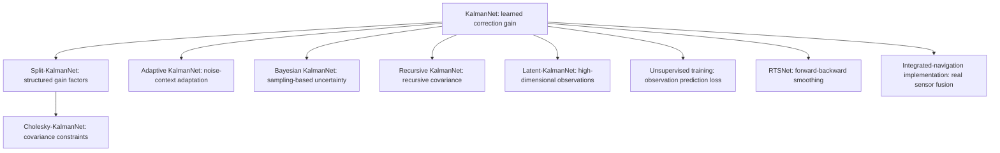
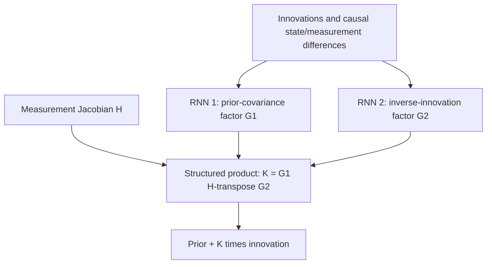
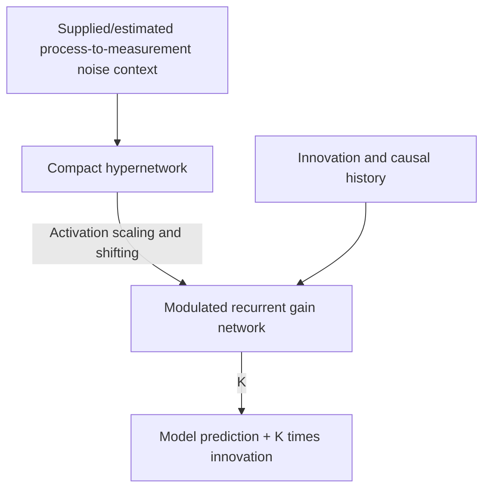
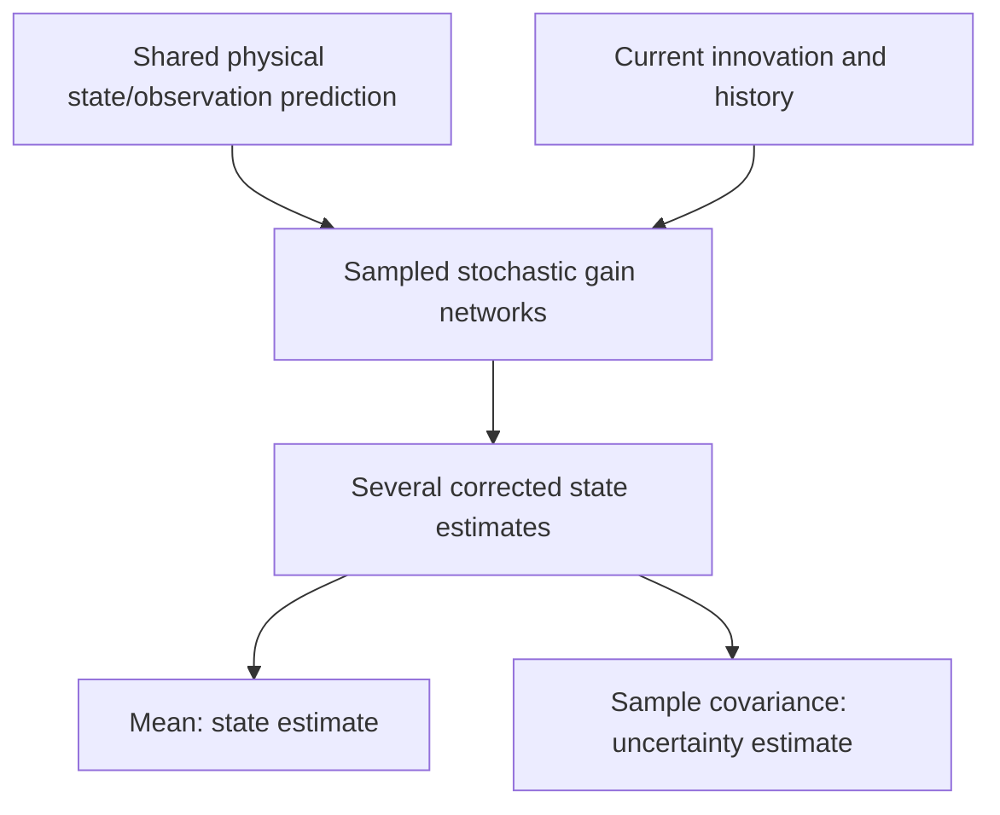
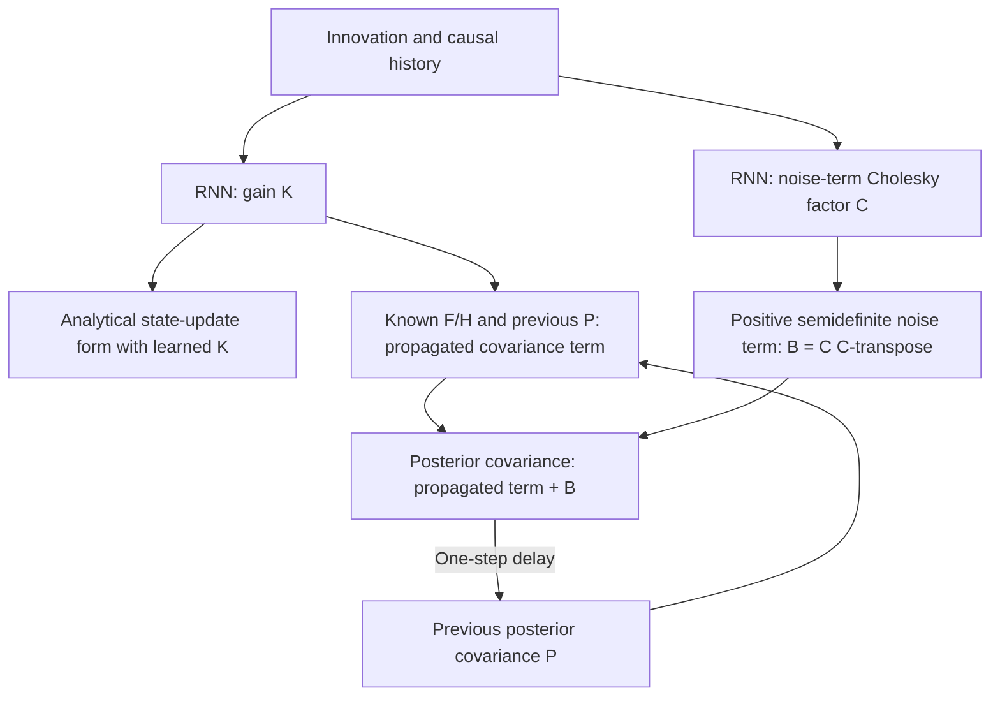

# KalmanNet variants and later models

Research checked: 13 November 2026. The user clarified that the intended discussion concerns KalmanNet variations and subsequent models, rather than predecessors. This is a targeted reading guide, not a systematic ranking or a reproduced benchmark.

Project constraints: **NCLT first**, frozen SuperPoint + LightGlue initially where cameras are used, analytical Kalman gain/correction in the primary architecture, and a physical state-estimation objective. Reviewing gain-learning methods does not select them for implementation. VID indoor and the 2024 racing-car dataset are optional future work. Physical/model-parameter and linearization discussion has resumed in the [NCLT modeling note](./nclt-modeling-options.md).

**Subsequent dataset/related-work audit:** see [benchmark data and prior work](./benchmark-data-and-novelty-audit.md) for verified training/test sessions and synthetic versus real-data use. The user has selected NCLT and explicitly removed novelty as a project requirement; related methods inform implementation and comparison.

## How to interpret success

The evidence below distinguishes reported improvements in a paper's experiments from demonstrated superiority on a shared drone/car benchmark. Publication in a strong venue, a synthetic navigation model, public code, and independent real-world validation are different evidence. Neither author-reported results nor this reading pass establish a universally best successor.

Read the state vector, actual observation channels, reference construction, initialization, train/test split and causality before adopting any result. In particular, a velocity-only NCLT experiment does not establish externally corrected navigation; a smoother is not a zero-delay filter. No method below has been executed locally.

## Main branches

The original KalmanNet paper itself contains two internal designs: a simpler recurrent gain network and a structured three-GRU design associated with Q, prior covariance and innovation covariance. Both ultimately learn K; naming hidden features after covariance quantities does not make them calibrated covariance outputs. These internal variants should be distinguished from separate follow-up papers. [Original paper, section III-C](https://arxiv.org/html/2107.10043).

The arrows group research directions. They do not assert that every method is a direct revision of the node above it or that later dates imply better performance.



## Evidence and architectural comparison

Dates use publication years, with preprint/online dates qualified where useful.

| Work | What changes | Reported validation / evidence boundary | Relationship to our primary design |
|---|---|---|---|
| **Split-KalmanNet**, IEEE TVT **2023** | Two recurrent modules learn prior-covariance and inverse-innovation-covariance factors, combined with the measurement Jacobian | Circular-motion simulations and NCLT; reports benefits over EKF/KalmanNet under noise/model mismatch. NCLT input is noisy odometry velocity, not independent position correction. [Paper](https://www.weizmann.ac.il/math/yonina/sites/math.yonina/files/Split-KalmanNet_A_Robust_Model-Based_Deep_Learning_Approach_for_State_Estimation.pdf), [author code](https://github.com/geonchoi/Split-KalmanNet) | Particularly relevant structural comparator; learned factors are not automatically conventional propagated covariances |
| **Adaptive KalmanNet**, ICASSP **2024**, preprint 2023 | A compact hypernetwork modulates the gain network using a scalar noise-context variable | Linear Gaussian/non-Gaussian simulations, unseen noise settings and abrupt changes. The context ratio must be supplied/estimated; this is not autonomous identification of arbitrary physical parameters. [Paper](https://arxiv.org/html/2309.07016), [author code](https://github.com/KalmanNet/Adaptive-KNet-ICASSP24) | Useful adaptation idea; published method still learns K |
| **Practical Implementation of KalmanNet for Accurate Data Fusion in Integrated Navigation**, IEEE SPL **2024** | Applies KalmanNet to navigation fusion and improves training with truncated backpropagation through time | GPS/wheel/IMU fusion on NCLT; authors report 20–40% average-RMSE improvements over their conventional EKF fusion baseline. Exact configuration/reference/splits need a full benchmark audit before reuse. [Publisher abstract](https://xplorestaging.ieee.org/document/10605082/), [official code](https://github.com/SongJgit/KalmanNet4SensorFusion) | More directly relevant to real navigation than the original velocity-only example; not a replacement for our analytical-K decision |
| **Cholesky-KalmanNet**, IEEE SPL **2025** volume, DOI/online lineage 2024 | Adds Cholesky-based constraints to covariance-related outputs and a covariance-aware training loss | Author manuscript reports synthetic and real-data improvements. Architecture/method excerpts inspected; the complete experiment inventory was not recovered in this pass. [NSF-hosted author manuscript](https://par.nsf.gov/servlets/purl/10656999), [DOI](https://doi.org/10.1109/LSP.2024.3519265) | Relevant to valid covariance outputs; positive definiteness alone does not establish calibration or consistent Riccati recursion |
| **Bayesian KalmanNet**, IEEE TSP **2025**, preprint 2023, ICASSP precursor 2024 | Stochastic gain networks produce multiple state estimates; their spread supplies an uncertainty estimate | Linear, pendulum and simulated 2D constant-velocity navigation examples; compares tracking error and covariance consistency. Sampling adds inference work. [Paper](https://arxiv.org/html/2309.03058), [published DOI](https://doi.org/10.1109/TSP.2025.3581703) | Important uncertainty reference; gain remains learned |
| **Recursive KalmanNet**, EUSIPCO **2025** | One RNN learns K; another learns a Cholesky factor of the noise-dependent term in a Joseph-form covariance recursion; trains with Gaussian NLL | Synthetic 1D constant-velocity tracking with position measurements and bimodal measurement noise; compares against KF/Cholesky-KalmanNet and assesses covariance consistency. [Paper](https://arxiv.org/html/2506.11639), [author code](https://github.com/ixblue/RecursiveKalmanNet) | Relevant covariance-recursion reference; it still predicts K directly |
| **Latent-KalmanNet**, IEEE TSP **2024**, preprint 2023 | Jointly learns an observation encoder and KalmanNet, including prior-aided encoding | High-dimensional observation experiments, including rendered pendulum/Lorenz settings; studies estimation and runtime. This is not a demonstrated full stereo VIO system. [Preprint](https://arxiv.org/html/2304.07827), [published version](https://pure.tue.nl/ws/files/353827833/Latent-KalmanNet_Learned_Kalman_Filtering_for_Tracking_From_High-Dimensional_Signals.pdf) | Its learned visual-encoder training is beyond our initial frozen-vision route |
| **RTSNet**, IEEE TSP **2023**, ICASSP precursor 2022 | Learns forward/backward smoothing gains and unfolds repeated refinement | Linear/kinematic simulations, Lorenz and Van der Pol; reported improvements over smoothing baselines. Uses future measurements. [Paper](https://arxiv.org/html/2110.04717), [author code](https://github.com/KalmanNet/RTSNet_TSP) | Possible offline comparator/reference; does not satisfy a causal zero-delay filtering contract as written |

## Flowcharts for the main changes

### Split-KalmanNet

The defining factorization is

```text
K[t] = G1_theta(history) * transpose(H[t]) * G2_phi(history)
```

with G1 and G2 intended to represent prior covariance and inverse innovation covariance. The original outputs are learned implicitly through estimation loss. Do not assume that G2 is formed as the inverse of H P-minus H-transpose + R, or that both outputs are automatically calibrated positive-definite covariances.



This is closer to an analytical gain structure than direct regression of K, but remains different from learning physical model/Q/R parameters and computing all covariances through a conventional filter. Cholesky-KalmanNet adds constraints/training aimed at making covariance-related quantities usable. [Split-KalmanNet method](https://doi.org/10.1109/TVT.2023.3270353), [Cholesky-KalmanNet method](https://par.nsf.gov/servlets/purl/10656999).

### Adaptive KalmanNet



Adaptation here is context-conditioned inference; it is not necessarily online gradient training. The scalar SoW summarizes relative process/observation noise scale in the paper's setting. Physical sensor gains and this network's modulation scales are different quantities. [Adaptive KalmanNet](https://arxiv.org/html/2309.07016).

### Bayesian KalmanNet



The studied implementation uses Monte Carlo dropout and multiple network realizations. Uncertainty is empirically estimated, rather than guaranteed correct by the Bayesian label. The paper tests calibration and inference cost; our application would need the same. [Bayesian KalmanNet](https://arxiv.org/html/2309.03058).

### Recursive KalmanNet

This **2025 Recursive KalmanNet is distinct from the 2019 Recurrent Kalman Network**, despite their shared RKN acronym.



Its useful distinction is learning the unknown noise contribution while retaining covariance recursion, rather than predicting an unrelated covariance at every sample. Its K is nevertheless neural, so the published architecture is outside our primary analytical-gain route. [Recursive KalmanNet](https://arxiv.org/html/2506.11639).

## Other training variants, later models and scope boundaries

- **Unsupervised Learned Kalman Filtering**, EUSIPCO 2022 / 2021 preprint: trains/adapts KalmanNet using the one-step observation-prediction loss rather than ground-truth states. The known observation/dynamics structure still matters; low observation loss alone does not prove hidden-state accuracy under every observability condition. [Paper](https://arxiv.org/html/2110.09005).
- **KalmanFormer**, published January 2025 in the journal's 2024 volume: uses a Transformer to learn K; reports synthetic and NCLT comparisons. It belongs to the learned-gain direction and is not the unrelated same-name multi-object-tracking method. No assumption about a superior accuracy/latency tradeoff for our task is made. [Original article](https://www.frontiersin.org/journals/neurorobotics/articles/10.3389/fnbot.2024.1460255/full).
- **MM-KalmanNet**, CVCI 2025: publisher abstract describes TCN processing of nine-axis IMU/GNSS, learned weights for multiple kinematic predictions and a KalmanNet update; reports NCLT and separately collected localization data. Treat as application-relevant discovery; full method and reproducibility audit pending. Do not conflate it with Han et al.'s earlier maneuvering-target multi-model KalmanNet. [Publisher abstract](https://ieeexplore.ieee.org/abstract/document/11348299).
- **Enhanced KalmanNet**, Signal Processing 2026: jointly learns process-model correction and K; publisher sections describe GPS/IMU/wheel fusion on NCLT with trajectory-level train/validation/test allocation. Relevant prior art for the deferred modeling-residual discussion; no claim that the entire model fits our analytical-K decision. [Publisher article and section excerpts](https://www.sciencedirect.com/science/article/abs/pii/S0165168425005730).
- **Unscented KalmanNet**, August 2026 preprint: combines learned Q/R with a bounded neural correction to an analytical UKF gain. Its flight example uses IMU-integrated pseudo-velocity, so the reported results do not establish independent visual/GNSS-aided navigation. Recent methodological reading; gain correction conflicts with our primary policy. [Preprint](https://arxiv.org/html/2608.04201).
- **MAML-KalmanNet**, IEEE TSP 2025: bibliographic record identified (DOI 10.1109/TSP.2025.3540018); primary technical text was not recovered in this pass. Keep on the adaptation-reading backlog rather than assert its detailed architecture/results from secondary summaries.

## Independent evidence and the reading priority for this project

A Mercedes-Benz-affiliated 2024 evaluation on **RadarScenes** found an **IMM** outperforming the original KalmanNet in its automotive target-tracking tests. That is a different task from estimating the ego vehicle's navigation state, and does not invalidate later variants. It does establish why an appropriate strong classical baseline is necessary before describing a neural method as successful for our task. [Mehrfard et al., paper](https://arxiv.org/html/2411.16930).

Reading priority, not additional implementation commitments:

1. **Split/Cholesky** for structured learned uncertainty and their difference from an analytical filter with learned Q/R.
2. **Song et al.'s integrated-navigation implementation** for a concrete real sensor-fusion/training reference, alongside a channel/reference/split audit.
3. **Recursive/Bayesian KalmanNet** for uncertainty evaluation and covariance-consistency questions.
4. **Adaptive KalmanNet** for adapting to reliability changes, with context availability specified.
5. Use **Enhanced KalmanNet and physical-residual methods** as references in the now-active NCLT modeling discussion.

The primary project still learns a justified physical parameter/residual or uncertainty component and computes K analytically. None of this changes the selected visual route or commits us to reproducing the entire KalmanNet family.
